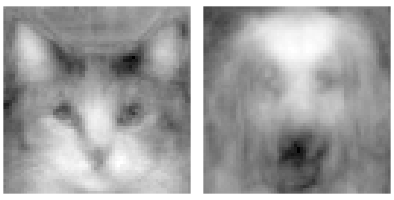
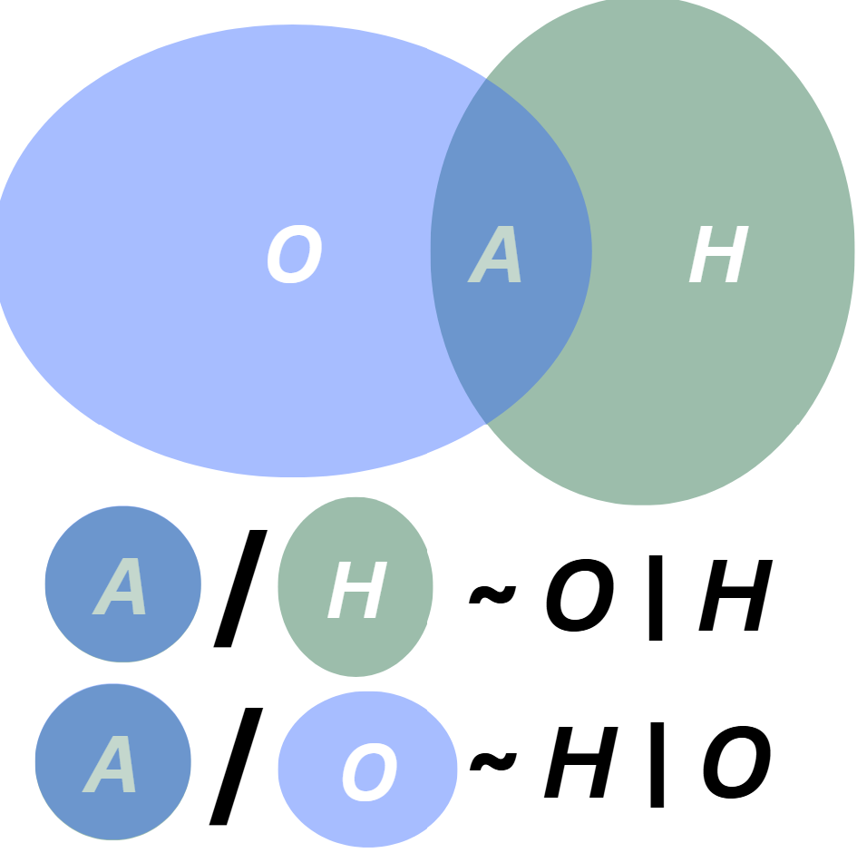
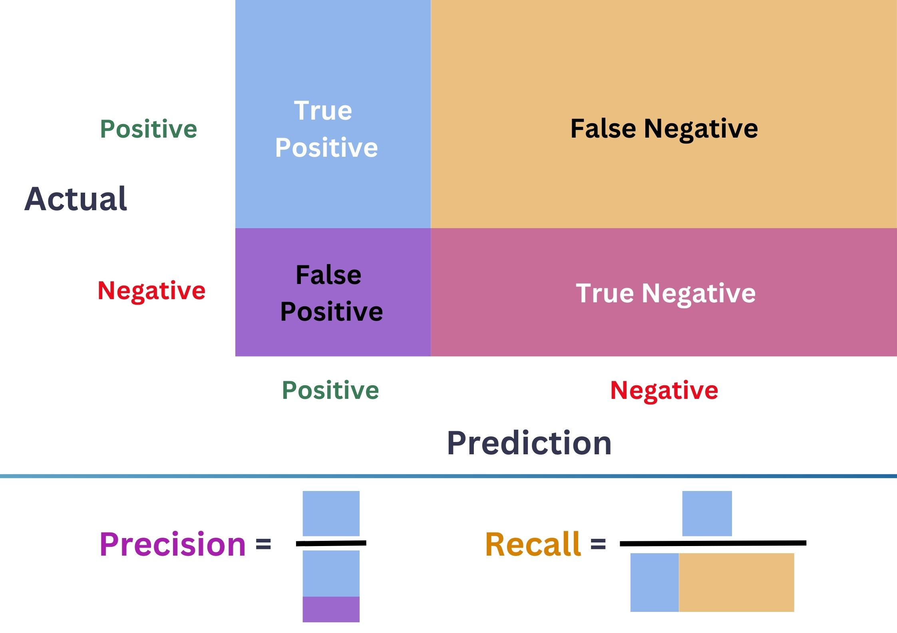
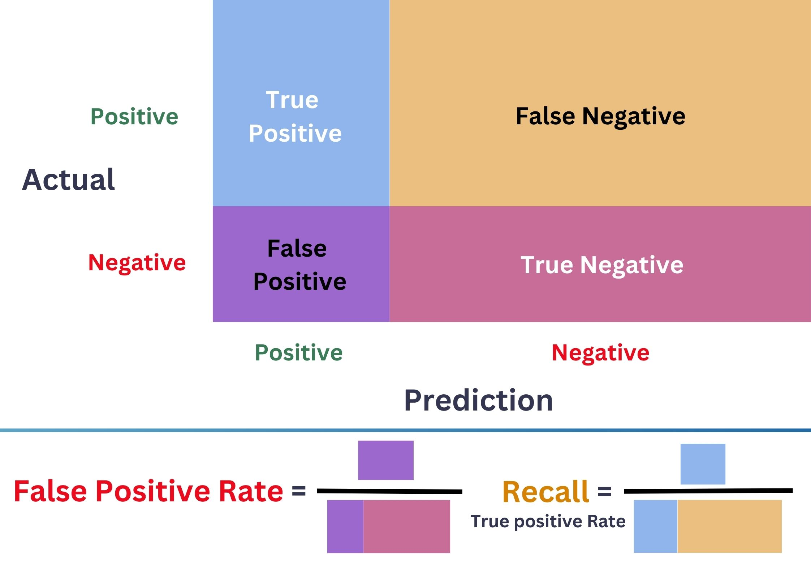

# Motivation & Introduction {background-color="#15797A"}

## Motivation & Introduction

:::{.columns .incremental}
:::{.column width="40%"}
:::{style="font-size: 80%" .fragment}
- Humans can effortlessly recognize these:

:::{.vspace style="--space: -20px"}
{width="220pt" fig-align="center"}
:::
:::
:::
:::{.column width="60%"}
:::{style="font-size: 80%" .fragment}
- No sweat even with these kind of patterns:

:::{.vspace style="--space: -20px"}
{width="300pt" fig-align="center"}
:::
:::
:::
:::{.vspace style="--space: -40px"}
:::{style="font-size: 80%" .incremental}
- Other than cats & dogs, it's much more useful to identify
    - Email spams []{.blue}
    - Frauds in banking systems []{.orange}
    - Diseases in health care system []{.green} ...
:::
:::
:::

## Motivation & Introduction
:::{.columns}
:::{.column width="60%"}
:::{style="font-size: 70%"}

- [**Machine Learning (ML):**]{.blue} a branch of [**AI**]{.red} focuses on enabling **computers / machines** to imitate the way that **humans** learn.

{ width="450px" fig-align="center"}

:::
:::
:::{.column width="40%"}
:::{style="font-size: 70%" .incremental .fragment}
There are 3 main branches:

:::{.vspace style="--space: -20px"}
- [**Supervised Learning:**]{.red} use labeled data ($X$,Y) and aims at predicting $y$ using $X$.
- [**Unsupervised Learning:**]{.blue} use unlabeled data $X$ for clustering and reducing the dimension of $X$.
- [**Reinforcement Learning:**]{.orange} agents (models) learn to complete tasks by interacting with an env. to maximize rewards.
:::
:::
:::
:::

```{python}
# path = "https://raw.githubusercontent.com/hassothea/MLcourses/main/data/"
path = './data/'
```

# Naive Bayes Classifier (NBC) {background-color="#15797A"}

## General notation
:::{.columns}
:::{.column width="60%"}
:::{style="font-size: 78%"}
- Consider Email spam dataset []{.blue}:

```{python}
#| code-line-numbers: "|1|2|3|4"
#| code-fold: false
#| output-location: fragment
import pandas as pd     # Load package 'pandas' and call it 'pd'
spam = pd.read_csv(path + "spam.txt", sep=" ") # 'path' in your machine
spam = spam.drop(columns=["Id"])
spam.iloc[:3,[0,2,3,-1]]
```
- Input ($\text{X}\in\mathbb{R}^{n\times d}$) & target ($\text{y}\in\mathbb{R}^n$): [$$\text{X}=\begin{pmatrix} x_{1,1} & x_{1,2} & \dots & x_{1,d}\\ {\color{blue}{x_{2,1}}} & {\color{blue}{x_{2,2}}} & \dots & {\color{blue}{x_{2,d}}}\\ \vdots & \vdots & \ddots & \vdots\\ x_{n,1} & x_{n,2} & \dots & x_{n,d} \end{pmatrix}\quad \&\quad \text{y}=\begin{pmatrix} y_{1}\\  {\color{blue}{y_{2}}}\\ \vdots\\ y_{n}\end{pmatrix}$$]{style="font-size: 85%"}

:::
:::
:::{.column width="40%"}
:::{style="font-size: 73%" .fragment}
- Example: an **input**: ${\color{blue}{\text{x}_i}}=({\color{blue}{x_{i1}}},{\color{blue}{x_{i2}}},\dots, {\color{blue}{x_{id}}})$: `Bag of words` of email $i$.

:::{.incremental .vspace style="--space: -20px"}
- **Target** ${\color{blue}{y_i}}\in\{1,0\}$ with <br> {$1:$ [spam]{.light-red}, $0:$ [nonspam]{.green}}.
- If $y_i$ are qualitative, the problem is called [**Classification**]{.blue}.
- If $y_i$ are quantitative, the problem is called [**Regression**]{.red}.
- Example: [**Classify**]{.blue} if an email is a [spam]{.light-red} or not.
:::
:::
:::
:::

<!--

---

### Binary NBC
:::{.columns}
:::{.column width="60%"}
:::{style="font-size: 78%"}
- Consider Email spam dataset []{.blue}:

```{python}
#| code-line-numbers: "|1|2|3|4"
#| code-fold: false
#| output-location: fragment
spam.iloc[:3,[0,2,3,-1]]
```
- **Input** $\text{x}_i=(x_{i1},x_{i2},\dots, x_{id})$: `Bag of words` of email $i$.

:::{.incremental .vspace style="--space: -20px"}
- **Target** $y_i\in\{1,0\}$ with $1=$ [spam]{.light-red} and $0=$ [nonspam]{.green}.
- [**Objective:**]{.blue} **Classify** if an email is a [spam]{.light-red} or not based on its **input**.
:::
:::
:::
:::{.column width="40%"}
:::{style="font-size: 75%"}

- Input matrix $M\in\mathbb{R}^{n\times d}$: [$$M=\begin{pmatrix} x_{1,1} & x_{1,2} & \dots & x_{1,d}\\ x_{2,1} & x_{2,2} & \dots & x_{2,d}\\ \vdots & \vdots & \ddots & \vdots\\ x_{n,1} & x_{n,2} & \dots & x_{n,d} \end{pmatrix}$$]{style="font-size: 80%"}
- Target vector $\text{y}\in\mathbb{R}$: [$$\text{y}=\begin{pmatrix} y_{1}\\  y_{2}\\ \vdots\\ y_{n}\end{pmatrix}$$]{style="font-size: 80%"}

:::
:::
:::

-->

## Binary NBC
:::{.columns}
:::{.column width="50%"}
:::{style="font-size: 78%"}
- Data shape: `{python} spam.shape`.
- Total [missing]{.light-red} values: `{python} int(spam.isna().sum().sum())`.
- Total [duplicated rows]{.light-red} `{python} int(spam.duplicated().sum())`.
- After removing [duplicates]{.light-red}:

```{python}
#| echo: true
#| code-fold: true
#| fig-align: center
import seaborn as sns
import matplotlib.pyplot as plt
sns.set(style="whitegrid")
_, ax = plt.subplots(1,1,figsize=(3.5,2))
spam.drop_duplicates(inplace=True)
sns.countplot(
    data=spam, 
    x="type", 
    hue="type", 
    stat="percent")
ax.set_title("Barplot of Email  Type")
ax.bar_label(ax.containers[0], fmt="%.2f", )
ax.bar_label(ax.containers[1], fmt="%.2f")
plt.show()
```
:::
:::
:::{.column width="50%"}
:::{style="font-size: 80%" .incremental}
- As a human, how would you predict if an email is a spam or not just by looking at its features?
- [**Main principal of Binary NBC:**]{.blue} Look at each [**feature marginally**]{.light-blue}, then [**combine the information**]{.light-red} to produce the class probability.
- This can be accomplished using [**Bayesian Theorem**]{.blue} + some [**assumption**]{.light-red}.
:::
:::
:::

---

### Model Motivation
:::{style="font-size:80%" .incremental}
- Given an email (input) $\text{x}_i=(0, 0.64,\dots,278)\in\mathbb{R}^{57}$, how would you guess its type $y_i$?
- 🔑 [**The most important quantity**]{.green} in (binary) classification: [$$\boxed{\color{blue}{\mathbb{P}(Y_i=1|X=\text{x}_i)}.}$$ [**Interpretation:** Given $\text{x}_i$, how likely that it is in class 1 (spam)?]{.blue}]{.vspace style="--space: -20px"}
- [**Decision rule:**]{.blue}
[$$\boxed{\text{ Email x}_i\text{ is a spam }\Leftrightarrow\color{blue}{\mathbb{P}(Y_i=1|X=\text{x}_i)}\geq 0.5.}$$]{.vspace style="--space: -20px"}
- From now, building a **classifier** is trying to estimate this chance [$$\boxed{\color{blue}{\mathbb{P}(Y_i=1|X=\text{x}_i)}.}$$]{.vspace style="--space: -15px"}
:::

---

### Recall Bayes's Theorem
::: {.callout-tip}

### Bayes's Theorem
:::{.columns}
:::{.column width="70%"}
For any two events $O,H$ with $\mathbb{P}(O)\times\mathbb{P}(H)>0,$
\begin{equation}\overbrace{\mathbb{P}(H|O)}^{\text{Posterior}}=\frac{\overbrace{\mathbb{P}(O|H)}^{\text{Likelihood}}\times\overbrace{\mathbb{P}(H)}^{\text{Prior}}}{\underbrace{\mathbb{P}(O)}_{\text{Marginal}}}.\end{equation}

:::{style="font-size: 85%"}
- $\mathbb{P}(H)$: Prior belief of having hypothesis $H$.
- $\mathbb{P}(O|H)$: If $H$ is true, how likely for $O$ to be observed?
- $\mathbb{P}(H|O)$: If $O$ is observed, how likely for $H$ to be true?
- $\mathbb{P}(O)$: How likely for $O$ to be observed in general?
:::
:::
:::{.column width="30%"}

{width="180"}

:::{.vspace style='--space: -20px'}
[{width="170"}](https://en.wikipedia.org/wiki/Thomas_Bayes){target="_blank"}

:::
:::
:::
:::

---

### Model Setting
:::{style="font-size:85%" .incremental}
- Bayes's theorem implies: [[$$\begin{align*}\color{blue}{\mathbb{P}(Y_i=1|X=\text{x}_i)}&=\frac{\color{red}{\mathbb{P}(X=\text{x}_i|Y_i=1)}\times\color{green}{\mathbb{P}(Y_i=1)}}{\mathbb{P}(X=\text{x}_i)}\\ &\propto \color{red}{\mathbb{P}(X=\text{x}_i|Y_i=1)}\times\color{green}{\mathbb{P}(Y_i=1)}.\end{align*}$$]{style="font-size: 90%"}]{.vspace style="--space: -20px"}

:::{.vspace style='--space: -30px'}
- [**Interpretation:**]{.blue}
    - $\color{green}{\mathbb{P}(Y_i=1)}$: The chance that an email $i$ is a [spam]{.light-red}.
    - $\color{red}{\mathbb{P}(X=\text{x}_i|Y_i=1)}$: If email $i$ is a [spam]{.light-red}, how likely that its input takes value $\text{x}_i$.
- $\color{green}{\mathbb{P}(Y_i=1)}$ is **easy** to estimate 😊: $\frac{\text{Number of all Spams}}{\text{Number of total emails}}$.
- $\color{red}{\mathbb{P}(X=\text{x}_i|Y_i=1)}$ is **very complicated** to estimate 🥹.
:::
:::

## {visibility="hidden"}

```{python}
#| echo: false
#| code-fold: true
from scipy.stats import gaussian_kde
import numpy as np
x1 = [1.5, 4.2, 5050]
x2 = [1.5, 4.2, 9000]

# Given Y = 1
ker_make = gaussian_kde(spam.make[spam.type=="spam"])
ker_address = gaussian_kde(spam.address[spam.type=="spam"])
ker_capital = gaussian_kde(spam.capitalTotal[spam.type=="spam"])
den11 = [ker_make(x1[0]), ker_address(x1[1]), ker_capital(x1[2])]
den12 = [ker_make(x2[0]), ker_address(x2[1]), ker_capital(x2[2])]
n_spam = np.sum(spam.type=="spam")
n_non = spam.shape[0] - n_spam
pro11 = n_spam/spam.shape[0] * np.prod(den11)
pro12 = n_spam/spam.shape[0] * np.prod(den12)

# Given Y = 0
ker_make = gaussian_kde(spam.make[spam.type=="nonspam"])
ker_address = gaussian_kde(spam.address[spam.type=="nonspam"])
ker_capital = gaussian_kde(spam.capitalTotal[spam.type=="nonspam"])
den01 = [ker_make(x1[0]), ker_address(x1[1]), ker_capital(x1[2])]
den02 = [ker_make(x2[0]), ker_address(x2[1]), ker_capital(x2[2])]
pro01 = n_non/spam.shape[0] * np.prod(den01)
pro02 = n_non/spam.shape[0] * np.prod(den02)

pro01, pro11 = pro01/(pro01+pro11), pro11/(pro01+pro11)
pro02, pro12 = pro02/(pro02+pro12), pro12/(pro02+pro12)
```

- Type of $\text{x}_1=(1.5, 4.2, \color{red}{5050})$ and $\text{x}_2=(1.5, 4.2, \color{blue}{9000})$?

---

### Main assumption & key quantity in NBC

::: {.callout-tip}
### Main assumption of NBC

- Within any class $k\in\{1,0\}$, the components of input $X|Y=k$ are [**indpendent**]{.blue} i.e., 
[$$\color{red}{\mathbb{P}(X=\text{x}|Y=k)}=\prod_{j=1}^d\mathbb{P}(X_j=x_j|Y=k).$$]{.vspace style="--space: -30px"}
:::
::: {.callout-tip .fragment}
### Key quantity in NBC

- From above, the classification probability is computed by
[$$\mathbb{P}(Y=1|X=\text{x})\propto \color{green}{\mathbb{P}(Y=1)}\color{red}{\prod_{j=1}^d\mathbb{P}(X_j=x_j|Y=1)},$$]{.vspace style="--space: -30px"}
:::

---

### Main assumption & key quantity in NBC
:::{.callout-tip}
### Key quantity in NBC

- From above, the classification probability is computed by
[$$\mathbb{P}(Y=1|X=\text{x})\propto \color{green}{\mathbb{P}(Y=1)}\color{red}{\prod_{j=1}^d\mathbb{P}(X_j=x_j|Y=1)},$$]{.vspace style="--space: -30px"}
:::

::: {style="font-size: 75%"}
- [${ }^{\small\text{📚}}$]{style="font-size: 80%"} $\color{red}{\mathbb{P}(X_j=x_j|Y=1)}$ is just a 1D distribution that can be estimated:

| Type of $X_j$ | Distribution | Graphic |
|:--------------|:------------------------|:----------------------|
| Qualitative   | Bernoulli, Multinomial... | `barplot`, `countplot` |
| Quantitative  | Gausian, Exponential... | `displot`, `hist`, `density`... |
|

[$^{\text{📚}}$ [Chapter 4, *Introduction to Statistical Learning with R*, James et al. (2021).](https://www.sas.upenn.edu/~fdiebold/NoHesitations/BookAdvanced.pdf)]{.slide-note}

:::

---

### Main assumption & key quantity in NBC
::: {.callout-tip}
### Key quantity in NBC

- From above, the classification probability is computed by
[$$\mathbb{P}(Y=1|X=\text{x})\propto \color{green}{\mathbb{P}(Y=1)}\color{red}{\prod_{j=1}^d\mathbb{P}(X_j=x_j|Y=1)}.$$]{.vspace style="--space: -25px"}

:::{.vspace style="--space: -25px"}
:::
:::

::: {style="font-size: 75%"}

```{python}
#| echo: true
#| code-fold: true
#| fig-align: 'center'
import plotly.figure_factory as ff
import plotly.express as px
from plotly.subplots import make_subplots
import plotly.graph_objects as go

fig = make_subplots(cols=2, rows=1, subplot_titles=("Exclamation", "CapitalTotal"))
temp1 = px.histogram(spam, x='charExclamation', color='type', nbins=10000)
temp1.data[0].showlegend=False
temp1.data[1].showlegend=False
temp2 = px.histogram(spam, x='capitalTotal', color='type', nbins=2)
fig.add_trace(temp1.data[0], row=1, col=1)
fig.add_trace(temp1.data[1], row=1, col=1)
fig.add_trace(temp2.data[0], row=1, col=2)
fig.add_trace(temp2.data[1], row=1, col=2)
fig.update_yaxes(type='log', row=1, col=1)
# fig.update_xaxes(type='log', row=1, col=2)
fig.update_layout(width=1000, height=230)
fig.show()
```

:::

---

### $M$-class Naive Bayes Classifier
- Suppose the target $y\in\{1,2,...,M\}$.

:::{.callout-tip}
### Key quantity

- For any $d$-dimensional input $\text{x}$ and $k\in\{1,2,...,M\}$:
[$$\color{blue}{\mathbb{P}(Y=k|X=\text{x})}\propto\color{green}{\mathbb{P}(Y=k)}\color{red}{\prod_{j=1}^d\mathbb{P}(X_j=x_j|Y=k)}.$$]{.vspace style="--space: -25px"}
:::
:::{.callout-tip .fragment}
### Classification Rule 
$$\text{x}\text{ belongs to class }\color{blue}{k^*}\text{ if }\color{blue}{\mathbb{P}(Y=k^*|X=\text{x})}=\max_{1\leq k\leq M}\color{blue}{\mathbb{P}(Y=k|X=\text{x})}.$$

:::

# Application {background-color="#15797A"}

## Application
### Email type vs only 3 inputs
:::{.columns}
:::{.column width="55%"}
:::{style="font-size: 80%"}
- If $\text{x}=($`make`, `address`, `capitalTotal`$)$.
- Test data: $20\%$ of all observations.

:::{.vspace style="--space: -10px"}
```{python}
#| echo: true
#| code-fold: true
#| message: false
#| warning: false
from sklearn.naive_bayes import GaussianNB
from sklearn.metrics import confusion_matrix, ConfusionMatrixDisplay
from sklearn.model_selection import train_test_split
sns.set(style="white")
X_train2, X_test2, y_train2, y_test2 = train_test_split(spam[["make","address", "capitalTotal"]], spam.iloc[:,57], test_size = 0.2, random_state=42)
nb2 = GaussianNB()
_, ax = plt.subplots(1,1, figsize=(2,2))
nb2 = nb2.fit(X_train2, y_train2)
pred2 = nb2.predict(X_test2)
conf2 = confusion_matrix(pred2, y_test2)
con_fig2 = ConfusionMatrixDisplay(conf2)
pr2 = nb2.predict_proba(X_test2)[:,1]
con_fig2.plot(ax=ax)
plt.show()
```
:::
:::
:::
:::{.column width="45%"}
:::{style="font-size: 80%"}
- [**Accuracy**]{.blue}: proportion of correctly classified emails. [[$$\frac{463+62}{463+62+20+297}\approx 0.624.$$]{style="font-size: 80%"}]{.vspace style="--space: -10px"}

- Misclassification error: [$$1-\text{accuracy}\approx0.376.$$]{.vspace style="--space: -10px"}

[⚠️ This depends on the split]{.red .fragment}

:::
:::
:::

---

### Email type vs all inputs

:::{.columns}
:::{.column width="55%"}
:::{style="font-size: 80%"}
- Data: $\text{x}\in\mathbb{R}^{57},y\in\{0,1\}$.
- Test data: the same $20\%$.

:::{.vspace style="--space: -10px"}
```{python}
#| echo: true
#| code-fold: true
#| message: false
#| warning: false
X_train1, X_test1, y_train1, y_test1 = train_test_split(spam.iloc[:,:57], spam.iloc[:,57], test_size = 0.2, random_state=42)
_, ax = plt.subplots(1,1, figsize=(3,3))
nb1 = GaussianNB()
nb1 = nb1.fit(X_train1, y_train1)
pred1 = nb1.predict(X_test1)
conf1 = confusion_matrix(pred1, y_test1)
con_fig1 = ConfusionMatrixDisplay(conf1)
pr1 = nb1.predict_proba(X_test1)[:,1]
con_fig1.plot(ax=ax)
plt.show()
```
:::
:::
:::
:::{.column width="45%"}
:::{style="font-size: 90%"}
- Accuracy: proportion of correctly classified emails. [[$$\frac{365+348}{365+348+11+118}\approx 0.846.$$]{style="font-size: 80%"}]{.vspace style="--space: -10px"}

- Misclassification error: [$$1-\text{accuracy}\approx 0.154.$$]{.vspace style="--space: -10px"}

[⚠️ This depends on the split]{.red}

:::
:::
:::

---

### Email type vs Selected Inputs

:::{.columns}
:::{.column width="60%"}
:::{style="font-size: 80%"}
- Visualize `type` against inputs can help us filter useful input features.
- There are too many features, we can apply statistical method, for example, `ANOVA`.

```{python}
from scipy.stats import f_oneway
# Initialize list to store selected features
selected_features = []
p_values = {}

# Get feature column names (excluding the target)
feature_columns = [col for col in spam.columns if col != 'type']

# For loop to test each feature
for feature in feature_columns:
    # Get unique classes in target variable
    classes = spam['type'].unique()

    # Create groups for ANOVA test
    groups = []
    for class_label in classes:
        group_data = spam[spam['type'] == class_label][feature]
        groups.append(group_data)
    
    # Perform one-way ANOVA
    f_stat, p_value = f_oneway(*groups)
    
    # Store p-value
    p_values[feature] = p_value
    
    # Select feature if p-value < 1e-15
    if p_value < 1e-15:
        selected_features.append(feature)
# Create DataFrame with only selected features and target
if selected_features:
    filtered_data = spam[selected_features]
```
- Number of selected features: `{python} len(selected_features)`.

:::{.vspace style="--space: -20px"}
```{python}
#| echo: false
#| message: false
#| warning: false
#| fig-align: "center"
X_train3, X_test3, y_train3, y_test3 = train_test_split(filtered_data, spam.iloc[:,57], test_size = 0.2, random_state=42)
_, ax = plt.subplots(1,1, figsize=(2.5,2.5))
nb3 = GaussianNB()
nb3 = nb2.fit(X_train3, y_train3)
pred3 = nb2.predict(X_test3)
conf3 = confusion_matrix(pred3, y_test3)
con_fig3 = ConfusionMatrixDisplay(conf3)
pr3 = nb3.predict_proba(X_test3)[:,1]
con_fig3.plot(ax=ax)
plt.show()
```
:::
:::
:::
:::{.column width="40%"}
:::{style="font-size: 80%"}
- Accuracy: [[$$\frac{359+350}{359+350+9+124}\approx 0.842.$$]{style="font-size: 80%"}]{.vspace style="--space: -10px"}

- Misclassification error: [$$1-\text{accuracy}\approx 0.158.$$]{.vspace style="--space: -10px"}

[⚠️ This depends on the split]{.red}
:::
:::
:::

---

### Pros & Cons of NBC
:::{.vspace style="--space:  -10px"}
:::{.columns}
:::{.column width="50%"}
:::{.callout-note icon=false}
### Pros
:::{style="font-size:95%" .incremental}
- Efficiency & simplicity
- Less training data requirement
- Scalability: works well on large and high-dimensional data
- Ability to handle categorical data
- Ability to handle missing data
- Sometimes, it still works well even thought the assumption of `independence` is violeted. 
:::
:::
:::
:::{.column width="50%"}
:::{.callout-important icon=false .fragment}
### Cons
:::{style="font-size:90%" .incremental}
- May perform poorly when features are highly correlated due to the violation of `independence` assumption.
- May not work well for complex relationship.
- Zero probability: when some categories are not presented in some training features.
- Continuous features often be modeled using Gaussian distribution, which might not always be appropriate.
:::
:::
:::
:::
:::

# Imbalanced data ⚠️ {background-color="#15797A"}

## Imbalanced data ⚠️ {.incremental auto-animate=true auto-animate-easing="ease-in-out" auto-animate-delay="0"}
:::{.style="font-size:70%"}
:::{.columns}
- If the data contains $95\%$ `nonspam`, always guessing `nonspam` gives $0.95$ accuracy!
- `Accuracy` isn't the right metric for `imbalanced` data!

:::{.column width="45%" .fragment}
:::{.vspace style="--space: -10px"}
- Confustion matrix:

:::{.vspace style="--space: -30px"}
{width="350px"}
:::
:::
:::
:::{.column width="55%" .fragment}
:::{style="font-size: 90%"}

- $\color{purple}{\text{Precision}}=\frac{\color{CornflowerBlue}{\text{TP}}}{\color{CornflowerBlue}{\text{TP}}+\color{purple}{\text{FP}}}$
- $\color{Tan}{\text{Recall}}=\frac{\color{CornflowerBlue}{\text{TP}}}{\color{CornflowerBlue}{\text{TP}}+\color{Tan}{\text{FN}}}$
- $\color{ForestGreen}{\text{F1-score}}=\frac{2.\color{purple}{\text{Precision}}.\color{Tan}{\text{Recall}}}{\color{purple}{\text{Precision}}+\color{Tan}{\text{Recall}}}$.
- $\color{ForestGreen}{\text{F1-score}}$ balances $\color{purple}{\text{FP}}$ & $\color{Tan}{\text{FN}}.$

:::
:::
:::
:::

---

### F1 score
:::{.columns}
:::{.column width="40%"}
{width="350px"}

:::{.vspace style="--space: -25px"}
:::{style="font-size: 80%"}
- $\color{purple}{\text{Precision}}=\frac{\color{CornflowerBlue}{\text{TP}}}{\color{CornflowerBlue}{\text{TP}}+\color{purple}{\text{FP}}}$
- $\color{Tan}{\text{Recall}}=\frac{\color{CornflowerBlue}{\text{TP}}}{\color{CornflowerBlue}{\text{TP}}+\color{Tan}{\text{FN}}}$
- $\color{ForestGreen}{\text{F1-score}}=\frac{2.\color{purple}{\text{Precision}}.\color{Tan}{\text{Recall}}}{\color{purple}{\text{Precision}}+\color{Tan}{\text{Recall}}}$.
:::
:::
:::
:::{.column width="60%"}

```{python}
#| echo: true
#| code-fold: true
import plotly.graph_objects as go
x = np.linspace(0,1,20)
y = np.linspace(0,1,20)
z1 = [[2*x[i]*y[j]/(x[i]+y[j]) for j in range(len(y))] for i in range(len(x))]
z2 = [[(x[i]+y[j])/2 for j in range(len(y))] for i in range(len(x))]

camera = dict(
    eye=dict(x=1.7, y=-1.2, z=1.2)
)

fig = go.Figure(go.Surface(x = x,
                           y = y,
                           z = z1,
                           name = "F1-score",
                           colorscale = "Blues",
                           showscale = False))
fig.add_trace(go.Surface(x = x,
                         y = y,
                         z = z2,
                        name = "Average",
                        colorscale = "Electric",
                        showscale = False))
fig.add_trace(
    go.Scatter3d(
        x = [0.2, 0.2],
        y = [0.9, 0.9],
        z = [0, 1],
        mode="markers + lines",
        showlegend=False,
        marker=dict(
            color='red',
            size=5),
        line=dict(color='red', 
            width=2,
            dash='dot'))
)
fig.update_layout(scene = dict(
                    xaxis_title='Precision',
                    yaxis_title='Recall',
                    zaxis_title='Scores'),
                  title = dict(text="F1-score vs Average", 
                               y=0.9,
                               x=0.5,
                               font=dict(size = 30, 
                                         color = "#1C66B5")
                              ),
                  scene_camera=camera,
                  width = 500,
                  height = 420)
fig.show()
```

:::
:::

---

### Receiver Operating Characteristic Curve (ROC)

:::{.columns}
:::{.column width="40%"}
{width="350px"}

:::{.vspace style="--space: -25px"}
:::{style="font-size: 80%"}
- $\color{purple}{\text{Precision}}=\frac{\color{CornflowerBlue}{\text{TP}}}{\color{CornflowerBlue}{\text{TP}}+\color{purple}{\text{FP}}}$
- $\color{Tan}{\text{Recall}}=\frac{\color{CornflowerBlue}{\text{TP}}}{\color{CornflowerBlue}{\text{TP}}+\color{Tan}{\text{FN}}}$
- $\color{ForestGreen}{\text{F1-score}}=\frac{2.\color{purple}{\text{Precision}}.\color{Tan}{\text{Recall}}}{\color{purple}{\text{Precision}}+\color{Tan}{\text{Recall}}}$
:::
:::
:::
:::{.column width="60%" .fragment}

```{python}
#| echo: true
#| code-fold: true

from sklearn.metrics import roc_curve, RocCurveDisplay
from plotly.tools import mpl_to_plotly

# Method 2: Using roc_curve and Matplotlib directly
y1 = 1*(y_test1 == "spam")
fpr, tpr, thresholds = roc_curve(y1.values, pr1.flatten())
plt.plot([0, 1], [0, 1], 'k--', label='Random Classifier') # Diagonal line
plt.plot(fpr, tpr, label='ROC Curve')

# Figures

fig_full = plt.gcf()
pl_1 = mpl_to_plotly(fig_full)
pl_1.update_layout(width=500, height=420, 
                      title=dict(text="ROC Curve of Full model", 
                                 font=dict(size=25)),
                      xaxis_title = dict(font=dict(size=20, color = "red")),
                      yaxis_title = dict(text='True Positive Rate (Recall)', font=dict(size=20, color = "#EBB31D")),
                      template='plotly_white')
pl_1.show()
```
:::
:::

---

### Receiver Operating Characteristic Curve (ROC)

:::{.columns}
:::{.column width="40%"}
{width="350px"}

::: {.callout-tip appearance="simple" icon=false}
$\bullet$ ROC $=\{($[FPR]{style="color:red"}$_{\delta}$,[TPR]{style="color:#EBB31D;"}$_{\delta}):\delta\in[0,1]\}$. <br> 
$\bullet$ [Better]{style="color:#20A011;"} model = [Larger]{style="color:#20A011;"} Area Under the Curve (AUC).
:::
:::

:::{.column width="60%"}

```{python}
#| echo: true
#| code-fold: true
fpr, tpr, thresholds = roc_curve(y1.values, pr2.flatten())
plt.plot(fpr, tpr, label='ROC Curve')
plt.plot([0, 1], [0, 1], 'k--', label='Random Classifier') # Diagonal line

# Figures
fig_2 = plt.gcf()
pl_2 = mpl_to_plotly(fig_2)
pl_2.update_layout(width=500, height=420, 
                      title=dict(text="ROC Curve of 3-input model", 
                                 font=dict(size=25)),
                      xaxis_title = dict(font=dict(size=20, color = "red")),
                      yaxis_title = dict(text='True Positive Rate (Recall)', font=dict(size=20, color = "#EBB31D")),
                      template='plotly_white')
pl_2.show()
```
:::
:::

---

### ⚠️ Imbalanced data (Summary)

:::{.columns}
:::{.column width="50%"}

::: {.callout-tip}
### Confusion matrix
- [Precision]{style="color:purple"}: controlls [FP]{style="color:purple"}.
- [Recall]{style="color:#EBB31D;"}: controlls [FN]{style="color:#EBB31D;"}.
- [F1-score]{style="color:green"}: ballances the two. 
:::

{width="350px"}

:::

:::{.column width="50%"}

::: {.callout-tip}
### ROC Curve & AUC
- ROC Curve: ballances [TPR]{style="color:#EBB31D;"} and [FPR]{style="color:red"}.
- Can be used to select $\delta\in [0,1]$.
- [Better]{style="color:green"} model = [Larger]{style="color:green"} AUC.
:::

{width="350px"}

:::
:::

---

### ⚠️ Imbalanced data (to explore)
:::{style="font-size: 80%"}
- **Sampling methods**:
    - Oversampling: random, SMOTE, SMOTE SVM, ADASYN...
    - Undersampling: random, new miss, CNN, Tomek Links...
- **Weight adjustment methods** (nonparametric)
    - Tree-based algorithms, $k$-NN, kernel methods...
- **Tuning threshold** $\delta$.
- **Work with packages that handle imbalanced data**: 
    - [`imbalanced-learn`](https://imbalanced-learn.org/stable/), [`PyCaret`](https://pycaret.org/)...
- Helpful links: [Geeks for Geeks](https://www.geeksforgeeks.org/handling-imbalanced-data-for-classification/), [Angelleon Collado](https://medium.com/@angelleoncollado/data-sampling-methods-in-machine-learning-17c77bbf0579), [Machine Learning Mastery](https://machinelearningmastery.com/tactics-to-combat-imbalanced-classes-in-your-machine-learning-dataset/)...

:::

:::{.center}

## 🥳 It's party time 🥂 {background-image="./img/end_page.jpg" background-opacity="0.3" .unlisted .unnumbered .no-header}

<br>
<br>
<br>
<br>
<br>
<br>
<br>
<br>

:::


<!--

:::{.column width="45%"}
```{python}
#| echo: true
#| code-fold: true
import numpy as np
from plotly.subplots import make_subplots
import plotly.graph_objs as go

# define means and covaraince matrix
mu1, Sigma1 = [0, 0], [[1.5, 0], [0, 2]]

# Simulate points
x1 = np.random.multivariate_normal(mean=mu1, cov=Sigma1, size=300)

# Plot points
fig = make_subplots(
    rows=2, cols=1,
    specs=[[{}], [{"type": "surface"}]],
    horizontal_spacing = 0.075,
    vertical_spacing= 0.09,
    subplot_titles=("2D points", "3D points"))
fig.add_trace(go.Scatter(x=x1[:,0], y = x1[:,1],
               mode = "markers",
               name = "Points",
               showlegend = False,
               marker = dict(size = 10)),
                        row=1, col=1)

# define means and covaraince matrix
mu2, Sigma2 = [0, 0, 0], [[1, 1, 0.5], [1, 2, -1], [0.5, -1, 1.5]]

# Simulate points
x2 = np.random.multivariate_normal(mean=mu2, cov=Sigma2, size=300)

# Plot points
fig.add_trace(go.Scatter3d(x=x2[:,0], y=x2[:,1], z=x2[:,2],
               mode = "markers",
               name = "Points",
               showlegend = False,
               marker = dict(size = 2)),
                        row=2, col=1)
camera = dict(
    eye=dict(x=5, y=-9, z=-0.9)
)
fig.update_layout(title = "",
                  width = 420,
                  height = 450)
# Density

# def density_gaussian2d(x, mu, Sigma):
#   return 1/((2*np.pi) ** (len(x)/2) * np.sqrt(np.linalg.det(Sigma))) * np.exp(-1/2 * np.dot(np.dot(x-mu, np.linalg.inv(Sigma)), x-mu))


# x = np.linspace(-5, 5, 50)
# y = np.linspace(-5, 5, 50)
# f1 = np.array([[density_gaussian2d(np.array([xi,yi]), mu1, Sigma1) for xi in x] for yi in y])

# fig.add_trace(
#     go.Surface(x = x,
#                y = y,
#                z = f1,
#                name = "Density 1",
#               #  surfacecolor= ["#2454CD"],
#                showlegend = False,
#               #  opacity=0.95,
#                showscale=False),
#                row=2, col=1)
# fig.update_layout(title = "",
#                   width = 420,
#                   height = 500)
fig.show()
```
:::
:::


## Coming up next...

:::{.fit}
Linear & Quadratic Discriminant Analysis (LDA & QDA)
:::

# Linear & Quadratic Discriminant Analysis {background-color="#15797A"}

-->