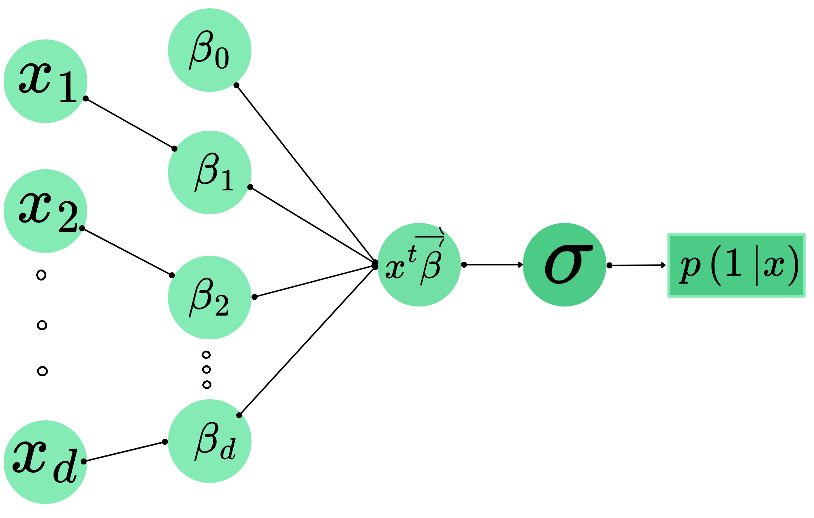
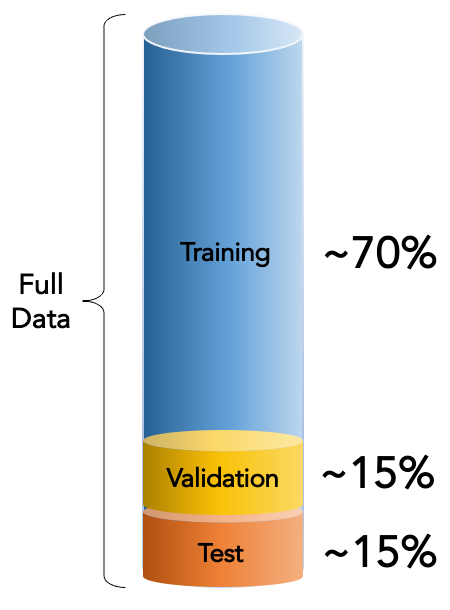
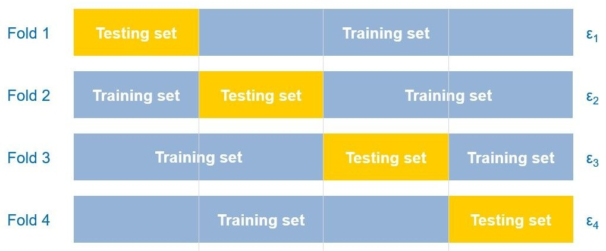
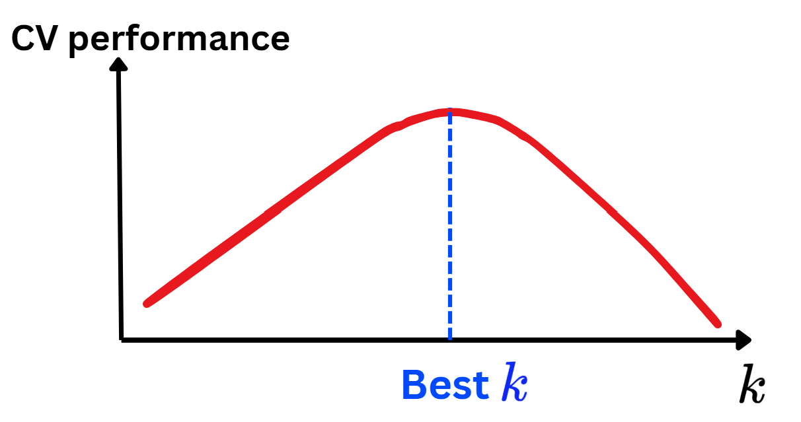

## 🗺️ Content

- [**1. Binary Logistic Regression**]{.section .secbr}
    - [**Model setting and Intuition**]{.section .secbr}
    - [**Conditional Likelihood and Loss function**]{.section .secbr}
- [**2. Optimization: GD and SGD**]{.section .secbr}
- [**3. Application**]{.section .secbr}
- [**4. Multiple Logistic Regression**]{.section .secbr}
- [**5. Polynomial Features**]{.section .secbr}
- [**6. Regularization/Penalization**]{.section .secbr}
- [**7. Hyperparameter Tuning**]{.section .secbr}


```{python}
# path = "https://raw.githubusercontent.com/hassothea/MLcourses/main/data/"
path = './data/'
import pandas as pd     # Load package 'pandas' and call it 'pd'
from sklearn.model_selection import train_test_split
import matplotlib.pyplot as plt
from sklearn.metrics import confusion_matrix, ConfusionMatrixDisplay
from sklearn.metrics import roc_curve, RocCurveDisplay
from plotly.tools import mpl_to_plotly
spam = pd.read_csv(path + "spam.txt", sep=" ") # 'path' in your machine
spam = spam.drop(columns=["Id"])
X_train1, X_test1, y_train1, y_test1 = train_test_split(spam.iloc[:,:57], spam.iloc[:,57], test_size = 0.2, random_state=42)
y1 = 1*(y_test1 == "spam")
```


# 1. Binary Logistic Regression {background-color="#15797A"}

## 1. Binary Logistic Regression
### 1.1. Model setting
:::{.incremental}
:::{.columns}
:::{.column width="50%"}
:::{style="font-size: 80%"}
```{python}
import numpy as np
import pandas as pd
import seaborn as sns
colors = sns.color_palette("Set2")
n = 200
np.random.seed(42)
x1 = np.random.uniform(-3,3,size=(n,2))
x1 = np.column_stack([np.ones(n), x1])
beta = np.array([0.1, -1, 1])
y = x1 @ beta + np.random.normal(0,1,n)
y_ = (y > 0) * 1
y = np.array(y_, dtype=object)
data_toy1 = pd.DataFrame({
    'x1' : x1[:,1],
    'x2' : x1[:,2],
    'y': y
})
data_toy1.sample(2, random_state=17).style.hide()
```

```{python}
#| fig-align: "center"
#| echo: true
#| code-fold: true
import plotly.express as px
import plotly.graph_objects as go
fig = px.scatter(
    data_toy1, x="x1", y="x2", 
    color="y")

# Lines
line_coefs = np.array(
    [[1, 1, -2], [-1, 0.3, 0.5], [-0.5, 0.3, -1], [0.1, -1, 1]])
frames = []
x_line = np.array([np.min(x1[:,1]), np.max(x1[:,1])])
y_range = np.array([np.min(x1[:,2]), np.max(x1[:,2])])
id_small = np.argsort(np.abs(x1[:,1]) + np.abs(x1[:,2]))[5]
point_far = np.array([x_line[0], y_range[1]])
point_near = np.array([x1[id_small,1],x1[id_small,2]])

for i, coef in enumerate(line_coefs):
    y_line = (-coef[0] - coef[1] * x_line) / coef[2]
    a, b = -coef[1]/coef[2], -coef[0]/coef[2]
    point_proj_far = np.array([(point_far[0]+a*point_far[1]-a*b)/(a**2+1), a*(point_far[0]+a*point_far[1]-a*b)/(a**2+1)+b])
    point_proj_near = np.array([(point_near[0]+a*point_near[1]-a*b)/(a**2+1), a*(point_near[0]+a*point_near[1]-a*b)/(a**2+1)+b])
    p1 = np.row_stack([point_far, point_proj_far])
    p2 = np.row_stack([point_near, point_proj_near])
    frames.append(go.Frame(
        data=[fig.data[0],
              fig.data[1],
              go.Scatter(
                x=p1[:,0],
                y=p1[:,1],
                name="Far from boundary",
                line=dict(dash="dash"),
                visible="legendonly"
              ),
              go.Scatter(
                x=p2[:,0],
                y=p2[:,1],
                name="Close to boundary",
                line=dict(dash="dash"),
                visible="legendonly"
              ),
              go.Scatter(
                x=x_line, y=y_line, mode='lines',
                line=dict(width=3, color="black"), 
                name=f'Line: {i+1}')],
        name=f'{i+1}'))

y_line = (-line_coefs[0,0] - line_coefs[0,1] * x_line) / line_coefs[0,2]
a, b = -line_coefs[0,0]/line_coefs[0,2], - line_coefs[0,1]/line_coefs[0,2]
point_proj_far = np.array([(point_far[0]+a*point_far[1]-a*b)/(a**2+1), a*(point_far[0]+a*point_far[1]-a*b)/(a**2+1)+b])
point_proj_near = np.array([(point_near[0]+a*point_near[1]-a*b)/(a**2+1), a*(point_near[0]+a*point_near[1]-a*b)/(a**2+1)+b])
p1 = np.row_stack([point_far, point_proj_far])
p2 = np.row_stack([point_near, point_proj_near])
fig1 = go.Figure(
    data=[
        fig.data[0],
        fig.data[1],
        go.Scatter(
            x=p1[:,0],
            y=p1[:,1],
            name="Far from boundary",
            line=dict(dash="dash"),
            visible="legendonly"
            ),
        go.Scatter(
            x=p2[:,0],
            y=p2[:,1],
            name="Close to boundary",
            line=dict(dash="dash"),
            visible="legendonly"
        ),
        go.Scatter(
            x=x_line, y=y_line, mode='lines',
            line=dict(width=3, color="black"), 
            name=f'Line: 1')
    ],
    layout=go.Layout(
        title="1st simulated data & boundary lines",
        xaxis=dict(title="x1", range=[-3.4, 3.4]),
        yaxis=dict(title="x2", range=[-3.4, 3.4]),
        updatemenus=[{
            "buttons": [
                {
                    "args": [None, {"frame": {"duration": 1000, "redraw": True}, "fromcurrent": True, "mode": "immediate"}],
                    "label": "Play",
                    "method": "animate"
                },
                {
                    "args": [[None], {"frame": {"duration": 0, "redraw": False}, "mode": "immediate"}],
                    "label": "Stop",
                    "method": "animate"
                }
            ],
            "type": "buttons",
            "showactive": False,
            "x": -0.1,
            "y": 1.25,
            "pad": {"r": 10, "t": 50}
        }],
        sliders=[{
            "active": 0,
            "currentvalue": {"prefix": "Line: "},
            "pad": {"t": 50},
            "steps": [{"label": f"{i}",
                       "method": "animate",
                       "args": [[f'{i}'], {"frame": {"duration": 1000, "redraw": True}, "mode": "immediate", 
                       "transition": {"duration": 10}}]}
                      for i in range(1,5)]
        }]
    ),
    frames=frames
)

fig1.update_layout(height=350, width=500)

fig1.show()
```
:::
:::
:::{.column width="50%"}
:::{style="font-size: 70%" .incremental}
- [**Objective:**]{.blue} Given input $\text{x}_i\in\mathbb{R}^d$, classify if $y\in\{0,1\}$ (Male or female).
- [**Main idea:**]{.blue} classify $\Leftrightarrow$ identify decision boundary.
- [**Main assumption:**]{.blue} Boundary(**B**) is `linear`.
- [**Model:**]{.blue} Given input $\text{x}_i$, the chance that it belongs to class $1$ is given by [$$\mathbb{P}(Y_i=1|X=\text{x}_i)=\sigma(\color{blue}{\beta_0}+\sum_{j=1}^d\color{blue}{\beta_j}x_{ij}),$$]{.br30}
[where $\color{blue}{\beta_0,\beta_1,\dots,\beta_d}\in\mathbb{R}$ are the key parameters to be estiamted from the data, and $\sigma(t)=1/(1+e^{-t}),\forall t\geq 0$.]{.br20}
:::
:::
:::
:::


## 1. Binary Logistic Regression {auto-animate="true"}
### 1.2. Model intuition
:::{style="font-size: 70%"}
- Ex: Given $\text{x}_0=[\text{h}_0,\text{w}_0]\in\mathbb{R}^2,$ for any [**candidate parameter**]{.light-blue} $\color{blue}{\vec{\beta}=[\beta_0,\beta_1,\beta_2]}$,
$$\color{green}{z_0}=\color{blue}{\beta_0}+\color{blue}{\beta_1}\text{h}_0+\color{blue}{\beta_2}\text{w}_0\text{ is the relative distance from }\text{x}_0\to\text{ Boundary (B)}.$$
:::
:::{.columns}
:::{.column width="60%"}
:::{style="font-size:70%"}
:::{.fragment}
- That's to say that
    - $\color{green}{z_0}>0\Leftrightarrow \text{x}_0$ is above the boundary.
    - $|\color{green}{z_0}|$ is large $\Leftrightarrow$ $\text{x}_0$ is far from the bounday.
:::
:::{.fragment}
- A **good boundary** should be such that:
    - $|\color{green}{z_0}|$ large $\Rightarrow$ **"certain about its class"**.
    - $|\color{green}{z_0}|$ small $\Rightarrow$ **"less certain about its class"**.
:::
:::
:::
:::{.column width="40%"}
```{python}
#| fig-align: "center"
fig1.update_layout(height=320, width=400)
fig1.show()
```
:::
:::

## 1. Binary Logistic Regression {auto-animate="true"}
### 1.2. Model intuition
:::{.columns}
:::{.column width="50%" style="font-size: 60%"}
- A **good boundary** should be such that:
    - $|\color{green}{z_0}|$ large $\Rightarrow$ **"certain about its class"**.
    - $|\color{green}{z_0}|$ small $\Rightarrow$ **"less certain about its class"**.

:::{.fragment}
- **Sigmoid** function, $\sigma:\mathbb{R}\to (0,1)$

:::{style="font-size:85%"}
$$\color{green}{z}\mapsto\sigma(\color{green}{z})=\frac{1}{1+\exp(-\color{green}{z})}.$$
:::

```{python}
def sigmoid(x):
    return 1/(1+np.exp(-x))
x = np.linspace(-4,4,100)
fig = go.Figure(go.Scatter(x=x, y=sigmoid(x), name="Sigmoid function"))
fig.add_trace(go.Scatter(x=x, y=np.zeros_like(x), line=dict(color="red", dash="dash"), name="y=0"))
fig.add_trace(go.Scatter(x=x, y=0.5*np.ones_like(x), line=dict(color="black", dash="dash"), name="y=0.5"))
fig.add_trace(go.Scatter(x=x, y=np.ones_like(x), line=dict(color="black", dash="dash"), name="y=1.0"))
fig.update_layout(width=500, height=270)
fig.update_xaxes(title_text="z")
fig.update_yaxes(title_text=r"$\sigma(z)$")
fig.show()
```

:::
:::

:::{.column width="50%"}

```{python}
#| fig-align: "center"
fig1.update_layout(height=380, width=490)
fig1.show()
```

:::{.callout-tip icon="false" style="font-size: 75%" .fragment}
### Key ideas
- $\color{green}{z_0}=\color{blue}{\beta_0}+\text{x}_0^T\color{blue}{\vec{\beta}}$ is the relative **distance** of $\text{x}_0$ w.r.t (**B**).
- **Sigmoid** converts this relative **distance** into probability.
:::
:::
:::

## 1. Binary Logistic Regression {auto-animate="true"}
::: {.callout-note icon="false"}
### Example
:::{style="font-size:65%"}
:::{.columns}
:::{.column width="50%"}
- For $\color{blue}{(\beta_0,\beta_1,\beta_2)=(-1, -1, 2)}$, compute $p(\color{blue}{1}|\text{x})$ for the data:
```{python}
fig1.show()
data_toy1.sample(3, random_state=37).style.hide()
```
:::
:::{.column width="50%" .incremental}
- Compute relative distance $z_i=\color{blue}{\beta_0}+\text{x}_i^T\color{blue}{\vec{\beta}}$, then $p(1|\text{x}_i)$
$$\begin{align*}z_1&=-1-1(2.489186)+2(-0.779048)\\
&=-5.047282<0\\
\Rightarrow p(1|\text{x}_1)&=\sigma(z_1)=1/(1+e^{-(-5.047282)})=\color{red}{0.00641}.\\
\\
z_2&=-1-1(-2.572868)+2(-1.086146)\\
&=-0.599424<0\\
\Rightarrow p(1|\text{x}_2)&=\sigma(z_2)=1/(1+e^{-(-0.599424)})=\color{red}{0.354483}.\\
\\
z_3&=-1-1(2.767143)+2(2.432104)\\
&=1.097065 > 0\\
\Rightarrow p(1|\text{x}_3)&=\sigma(z_3)=1/(1+e^{-1.097065})=\color{blue}{0.749788}.\end{align*}$$

- **Interpretation**: $\text{x}_1,\text{x}_2$ are located below the line $(B):-1-x_1+2x_2$ as $z_1,z_2<0$ and are predicted to be in class $\color{red}{0}$. On the other hand, $\text{x}_3$ is located above the line ($z_3>0$) and is predicted to be in class $\color{blue}{1}$.

:::{style='font-size: 120%'}
- [**Question:**]{.light-red} Now, how do we find the best key parameter $\color{blue}{\beta_0,\dots,\beta_d}$?
:::
:::
:::
:::
:::

## 1. Binary Logistic Regression {auto-animate="true"}
### 1.3. Conditional likelihood $\to$ Cross-entropy
:::{style="font-size: 55%" .incremental}
- Data: ${\cal D}=\{(\text{x}_1,y_1),...,(\text{x}_n,y_n)\}\subset\mathbb{R}^d\times \{0,1\}$.
- **Objective**: search for $\color{blue}{\beta_0}\in\mathbb{R},\color{blue}{\vec{\beta}}\in\mathbb{R}^d$ such that the `model` is best aligned with the data ${\cal D}$:
$$p(y_i|\text{x}_i)\text{ is large for all }i\in\{1,\dots,n\}.$$

:::{.fragment}
- **Conditional Likelihood Function**: If the data are `iid`, one has $$\begin{align*}{L}(\color{blue}{\beta_0},\color{blue}{\vec{\beta}})&=\mathbb{P}(Y_1=y_1,\dots,Y_n=y_n|X_1=\text{x}_1,\dots,X_n=\text{x}_n)\\
&=\prod_{i=1}^np(y_i|\text{x}_i)\\
&=\prod_{i=1}^n\Big[p(1|\text{x}_i)\Big]^{y_i}\Big[p(0|\text{x}_i)\Big]^{1-y_i}\\
&=\prod_{i=1}^n\Big[\sigma(-\color{blue}{\beta_0}-\text{x}_i^T\color{blue}{\vec{\beta}})\Big]^{y_i}\Big[(1-\sigma(-\color{blue}{\beta_0}-\text{x}_i^T\color{blue}{\vec{\beta}}))\Big]^{1-y_i}.
\end{align*}$$

- [**Cross-entropy**]{.blue}: $\text{CEn}(\color{blue}{\vec{\beta}})=-\sum_{i=1}^n\Big[y_i\log[\sigma(-\color{blue}{\beta_0}-\text{x}_i^T\color{blue}{\vec{\beta}})]+(1-y_i)\log[(1-\sigma(-\color{blue}{\beta_0}-\text{x}_i^T\color{blue}{\vec{\beta}}))]\Big]$.
:::
:::

## 1. Binary Logistic Regression {auto-animate="true"}
### 1.3. Conditional likelihood $\to$ Cross-entropy
:::{style="font-size: 80%"}
- [**Cross-entropy**]{.blue}: [$$\text{CEn}(\color{blue}{\vec{\beta}})=-\sum_{i=1}^n\Big[y_i\log[\sigma(-\color{blue}{\beta_0}-\text{x}_i^T\color{blue}{\vec{\beta}})]+(1-y_i)\log[(1-\sigma(-\color{blue}{\beta_0}-\text{x}_i^T\color{blue}{\vec{\beta}}))]\Big].$$]{style='font-size: 80%'}
- It's also known as `log-loss` or `logistic loss`.

```{python}
#| echo: true
#| code-fold: true
#| fig-align: center

def log_loss(beta1, beta2, X, y, beta0 = 0.1):
    beta_ = np.array([beta0, beta1, beta2])
    sig = sigmoid(X @ beta_)
    loss = np.mean(y*np.log(sig) + (1-y)*np.log(1-sig))
    return -loss

beta1 = np.linspace(-7,2,25)
beta2 = np.linspace(-2,7,30)
losses = np.array([[log_loss(b1, b2, X=x1, y=y_) for b1 in beta1] for b2 in beta2])
bright_blue1 = [[0, '#235b63'], [1, '#45e696']]
fig = go.Figure(go.Surface(
    x=beta1, y=beta2, z=losses, name="Loss function",
    colorscale=bright_blue1,
    hovertemplate='beta1: %{x}<br>' + 
                  'beta2: %{y}<br>' +
                  'Loss: %{z}<extra></extra>'))
fig.update_layout(
                scene = dict(
                xaxis_title= 'beta1',
                yaxis_title= 'beta2',
                zaxis_title='Loss'),
                width=1000, height=250, title="Loss function of the simulated dataset")
fig.show()
```

:::

## 1. Binary Logistic Regression {auto-animate="true"}
### 1.3. Conditional likelihood $\to$ Cross-entropy
:::{style="font-size:80%" .incremental}
- We search for coefficient $\color{blue}{\vec{\beta}}=[\color{blue}{\beta_0,\dots,\beta_d}]$ minimizing $$\text{CEn}(\color{blue}{\vec{\beta}})=-\sum_{i=1}^n\Big[y_i\log[\sigma(-\color{blue}{\beta_0}-\text{x}_i^T\color{blue}{\vec{\beta}})]+(1-y_i)\log[(1-\sigma(-\color{blue}{\beta_0}-\text{x}_i^T\color{blue}{\vec{\beta}}))]\Big].$$

- 😭 [Unfortunately]{.red}, such minimizer values $(\color{blue}{\widehat{\beta}_0,\widehat{\vec{\beta}}})$ [**CANNOT**]{.light-red} be **analytically** computed.

- 😊 [Fortunately]{.green}, it can be **numerically** approximated!

- We can use optimization algorithms such as [**Gradient Descent Algorithm**]{.light-blue} to estimate the best $\color{blue}{\hat{\beta}}$.
- This is the next step!

:::

## 1. Binary Logistic Regression
### Summary
:::{.incremental}
:::{.callout-tip appearance="simple"}
#### [Logistic Regression Model]{.blue}
:::{.columns}
:::{.column width="70%"}
- [**Main model**]{.blue}: $p(1|\text{x})=1/(1+e^{-\color{green}{z}})=1/(1+e^{-(\color{blue}{\beta_0}+\text{x}^T\color{blue}{\vec{\beta}})})$.
    - **Interpretation:**
        - Boundary decision is `Linear` defined by the coefficients $\color{blue}{\beta_0}$ and $\color{blue}{\vec{\beta}}$.
        - Probability of being in each class depends on the **relative distance** of that point to the boundary.
        - Works well when classes are **linearly separable**.
:::
:::{.column width="30%"}

{fig-align="center"}

:::
- **Objective**: buliding a **Logistic Regression** model is equivalent to **searching for parameters** $\color{blue}{\beta_0}$ and $\color{blue}{\vec{\beta}}$ that minimizes the **Cross-entropy**.
- The **loss** cannot be minimized **analytically** but can be minimized **numerically**.
:::
:::
:::

# 2. Optimization: GD & SGD {background-color="#15797A"}

## 2. Optimization algorithm
### 2.1. Gradient
:::{style="font-size: 70%"}
:::{.callout-tip icon="false" appearance="simple"}
:::{.columns}
:::{.column width="55%" .incremental}
- If $L:\mathbb{R}^d\to\mathbb{R}, y=L(x_1,...,x_d)$ be a real-valued function of $d$ real variables. For any point $a\in\mathbb{R}^d$, the gradient of $L$ at point $a$ is a $d$-dimensional vector defined by 
$$\nabla L(a)=\begin{bmatrix}\frac{\partial L}{\partial x_1}(a)\\ \vdots\\ \frac{\partial L}{\partial x_d}(a)\end{bmatrix}.$$
- It is the direction (from the point $a$) with **the fastest increasing rate** of the function $L$.
- Ex: $f(x,y)=0.1x^4+0.5y^2$. Compute $\nabla f(1,-1)$. 
    - One has $\frac{\partial f}{\partial x}=0.4x^3$ and $\frac{\partial f}{\partial y}=y$.
    - Therefore, $\nabla f(1,-1)=(0.4,-1).$
    - **Meaning**: from point $(1,-1)$, function $f$ increases fastest along the direction $(0.4, -1)$.
- Around 1847, [**Augustin-Louis Cauchy**](https://www.kurims.kyoto-u.ac.jp/EMIS/journals/DMJDMV/vol-ismp/40_lemarechal-claude.pdf){target="_blank"} used this to propose a genius algorithm that makes impossibilities, possible!
:::
:::{.column width="45%" .fragment}
<br><br>
<iframe src="https://www.geogebra.org/3d/uaphfpu7" width="800" height="450" allowfullscreen style="border: 1px solid #e4e4e4;border-radius: 4px;" frameborder="0"></iframe>
:::
:::
:::
:::


## 2. Optimization algorithm {auto-animate="true"}
### 2.2. Gradient Descent Algorithm (GD)
:::{style="font-size: 67%" .incremental}
:::{.callout-tip icon="false" appearance="simple"}
- If $L$ is the loss function, then our goal is to find its lowest position.
- Consider $\theta_0\in\mathbb{R}^d$ and if $L$ is differentiable, we can approximate $L$ by a linear form around $\theta_0$:
$$L(\color{green}{\theta_0+h})\approx L(\color{red}{\theta_0})+\nabla L(\theta_0)^Th.$$
    - If $h=-\eta\nabla L(\theta_0)$ for some $\eta>0$, we have: $L(\color{green}{\theta_0-\eta\nabla L(\theta_0)})\approx L(\color{red}{\theta_0})-\eta\|\nabla L(\theta_0)\|^2\leq L(\theta_0).$
    - **Interpretation**: The loss $L(\color{green}{\theta_0-\eta\nabla L(\theta_0)})$ is likely to be lower than $L(\color{red}{\theta_0})$, therefore in searching for the **lowest positoin** of $L$, we should move from $\color{red}{\theta_0}\to\color{green}{\theta_0-\eta\nabla L(\theta_0)}$. This is the **main idea** of **GD** algorithm.

:::{.columns}
:::{.column width="55%"}

- `Gradient Descent Algorithm`:
    - Initialiaztion: 
        - learning rate: $\eta>0$ (small $\approx 0.001$ or $0.01$)
        - initial value: $\theta_0$
        - Maximum iteration: $N$
        - Stopping threshold: $\delta>0$ (small $< 10^{-5}$).
    - Update: `for t=1,2,...,N`:
    $$\color{green}{\theta_{t}:=\theta_{t-1}-\eta\nabla L(\theta_{t-1})}.$$
        - `if` $\|\nabla L(\theta_{t^*})\|<\delta$ at some step $t^*$: `return` $\color{green}{\theta_{t^*}}$.
        - `else: return` $\color{green}{\theta_{N}}$.
:::
:::{.column width="45%"}

```{python}
def grad_desc(f, x0=[0,0], max_Iter = 100, lr = 0.1, ep = 1e-5, threshold = 1e-10):
    val = [np.random.uniform(-5, 5, size=2)]
    grads = [np.array([(f(val[-1][0] + ep, val[-1][1]) - f(val[-1][0] - ep, val[-1][1]))/(2*ep),
             (f(val[-1][0], val[-1][1] + ep) - f(val[-1][0], val[-1][1] - ep))/(2*ep)])]
    for i in range(max_Iter):
        if np.sum(np.abs(grads[-1])) < threshold:
            return np.row_stack(val), np.row_stack(grads)
        new = val[-1] - lr * grads[-1]
        val.append(new)
        grad = np.array([(f(val[-1][0] + ep, val[-1][1]) - f(val[-1][0] - ep, val[-1][1]))/(2*ep),
             (f(val[-1][0], val[-1][1] + ep) - f(val[-1][0], val[-1][1] - ep))/(2*ep)])
        grads.append(grad)
    return np.row_stack(val), np.row_stack(grads)

def f(beta1, beta2):
    return log_loss(beta1, beta2, X=x1, y=y_)

beta_gd, grad_gd = grad_desc(f)
beta_gd = np.column_stack([beta_gd, np.repeat(0, beta_gd.shape[0])])
frames = []
for i in range(5,len(beta_gd[:,0].reshape(-1)), 5):
    frames.append(go.Frame(
        data=[fig.data[0],
              go.Scatter3d(
                x=beta_gd[:,0].reshape(-1)[:i:5], 
                y=beta_gd[:,1].reshape(-1)[:i:5],
                z=[f(xi, yi) for xi, yi in zip(beta_gd[:,0].reshape(-1)[:i:5],beta_gd[:,1].reshape(-1)[:i:5])], 
                hovertemplate='beta1: %{x}<br>' + 
                              'beta2: %{y}<br>' +
                              'Loss: %{z}<extra></extra>',
                mode="markers+lines", name="GD steps on the loss", 
                marker=dict(size=5, color='blue'), opacity=0.5),
             go.Scatter3d(
                x=beta_gd[:,0].reshape(-1)[:i:5], 
                y=beta_gd[:,1].reshape(-1)[:i:5], 
                z=beta_gd[:,2].reshape(-1)[:i:5],
                hovertemplate='beta1: %{x}<br>' + 
                            'beta2: %{y}<br>' +
                            'Loss: %{z}<extra></extra>', 
                mode="markers+lines", name="GD steps", 
                marker=dict(size=3, color='red'))],
        name=f'{i}'))

fig_gd = go.Figure(
    data=[
        fig.data[0],
        go.Scatter3d(
                x=[beta_gd[:,0].reshape(-1)[0]], 
                y=[beta_gd[:,1].reshape(-1)[0]],
                z=[f(beta_gd[:,0].reshape(-1)[0],beta_gd[:,1].reshape(-1)[0])], 
                hovertemplate='beta1: %{x}<br>' + 
                              'beta2: %{y}<br>' +
                              'Loss: %{z}<extra></extra>',
                mode="markers+lines", name="GD steps on the loss", 
                marker=dict(size=5, color='blue'), opacity=0.5),
             go.Scatter3d(
                x=[beta_gd[:,0].reshape(-1)[0]], 
                y=[beta_gd[:,1].reshape(-1)[0]], 
                z=[beta_gd[:,2].reshape(-1)[0]],
                hovertemplate='beta1: %{x}<br>' + 
                            'beta2: %{y}<br>' +
                            'Loss: %{z}<extra></extra>', 
                mode="markers+lines", name="GD steps", 
                marker=dict(size=3, color='red'))
    ],
    layout=go.Layout(
        title="GD algorithm on loss function",
        xaxis=dict(title="W1", range=[np.min(beta_gd[:,0])*0.9, np.max(beta_gd[:,0])*1.1]),
        yaxis=dict(title="W2", range=[np.min(beta_gd[:,1])*0.9, np.max(beta_gd[:,1])*1.1]),
        updatemenus=[{
            "buttons": [
                {
                    "args": [None, {"frame": {"duration": 1000, "redraw": True}, "fromcurrent": True, "mode": "immediate"}],
                    "label": "Play",
                    "method": "animate"
                },
                {
                    "args": [[None], {"frame": {"duration": 0, "redraw": False}, "mode": "immediate"}],
                    "label": "Stop",
                    "method": "animate"
                }
            ],
            "type": "buttons",
            "showactive": False,
            "x": 0.1,
            "y": 1.2,
            "pad": {"r": 3, "t": 20}
        }],
        sliders=[{
            "active": 0,
            "currentvalue": {"prefix": "Iteration: "},
            "pad": {"t": 20},
            "steps": [{"label": f"{i}",
                       "method": "animate",
                       "args": [[f'{i}'], {"frame": {"duration": 1000, "redraw": True}, "mode": "immediate", 
                       "transition": {"duration": 10}}]}
                      for i in range(5,len(beta_gd[:,0].reshape(-1)), 5)]
        }]
    ),
    frames=frames
)

fig_gd.update_layout(height=320, width=450)
fig_gd.update_scenes(xaxis_title_text= "beta1",  
                   yaxis_title_text= "beta2",  
                   zaxis_title_text="Loss function")
fig_gd.data[0].update(showscale=False)
fig_gd.show()
```
:::
:::
:::
:::

## 2. Optimization algorithm {auto-animate="true"}
### 2.2. Gradient Descent Algorithm (GD)

```{python}
#| fig-align: "center"
fig_gd.update_layout(width=1000, height=500)
fig_gd.show()
```

## 2. Optimization algorithm {auto-animate="true"}
### 2.3. Stochastic Gradient Descent (SGD)
:::{style="font-size: 80%"}
:::{.callout-tip icon="false" .incremental}
### Stochastic Gradient Descent (SGD) Algorithm
- Recall that for Logistic Regression, log loss is defined by
$$\color{red}{{\cal L}(\beta_0,\vec{\beta})}=-\color{red}{\sum_{i=1}^n}\left[y_i\log(p(1|\text{x}_i))+(1-y_i)\log(p(0|\text{x}_i))\right]:=\color{red}{\sum_{i=1}^n}\ell(y_i,\hat{y}_i).$$
- In **GD**, the gradient $\nabla {\cal L}$ is computed using the whole training data, which is very costly for large datasets.
- Using **statistics**, at each iteration $t=1,\dots,N$, we can approximate $\color{red}{\sum_{i=1}^n}$ in the **loss** by $\color{green}{\sum_{i\in B_t}}$ using some random subset $B_t\subset \{1,\dots,n\}$ (called *minibatch*), i.e., $\color{red}{{\cal L}(\beta_0,\vec{\beta})}\approx\color{green}{\widehat{\cal L}(\beta_0,\vec{\beta})}=\color{green}{\sum_{i\in B_t}}\ell(y_i,\hat{y}_i)$.
- **Stochastic Gradient Descent Algorithm**: (In Logistic Regression: $\theta=(\beta_0,\vec{\beta})$)
    - Initialize: $\eta, N, \theta_0, \delta>0$ (same as in **GD**), and minibatch size $b=|B_t|,\forall t=1,2,...,N$.
    - Main loop: `for i=1,2,...,N:`
    $$\color{green}{\theta_{t}}:=\color{red}{\theta_{t-1}}+\eta\nabla\color{green}{\widehat{\cal L}}(\color{red}{\theta_{t-1}}).$$

- Ex: Consider 1st simuated data 👉
:::
:::

## 2. Optimization algorithm {auto-animate="true"}
### 2.3. Stochastic Gradient Descent (SGD) in Action

```{python}
#| fig-align: "center"
def SGD(f, x0=[0,0], max_Iter = 100, lr = 0.1, b = 50, ep = 1e-5, threshold = 1e-10, n = None):
    val = [np.random.uniform(-3, -2.5, size=2)]
    rand_id = np.random.choice(n, size=b)
    grads = [np.array([(f(val[-1][0] + ep , val[-1][1], rand_id = rand_id) - f(val[-1][0] - ep, val[-1][1], rand_id = rand_id))/(2*ep),
             (f(val[-1][0], val[-1][1] + ep, rand_id = rand_id) - f(val[-1][0], val[-1][1] - ep, rand_id = rand_id))/(2*ep)])]
    for i in range(max_Iter):
        if np.sum(np.abs(grads[-1])) < threshold:
            return np.row_stack(val), np.row_stack(grads)
        new = val[-1] - lr * grads[-1]
        val.append(new)
        rand_id = np.random.choice(n, size=b)
        grad = np.array([(f(val[-1][0] + ep, val[-1][1], rand_id = rand_id) - f(val[-1][0] - ep, val[-1][1], rand_id = rand_id))/(2*ep),
             (f(val[-1][0], val[-1][1] + ep, rand_id = rand_id) - f(val[-1][0], val[-1][1] - ep, rand_id = rand_id))/(2*ep)])
        grads.append(grad)
    return np.row_stack(val), np.row_stack(grads)

def stoch_log_loss(beta1, beta2, X, y, rand_id, beta0 = 0.1):
    beta_ = np.array([beta0, beta1, beta2])
    sig = sigmoid(X[rand_id,:] @ beta_)
    loss = np.mean(y[rand_id]*np.log(sig) + (1-y[rand_id])*np.log(1-sig))
    return -loss

def g(beta1, beta2, rand_id):
    return stoch_log_loss(beta1, beta2, X=x1, y=y_, rand_id = rand_id)

beta_gd, grad_gd = SGD(g, b = 1, n = len(y_))
beta_gd = np.column_stack([beta_gd, np.repeat(0, beta_gd.shape[0])])

frames = []
for i in range(5,len(beta_gd[:,0].reshape(-1)), 10):
    frames.append(go.Frame(
        data=[fig_gd.data[0],
              fig_gd.data[-1],
              fig_gd.data[-2],
              go.Scatter3d(
                x=beta_gd[:,0].reshape(-1)[:i:10], 
                y=beta_gd[:,1].reshape(-1)[:i:10],
                z=[f(xi, yi) for xi, yi in zip(beta_gd[:,0].reshape(-1)[:i:10], beta_gd[:,1].reshape(-1)[:i:10])], 
                hovertemplate='beta1: %{x}<br>' + 
                              'beta2: %{y}<br>' +
                              'Loss: %{z}<extra></extra>',
                mode="markers+lines", name="SGD steps on the loss", 
                marker=dict(size=5, color='purple'), opacity=0.5),
             go.Scatter3d(
                x=beta_gd[:,0].reshape(-1)[:i:10], 
                y=beta_gd[:,1].reshape(-1)[:i:10], 
                z=beta_gd[:,2].reshape(-1)[:i:10],
                hovertemplate='beta1: %{x}<br>' + 
                            'beta2: %{y}<br>' +
                            'Loss: %{z}<extra></extra>', 
                mode="markers+lines", name="SGD steps", 
                marker=dict(size=3, color='green'))],
        name=f'{i}'))

fig_sgd = go.Figure(
    data=[
        fig_gd.data[0],
        fig_gd.data[-1],
        fig_gd.data[-2],
        go.Scatter3d(
                x=[beta_gd[:,0].reshape(-1)[0]], 
                y=[beta_gd[:,1].reshape(-1)[0]],
                z=[f(beta_gd[:,0].reshape(-1)[0], beta_gd[:,1].reshape(-1)[0])], 
                hovertemplate='beta1: %{x}<br>' + 
                              'beta2: %{y}<br>' +
                              'Loss: %{z}<extra></extra>',
                mode="markers+lines", name="SGD steps on the loss", 
                marker=dict(size=5, color='purple'), opacity=0.5),
             go.Scatter3d(
                x=[beta_gd[:,0].reshape(-1)[0]], 
                y=[beta_gd[:,1].reshape(-1)[0]], 
                z=[beta_gd[:,2].reshape(-1)[0]],
                hovertemplate='beta1: %{x}<br>' + 
                            'beta2: %{y}<br>' +
                            'Loss: %{z}<extra></extra>', 
                mode="markers+lines", name="SGD steps", 
                marker=dict(size=3, color='green'))
    ],
    layout=go.Layout(
        title="SGD algorithm with b = 1",
        xaxis=dict(title="W1", range=[np.min(beta_gd[:,0])*0.9, np.max(beta_gd[:,0])*1.1]),
        yaxis=dict(title="W2", range=[np.min(beta_gd[:,1])*0.9, np.max(beta_gd[:,1])*1.1]),
        updatemenus=[{
            "buttons": [
                {
                    "args": [None, {"frame": {"duration": 1000, "redraw": True}, "fromcurrent": True, "mode": "immediate"}],
                    "label": "Play",
                    "method": "animate"
                },
                {
                    "args": [[None], {"frame": {"duration": 0, "redraw": False}, "mode": "immediate"}],
                    "label": "Stop",
                    "method": "animate"
                }
            ],
            "type": "buttons",
            "showactive": False,
            "x": 0.1,
            "y": 1.2,
            "pad": {"r": 3, "t": 20}
        }],
        sliders=[{
            "active": 0,
            "currentvalue": {"prefix": "Iteration: "},
            "pad": {"t": 20},
            "steps": [{"label": f'{i}',
                       "method": "animate",
                       "args": [[f'{i}'], {"frame": {"duration": 1000, "redraw": True}, "mode": "immediate", 
                       "transition": {"duration": 10}}]}
                      for i in range(5,len(beta_gd[:,0].reshape(-1)), 10)]
        }]
    ),
    frames=frames
)

fig_sgd.update_layout(height=500, width=1000)
fig_sgd.update_scenes(xaxis_title_text= "beta1",  
                   yaxis_title_text= "beta2",  
                   zaxis_title_text="Loss function")
fig_sgd.data[0].update(showscale=False)
fig_sgd.show()
```

## 2. Optimization algorithm
### 2.4. Gradient of Log Loss
:::{style="font-size: 80%"}
:::{.callout-tip icon="false"}
### Optimizing Log Loss in Logistic Regression
- Log loss for any parameter $\beta_0,\vec{\beta}\in\mathbb{R}^d: {\cal L}(\beta_0,\vec{\beta})=-\sum_{i=1}^n[y_i\log(p(1|\text{x}_i))+(1-y_i)\log(p(0|\text{x}_i))]$.
- You should verify that:
    - $\partial_{\beta_0} {\cal L}(\beta_0,\vec{\beta})=\sum_{i=1}^n\partial_{\beta_0} \ell(y_i,\hat{y}_i)=-\sum_{i=1}^n(y_i-p(1|\text{x}_i))\in\mathbb{R}$.
    - $\nabla_{\vec{\beta}} {\cal L}(\beta_0,\vec{\beta})=\sum_{i=1}^n\nabla_{\vec{\beta}} \ell(y_i,\hat{y}_i)=-\sum_{i=1}^n\underbrace{(y_i-p(1|\text{x}_i))}_{\in\mathbb{R}}\underbrace{\text{x}_i}_{\in\mathbb{R}^d}$.

:::{.columns}
:::{.column width='50%'}
- We define `sigmoid function` $\sigma$ and the above gradient function of `log loss` as follow:

:::{style="font-size: 92%"}
```{python}
#| echo: true
#| eval: false
def sigmoid(z):
    return 1/(1+np.exp(-z))

def gradLogLoss(beta, X,y):
    X_ = np.column_stack([np.ones_like(y), np.array(X)])
    return -np.sum(np.diag(y-sigmoid(X_ @ beta)) @ X_, axis=0)
```
:::

- `GD` code is given in the next panel.

- `SGD` can be implemented easily from this `GD` code.
:::

:::{.column width='50%'}

:::{style="font-size: 97%"}
```{python}
#| echo: true
#| eval: false
d = 3 # input dimension of X
def grad_desc(grad, X, y, theta0 = [0]*(d+1), 
              max_Iter = 100, lr = 0.1, threshold = 1e-10):
    if theta0 is None:
        val = [np.random.uniform(-10, 10, size=d)]
    else:
        val = [np.array(theta0)]
    grads = [grad(theta0, X, y)]
    for i in range(max_Iter):
        if np.sum(np.abs(grads[-1])) < threshold:
            return np.row_stack(val), np.row_stack(grads)
        new = val[-1] - lr * grads[-1]
        val.append(new)
        gr = grad(new)
        grads.append(gr)
    return np.row_stack(val), np.row_stack(grads)
```
:::
:::
:::
:::
:::


## 2. Optimization algorithm
### 2.5. More about gradient-based optimizations
:::{style="font-size: 90%"}
- [An overview of gradient descent optimization algorithms by S. Ruder (2016)](https://arxiv.org/abs/1609.04747){target="_blank"}
    - Introductory, general ideas and implementation
    - Less theories

- [Gradient-Based Optimizer (GBO): A Review, Theory, Variants, and Applications by Daoud, M.S., Shehab, M., Al-Mimi, H.M. et al. (2023)](https://link.springer.com/article/10.1007/s11831-022-09872-y){target="_blank"}
    - Both explanation and theoretical

- [Recent Advances in Stochastic Gradient Descent in Deep Learning by Tian, Y.; Zhang, Y.; Zhang, H. (2023)](https://www.mdpi.com/2227-7390/11/3/682){target="_blank"}
    - More detailed with implementation
    - Less theories
:::

# 3. Application {background-color="#15797A"}

## 3. Application
### 3.1. Application on [`Spam` dataset](https://hassothea.github.io/Advanced-Machine-Learning-ITC/courses/AML1_NBC.html#/setting-and-main-assumption-1){target="_blank"}
:::{.columns}
:::{.column width="50%"}
:::{style="font-size: 80%" .incremental}
- We build Binary Logistic Regression for **spam** filtering.
- The same $20%$ test data is considered.
- [**Feature engineering:**]{.blue}
    - *Standardization features*: $$x_j\to\tilde{x}_j=\frac{x_j-\mu_j}{\sigma_j}.$$
- [**Standardization**]{.blue} often **helps the optimization to converge faster**.
- We obtain the following `ROC Curve` ([TPF]{.yellow}, [FPR]{.red}).
:::
:::
:::{.column width="50%"}
:::{style="font-size: 80%" .incremental}
:::{.fragment}
```{python}
#| echo: true
#| code-fold: true
#| fig-align: "center"
from sklearn.linear_model import LogisticRegression
from sklearn.preprocessing import StandardScaler
# Standardization
scaler = StandardScaler()
X_sc_train = scaler.fit_transform(X_train1)
X_sc_test = scaler.transform(X_test1)

# Fit model
logit = LogisticRegression()
logit = logit.fit(X_sc_train, y_train1)
logit_pred = logit.predict(X_sc_test)
logit_pred_pro = logit.predict_proba(X_sc_test)[:,1]
acc = np.mean(logit_pred.flatten() == y_test1.to_numpy().flatten())
sns.set(style="white")
_, ax = plt.subplots(1,1,figsize=(3,1.5))
conf = confusion_matrix(logit_pred, y_test1)
con_fig = ConfusionMatrixDisplay(conf)
con_fig.plot(ax=ax)
ax.set_title(f"Accuracy = {np.round(acc,3)}")
plt.show()
```

:::{.br20}
```{python}
#| fig-align: "center"
fpr, tpr, thresholds = roc_curve(y1, logit_pred_pro)
plt.plot(fpr, tpr, label='ROC Curve')
plt.plot([0, 1], [0, 1], 'k--', label='Random Classifier') # Diagonal line

# Figures
fig_full = plt.gcf()
pl_full = mpl_to_plotly(fig_full)
pl_full.update_layout(width=500, height=260, 
                      title=dict(text="ROC Curve of Full model", 
                                 font=dict(size=25)),
                      xaxis_title = dict(text= 'False Positive Rate (FPR)',font=dict(size=15, color = "red")),
                      yaxis_title = dict(text='True Positive Rate (Recall)', font=dict(size=15, color = "#EBB31D")),
                      template='plotly_white')
pl_full.show()

```
:::
:::
:::
:::
:::


## Summary
:::{style="font-size: 80%" .incremental}
- We introduce basic concept of Logistic Regression Model:
$$p(1|X=\text{x})=\frac{1}{(1+e^{-\color{blue}{\beta_0}-\text{x}^T\color{blue}{\vec{\beta}}})}.$$
- **The intuition of the model:** the probability of being in class $1$ depends on the relative distance from $\text{x}$ to a linear boundary defined by $\color{blue}{[\beta_0,\beta_1,\dots,\beta_d]}$.
- The **linear boundary** assumption may be too weak in practice.
- The performance of the model can be improved further by
    - Selecting relevant features
    - **Feature engineering:** polynomial transform...
    - **Regularization** or **penalty** methods...
:::

# 4. Multinomial Logistic Regression {background-color="#15797A"}

## 4. Multinomial Logistic Regression {auto-animate="true"}
### 4.1. Model
:::{style="font-size: 75%" .incremental}
- In this case, $y$ takes $M$ distinct values, it's often encoded to be $M$-dimensional vector:
$$y=k\Leftrightarrow p=(0,\dots,0,\underbrace{1}_{k\text{th index}},0,\dots,0)^T.$$
- The model also returns $M$-dimensional probability vector where `index` with highest probability is the `predicted class`.
- $\text{Softmax}:\mathbb{R}^M\to\mathbb{S}_{M-1}=\{p_j\in[0,1]^M:\sum_{j=1}^Mp_j=1\}$ defined by
$$\vec{z}\mapsto \vec{s}=\text{Softmax}(z)=\Big(\frac{e^{z_1}}{\sum_{j=1}^Me^{z_j}},\dots,\frac{e^{z_M}}{\sum_{j=1}^Me^{z_j}}\Big).$$
- It converts any $M$-dimensional vector $\vec{z}$ to $M$-dimensional probability vector $\vec{s}$.
:::

## 4. Multinomial Logistic Regression {auto-animate="true"}
### 4.1. Model
:::{box-id="graph" style="font-size: 70%"}
- $\text{Softmax}:\mathbb{R}^M\to\mathbb{S}_{M-1}=\{p_j\in[0,1]^M:\sum_{j=1}^Mp_j=1\}$ defined by
$$\vec{z}\mapsto \vec{s}=\text{Softmax}(z)=\Big(\frac{e^{z_1}}{\sum_{j=1}^Me^{z_j}},\dots,\frac{e^{z_M}}{\sum_{j=1}^Me^{z_j}}\Big).$$

:::{.columns}
- **Model**: Given parameter matrix $\color{green}{W}$ of size $M\times d$ and intercept vector $\color{green}{\vec{b}}\in\mathbb{R}^d$, the predicted probability of any input data $\text{x}_i\in\mathbb{R}^d$ is defined by

:::{box-id="anim" .column width="40%"}
{fig-align="center"}
:::
:::{box-id="matrix" .column width="60%" style="font-size: 80%"}
$$\begin{align*}\color{red}{\hat{p}_i}&=\text{Softmax}(\color{green}{W}\text{x}_i+\color{green}{\vec{b}})\\
&=\text{Softmax}\begin{pmatrix}
    \color{green}{\begin{bmatrix}w_{11}& \dots & w_{1d}\\
    w_{11}& \dots & w_{1d}\\
    \vdots & \vdots & \vdots\\
    w_{M1}& \dots & w_{Md}\end{bmatrix}}\begin{bmatrix}x_{i1}\\
    x_{i2}\\
    \vdots\\
    x_{id}\end{bmatrix}+\color{green}{\begin{bmatrix}b_{1}\\
    b_{2}\\
    \vdots\\
    b_{M}\end{bmatrix}}\end{pmatrix}=\color{red}{\begin{bmatrix}p_{i1}\\
    p_{i2}\\
    \vdots\\
    p_{iM}\end{bmatrix}}\end{align*}$$
:::
:::
:::

## 4. Multinomial Logistic Regression {auto-animate="true"}
### 4.1. Model
:::{.columns}
:::{box-id="graph" .column width="40%"}
{fig-align="center" width="450"}
:::
:::{box-id="anim" .column width="60%" .br30}
{fig-align="left" width="900"}
:::
:::

:::{box-id="matrix" style="font-size:60%" .br30}
$$\begin{align*}\color{red}{\hat{p}_i}&=\text{Softmax}(\color{green}{W}\text{x}_i+\color{green}{\vec{b}})\\
&=\text{Softmax}\begin{pmatrix}
    \color{green}{\begin{bmatrix}w_{11}& \dots & w_{1d}\\
    w_{11}& \dots & w_{1d}\\
    \vdots & \vdots & \vdots\\
    w_{M1}& \dots & w_{Md}\end{bmatrix}}\begin{bmatrix}x_{i1}\\
    x_{i2}\\
    \vdots\\
    x_{id}\end{bmatrix}+\color{green}{\begin{bmatrix}b_{1}\\
    b_{2}\\
    \vdots\\
    b_{M}\end{bmatrix}}\end{pmatrix}=\color{red}{\begin{bmatrix}p_{i1}\\
    p_{i2}\\
    \vdots\\
    p_{iM}\end{bmatrix}}\end{align*}$$
:::

## 4. Multinomial Logistic Regression {auto-animate="true"}
### 4.2. Cross-entropy loss
:::{style="font-size: 50%"}
- We search for best possible parameters $\color{green}{W}\in\mathbb{R}^{M\times d}$ and $\color{green}{\vec{b}}\in\mathbb{R}^d$ by minimizing `Cross Entropy` loss defined below:
$$\text{CEn}(W,\vec{b})=-\sum_{i=1}^n\sum_{m=1}^M\color{blue}{p_{im}}\log(\color{red}{\hat{p}_{im}}),\text{ where }\color{red}{\widehat{\text{p}}_i}=(\color{red}{\hat{p}_{i1}},\color{red}{\dots},\color{red}{\hat{p}_{iM}})\text{ is the predicted probability of }\color{blue}{\text{p}_i}.$$

```{python}
from plotly.subplots import make_subplots

fig_loss = make_subplots(
    rows=1, cols=2, 
    specs=[
        [{"type": "surface"}, {"type": "surface"}]
    ],
    subplot_titles=("Cross-Entropy", "KL Divergence"))

p_true = np.linspace(0.001,0.999,50)
p_pred = np.linspace(0.001,0.999,50)
def entropy(p_true, p_pred):
    return -p_true*np.log(p_pred) - (1-p_true)*np.log(1-p_pred)

def KL(p_true, p_pred):
    return p_true*np.log(p_true/p_pred) + (1-p_true)*np.log((1-p_true)/(1-p_pred))

en_surf = np.array([[entropy(xi, yi) for yi in p_pred] for xi in p_true])
kl_surf = np.array([[KL(xi, yi) for yi in p_pred] for xi in p_true])

fig_loss.add_trace(
    go.Surface(x=p_true, y=p_pred, z=en_surf, name="Cross-Entropy", colorscale='YlGnBu', showscale=True), row=1, col=1)
fig_loss.add_trace(
    go.Surface(x=p_true, y=p_pred, z=kl_surf, name="KL Divergence", colorscale='YlOrRd'), row=1, col=2)

# Update yaxis properties

# Update title and height
fig_loss.update_layout(height=350, width=1000,
                        scene=dict( xaxis_title='True probab',
                        yaxis_title='Predicted probab',
                        zaxis_title='Cross-Entropy'),
                    scene2=dict(
                        xaxis_title='True probab',
                        yaxis_title='Predicted probab',
                        zaxis_title='KL Divergence'))
fig_loss.show()

```
:::


## 4. Multinomial Logistic Regression {auto-animate="true"}
### 4.3. Gradient of Cross-Entropy
:::{style="font-size: 75%"}
:::{.callout-tip icon="false"}
### Optimizing Cross-entropy in Multinomial Logistic Regression
- **Cross Entropy** of any parameter $\color{green}{W}\in\mathbb{R}^{M\times d}$ and $\color{green}{\vec{b}}\in\mathbb{R}^d$: $\text{CEn}(\color{green}{W},\color{green}{\vec{b}})=-\sum_{i=1}^n\sum_{m=1}^M\color{blue}{p_{im}}\log(\color{red}{\widehat{p}_{im}})$.
- **Challenge**: Show that
    - $\nabla_{\color{green}{\vec{b}}} \text{CEn}(\color{green}{W},\color{green}{\vec{b}})=\sum_{i=1}^n\nabla_{\color{green}{\vec{b}}} \ell(\color{blue}{\text{p}_i},\color{red}{\hat{\text{p}}_i})=-\sum_{i=1}^n\underbrace{(\color{blue}{\text{p}_i}-\text{softmax}(\color{green}{W}\text{x}+\color{green}{\vec{b}}))}_{\in\mathbb{R}^d}$.
    - $\nabla_{\color{green}{W}} \text{CEn}(\color{green}{W},\color{green}{\vec{b}})=\sum_{i=1}^n\nabla_{\color{green}{W}} \ell(\color{blue}{\text{p}_i},\color{red}{\widehat{p}_i})=-\sum_{i=1}^n\underbrace{(\color{blue}{\text{p}_i}-\color{red}{\widehat{\text{p}}_i})}_{\in\mathbb{R}^{d\times 1}}\underbrace{\text{x}_i^T}_{\in\mathbb{R}^{1\times d}}=\underbrace{(\color{red}{\widehat{P}}-\color{blue}{P})^TX}_{\in\mathbb{R}^{d\times d}}$, where

$$\begin{align*}
\color{red}{\hat{P}}=\color{red}{\underbrace{\begin{bmatrix}
\hat{p}_{11} &\dots & \hat{p}_{1d}\\
\vdots & \vdots & \vdots\\
\hat{p}_{n1} &\dots & \hat{p}_{nd}
\end{bmatrix}}_{\text{Matrix of predicted probab}}},
\color{blue}{P}=\color{blue}{\underbrace{\begin{bmatrix}
p_{11} &\dots & p_{1d}\\
\vdots & \vdots & \vdots\\
p_{n1} &\dots & p_{nd}
\end{bmatrix}}_{\text{One-hot encoded matrix of $y_i$}}}\text{ and }
X=\underbrace{\begin{bmatrix}
x_{11} &\dots & x_{1d}\\
\vdots & \vdots & \vdots\\
x_{n1} &\dots & x_{nd}
\end{bmatrix}}_{\text{Matrix of inputs $x_i$}}
\end{align*}$$
:::
:::
:::{style="font-size:50%"}
Further reading: [J. Chiang (2023)](https://arxiv.org/pdf/2208.06828){target="_blank"} and [K. Stratos (2018)](https://sgunasekar.github.io/website-intromlss2018/course_material/Day3b.pdf){target="_blank"}.
:::

## 4. Multinomial Logistic Regression
### 4.5. Pros & Cons
:::{.callout-note icon=false}
### Pros
:::{style="font-size: 69%"}
- **Simplicity**: It's easy to understand and implement.
- **Efficiency**: It's not so computationally expensive, making it suitable for large datasets.
- **Interpretability**: It converts relative distances from input data to boundary decision into probabilities, which can be meaningfully interpreted.
- **No Scaling Required**: It doesn't require input features to be scaled or standardized (you can also tranform for efficient computation).
- **Works Well with Linearly Separable Data**: Performs well when the data is linearly separable.
:::
:::

:::{.callout-important icon=false}
### Cons
:::{style="font-size:69%" .fragment}
- **Assumes Linearity**: Assumes a linear relationship between the independent variables and the log-odds of the dependent variable.
- **Sensitivity to Outliers**: Outliers can affect the model's performance and accuracy.
- **Overfitting**: Can overfit if the dataset has a large number of features compared to the number of observations.
- **Limited to Binary Outcomes**: Standard logistic regression is designed for binary classification and may not perform as well with multiclass classification problems.
- **Assumes Independence of Errors**: Assumes that the observations are independent of each other and that there is no multicollinearity among predictors.
:::
:::

# 5. Polynomial features (Beyond linearity){background-color="#15797A"}

## 5. Polynomial Features
:::{style="font-size: 90%"}
- [**Linear boundary**]{.light-blue} assumption might be too weak in real situation.
- **Polynomial features:** $X_1,\dots,X_d\to X_i^kX_j^{p-k}, k=0,1,\dots,p$.

:::{.columns}
:::{.column width="47%"}
- Original data:

```{python}
from sklearn.preprocessing import PolynomialFeatures
poly = PolynomialFeatures(degree=2, include_bias=False)
x_transformed = poly.fit_transform(pd.DataFrame(x1[:,1:], columns=['x1', 'x2']))
pd.DataFrame(x1[:3,1:], columns=['x1', 'x2'])
```
:::
:::{.column width="53%"}
- Poly. features:

```{python}
X_poly2 = pd.DataFrame(x_transformed, columns=poly.get_feature_names_out(input_features=['x1', 'x2']))
X_poly2.iloc[:3,:]
```
:::
:::
:::


## 5. Polynomial Features
:::{style="font-size: 90%"}
- [**Linear boundary**]{.light-blue} assumption might be too weak in real situation.
- **Polynomial features:** $X_1,\dots,X_d\to X_i^kX_j^{p-k}, k=0,1,\dots,p$.

:::{.columns}
:::{.column width="60%"}
```{python}
#| fig-align: "center"
from sklearn.linear_model import LogisticRegression
X_poly2 = X_poly2.iloc[:,:-1]  # without x2^2
model = LogisticRegression()
model_fit = model.fit(X_poly2, y_)
beta_opt = np.concatenate([model_fit.intercept_, model.coef_[0]])
def poly_boundary(x1, beta, deg):
    x2_ = -(beta[0]+beta[1]*x1+beta[3]*x1 ** deg)/(beta[2]+beta[4]*x1 ** (deg-2))
    return np.column_stack([x1, x2_])

X1_fit3 = poly_boundary(x1[:,1], beta_opt, deg=3)
X1_fit5 = poly_boundary(x1[:,1], beta_opt, deg=4)

id_sort = np.argsort(X1_fit3[:,0])

fig1.add_trace(go.Scatter(
    x=X1_fit3[id_sort,0], y=X1_fit3[id_sort,1], name="Poly. 3 boundary",
    mode="lines", line=dict(width=3, color="purple")))
fig1.add_trace(go.Scatter(
    x=X1_fit5[id_sort,0], y=X1_fit5[id_sort,1], name="Poly. 5 boundary",
    mode="lines", line=dict(width=3, color="#0d31ff", dash="dash")))
fig1.update_layout(title="1st simulated data with linear and quadratic boundaries", width=600)
fig1.show()

```
:::
:::{.column width="40%"}
:::{style="font-size: 85%"}
- Offer more flexible boundaries.
- May be more suitable in complex problems.
- Higher risk of [**overfitting**]{.red}!!!
- [**Overfitting**](https://hassothea.github.io/Data_Analytics_AUPP/slides/Model_Evaluation_Refinement.html#/overfitting){target="_blank"}: happens when a model learns the training data too well, capturing noise and fluctuations rather than the underlying pattern.
:::
:::
:::
:::


# 6. Regularization/penalization {background-color="#15797A"}


## 6. Regularization/penalization
### Why Regularization?

:::{.columns}
:::{.column width="50%" style="font-size: 60%"}
- In many cases, linear assumption is not suitable.
- However, when a model is too flexible (high-order polynomial features), it's risky of [**overfitting**]{.light-red}.
- Building a `good model` is capturing the `pattern of data`, `NOT` to fit all the training points.

```{python}
fig1.update_layout(width=450, height=350)
fig1.show()
```
:::
:::{.column width="50%" style="font-size: 70%"}
- The effect of controlling parameters:

:::{.center}
<iframe src="https://www.desmos.com/calculator/t4nrzxvvn1" width="600" height="460" style="border: 1px solid #ccc" frameborder=0></iframe>
:::
:::
:::

## 6. Regularization/penalization
### 6.1. $L_2$ Penalization
:::{style="font-size: 65%"}
:::{.columns}
:::{.column width="60%"}
- $L_2$ regularized loss function: for any $\alpha>0$,
$${\cal L}_2(\beta_0,\vec{\beta})=\underbrace{\color{red}{{\cal L}(\beta_0,\vec{\beta})}}_{\text{loss function}}+\alpha\underbrace{\color{green}{\sum_{j=0}^d\beta_j^2}}_{\text{Control}}.$$
    - $\alpha$ is called `regularization strength`.
    - `Large` $\alpha\Leftrightarrow$ `strong` penalization $\Leftrightarrow$ `small` $\beta_0,\vec{\beta}$.
    - `Small` $\alpha\Leftrightarrow$ `light` penalization $\Leftrightarrow$ `large` $\beta_0,\vec{\beta}$.
- Parameter $\alpha$ balances `goodness of fit` (loss $\color{red}{{\cal L}}$) and flexibility of the model ($\color{green}{\sum_{j=0}^d\beta_j^2}$).
- 🔑 **Key idea**: Tune a suitable penalization strength $\alpha$ that balances these two terms.
:::

:::{.column width="40%"}

```{python}
#| fig-align: center
import plotly.graph_objects as go

# Create a convex surface
x = np.linspace(-1, 4, 50)
y = np.linspace(-4, 1, 50)
x, y = np.meshgrid(x, y)
z = (x-1.5)**2 + (y+1.5)**2

# Create the curve for x^2 + y^2 = 1
theta = np.linspace(0, 2 * np.pi, 100)
x_curve = np.cos(theta)
y_curve = np.sin(theta)
z_curve = np.zeros_like(theta)

# Create the curve plot
curve = go.Scatter3d(x=x_curve, y=y_curve, z=z_curve, mode='lines', line=dict(color='blue', width=7), name=r'$x^2 + y^2 = \alpha$')
line1 = go.Scatter3d(x=[-4, 4], y=[0,0], z=[0,0], mode='lines', line=dict(color='gray', width=2, dash='dash'), name='y=z=0')
line2 = go.Scatter3d(x=[0, 0], y=[-4, 4], z=[0,0], mode='lines', line=dict(color='gray', width=2, dash='dash'), name='x=z=0')

surface = go.Surface(z=z, x=x, y=y, colorscale=[[0, 'red'], [1, 'red']],
                     showscale=False, opacity=0.5,
                     hovertemplate='beta0: %{x}<br>' + 
                                   'beta1: %{y}<br>' + 
                                   'Loss: %{z} <extra></extra>')

# Create the figure and add the surface and curve
fig = go.Figure(data=[surface, curve, line1, line2])

alphas = np.linspace(0.25, 5, 20)

frames = []
for lmd in alphas:
    # Create the surface plot
    frames.append(go.Frame(
        data=[fig.data[0],
              fig.data[2],
              fig.data[3],
              go.Scatter3d(x=x_curve/lmd, y=y_curve/lmd, z=z_curve, mode='lines', line=dict(color='blue', width=7), 
              name=r'$x^2+y^2=\alpha$')],
        name=f'{np.round(lmd, 3)}'))

# Add scatter plot and first polynomial fit to the initial figure
fig = go.Figure(
    data=[
        fig.data[0],
        fig.data[2],
        fig.data[3],
        frames[0].data[3]],
    layout=go.Layout(
        title="Loss function & regularization norm",
        xaxis=dict(title="beta0", range=[-4, 4]),
        yaxis=dict(title="beta1", range=[-4, 4]),
        updatemenus=[{
            "buttons": [
                {
                    "args": [None, {"frame": {"duration": 1000, "redraw": True}, "fromcurrent": True, "mode": "immediate"}],
                    "label": "Play",
                    "method": "animate"
                },
                {
                    "args": [[None], {"frame": {"duration": 0, "redraw": False}, "mode": "immediate"}],
                    "label": "Stop",
                    "method": "animate"
                }
            ],
            "type": "buttons",
            "showactive": False,
            "x": 0,
            "y": 1.25,
            "pad": {"r": 10, "t": 50}
        }],
        sliders=[{
            "active": 0,
            "currentvalue": {"prefix": "alpha: "},
            "pad": {"t": 50},
            "steps": [{"label": f"{np.round(lmd, 3)}",
                       "method": "animate",
                       "args": [[f'{np.round(lmd, 3)}'], {"frame": {"duration": 1000, "redraw": True}, "mode": "immediate", 
                       "transition": {"duration": 10}}]}
                      for lmd in alphas]
        }]
    ),
    frames=frames
)

# Update layout
fig.update_layout(
    width=400,
    height=500,
    title='Loss function & regularization',
    scene=dict(
        xaxis_title='beta0',
        yaxis_title='beta1',
        zaxis_title='Loss function'
    )
)

fig.update_scenes(xaxis_title_text= "x1",  
                  yaxis_title_text= "x2",  
                  zaxis_title_text="Loss"
)

fig.show()

```
:::
:::
:::

## 6. Regularization/penalization
### 6.2. $L_1$ Penalization
:::{style="font-size: 65%"}
:::{.columns}
:::{.column width="60%"}
- $L_1$ regularized loss function: for any $\alpha>0$,
$${\cal L}_1(\beta_0,\vec{\beta})=\underbrace{\color{red}{{\cal L}(\beta_0,\vec{\beta})}}_{\text{loss function}}+\alpha\underbrace{\color{green}{\sum_{j=0}^d|\beta_j|}}_{\text{Control}}.$$
- By its nature, $L_1$ regularization performs `variable selection`.
- It tends to force unimportant components/variables to be $0$.
- 🔑 **Key idea**: Tune a suitable penalization strength $\alpha$.

-------

:::{.fragment}
- **Remark**: `Regularization` is an important method that can be used with any **parametric models** not only logtistic regression.
:::
:::

:::{.column width="40%"}

```{python}
#| fig-align: center
import numpy as np
import plotly.graph_objects as go

# Create a convex surface
x = np.linspace(-1, 4, 50)
y = np.linspace(-4, 1, 50)
x, y = np.meshgrid(x, y)
z = (x-1.5)**2 + (y+1.5)**2

# Create the curve for x^2 + y^2 = 1
x_curve = np.array([-1, 0, 1, 0, -1])
y_curve = np.array([0, 1, 0, -1, 0])
z_curve = np.zeros_like(x_curve)

# Create the curve plot
curve = go.Scatter3d(x=x_curve, y=y_curve, z=z_curve, mode='lines', line=dict(color='blue', width=7), name=r'$|x| + |y| = \alpha$')
line1 = go.Scatter3d(x=[-4, 4], y=[0,0], z=[0,0], mode='lines', line=dict(color='gray', width=2, dash='dash'), name='y=z=0')
line2 = go.Scatter3d(x=[0, 0], y=[-4, 4], z=[0,0], mode='lines', line=dict(color='gray', width=2, dash='dash'), name='x=z=0')

surface = go.Surface(z=z, x=x, y=y, colorscale=[[0, 'red'], [1, 'red']],
                     showscale=False, opacity=0.5,
                     hovertemplate='beta0: %{x}<br>' + 
                                   'beta1: %{y}<br>' + 
                                   'Loss: %{z} <extra></extra>')

# Create the figure and add the surface and curve
fig = go.Figure(data=[surface, curve, line1, line2])

alphas = np.linspace(0.25, 5, 20)

frames = []
for lmd in alphas:
    # Create the surface plot
    frames.append(go.Frame(
        data=[fig.data[0],
              fig.data[2],
              fig.data[3],
              go.Scatter3d(x=x_curve/lmd, y=y_curve/lmd, z=z_curve, mode='lines', line=dict(color='blue', width=7), 
              name=r'$|x|+|y|=\alpha$')],
        name=f'{np.round(lmd, 3)}'))

# Add scatter plot and first polynomial fit to the initial figure
fig = go.Figure(
    data=[
        fig.data[0],
        fig.data[2],
        fig.data[3],
        frames[0].data[3]],
    layout=go.Layout(
        title="Loss function & regularization norm",
        xaxis=dict(title="beta0", range=[-4, 4]),
        yaxis=dict(title="beta1", range=[-4, 4]),
        updatemenus=[{
            "buttons": [
                {
                    "args": [None, {"frame": {"duration": 1000, "redraw": True}, "fromcurrent": True, "mode": "immediate"}],
                    "label": "Play",
                    "method": "animate"
                },
                {
                    "args": [[None], {"frame": {"duration": 0, "redraw": False}, "mode": "immediate"}],
                    "label": "Stop",
                    "method": "animate"
                }
            ],
            "type": "buttons",
            "showactive": False,
            "x": 0,
            "y": 1.25,
            "pad": {"r": 10, "t": 50}
        }],
        sliders=[{
            "active": 0,
            "currentvalue": {"prefix": "alpha: "},
            "pad": {"t": 50},
            "steps": [{"label": f"{np.round(lmd, 3)}",
                       "method": "animate",
                       "args": [[f'{np.round(lmd, 3)}'], {"frame": {"duration": 1000, "redraw": True}, "mode": "immediate", 
                       "transition": {"duration": 10}}]}
                      for lmd in alphas]
        }]
    ),
    frames=frames
)

# Update layout
fig.update_layout(
    width=400,
    height=500,
    title='Loss function & regularization',
    scene=dict(
        xaxis_title='beta0',
        yaxis_title='beta1',
        zaxis_title='Loss function'
    )
)

fig.update_scenes(xaxis_title_text= "x1",  
                  yaxis_title_text= "x2",  
                  zaxis_title_text="Loss"
)

fig.show()

```
:::
:::
:::


# 7. Hyperparameter Tuning {background-color="#15797A"}


<!-- Problem -->


## 7. Hyperparameter Tuning
### 7.1. Data splitting: Train/Validate/Test
:::{style="font-size: 80%"}
:::{.columns}
:::{.column width="75%"}
:::{.incremental}
- A good model is the one that can generalize/predict **new unseen** data.
- **The first attempt:** splitting the data into 3 parts.

:::{.fragment}

| Set |	Common % | Purpose |
|-----|-------------------|---------|
| [**Train**]{.blue} | 60%–70% |	For training the model |
| [**Validation**]{.yellow} | 15%–20% | Tune hyperparameters $k$ |
| [**Test**]{.red} | 15%–20% | Evaluate final model performance |

:::

- In this case, the **best** $k$ is the one achieving the **best performance** on [**Validation**]{.yellow} set.
- The **final performance** is measured using the [**Test**]{.red} set.
:::
:::
:::{.column width="25%"}
{fig-align="center"}
:::
:::
:::

## 7. Hyperparameter Tuning
### 7.2. Data splitting: $K$-fold Cross-Validation
:::{style="font-size: 70%" .incremental}
- In the previous splitting scheme, [**the best $k$**]{.light-blue} depends strongly on the split.
- To reduce this dependency, a more stable scheme is proposed called **$K$-fold Cross-Validation** technique.

:::{.columns}
:::{.column width="50%"}
:::{.fragment}
#### Pseudocode
:::
:::{style='font-size: 80%'}
- For $\color{blue}{k}$ `[1,2,3,...,N]`:
    - For `f` in `[1,...,K]`:
        - Train $k$-NN on all data except for fold `f`.
        - Predict and measure performance on fold `f`.
        - Save the performance as $\color{red}{\epsilon_f}$.
    - Compute **CV** performance for $\color{blue}{k}$: $$\text{CV}(\color{blue}{k})=\frac{1}{K}\sum_{f=1}^K\color{red}{\epsilon_f}.$$
- Choose [**the best $k$**]{.light-blue} with the best [**CV**]{.light-blue} performance.

:::
:::
:::{.column width="50%"}

{fig-align="left" height="170"}

{fig-align="center" height="175" .fragment}

:::
:::
:::


<!-- End -->


## 7. Hyperparameter Tuning
### 7.3. Tuning polynomial degree
:::{.callout-tip icon="true"}
#### Tuning Optimal Polynomial Degree using $10$-fold Cross-Validation
:::{.columns}
:::{.column width="62%"}
:::{style="font-size: 90%"}
```{python}
#| echo: true
from sklearn.metrics import accuracy_score
from sklearn.model_selection import cross_val_score

# List of degrees to search over
degrees = list(range(1,11))

# List for storing accuracy
acc = []
for deg in degrees:
    poly = PolynomialFeatures(degree=deg, include_bias=False)
    x_poly = poly.fit_transform(
        pd.DataFrame(x1[:,1], columns=['x1'])
    )
    x_poly = np.column_stack([x_poly,x1[:,2],x1[:,1]*x1[:,2]])

    # model
    model = LogisticRegression()
    score = cross_val_score(model, x_poly, y_, cv=10, 
                scoring='accuracy'
            ).mean()
    acc.append(score)
```
:::
:::

:::{.column width="38%"}

```{python}
fig_deg = go.Figure(go.Scatter(x=degrees, y=acc, name="Accuracy vs degree", mode="lines+markers", line=dict(color="blue")))
fig_deg.update_layout(title="CV-Accuracy vs poly. of inputs", width=370, height=430, xaxis=dict(title="Degree"), yaxis=dict(title="CV-Accuracy"))
fig_deg.show()
```
:::
:::
:::


## 7. Hyperparameter Tuning
### 7.4. Tuning Penalty Strength $\alpha$ in $L_2$ Penalty
:::{.callout-tip icon="true"}
#### Tuning Penalty Strength $\alpha$ using $10$-fold Cross-Validation
:::{.columns}
:::{.column width="62%"}
:::{style="font-size: 95%"}
```{python}
#| echo: true
from sklearn.metrics import accuracy_score
from sklearn.model_selection import cross_val_score
# Data
poly = PolynomialFeatures(degree=5, include_bias=False)
x_poly = poly.fit_transform(
        pd.DataFrame(x1[:,1], columns=['x1']))
x_poly = np.column_stack([x_poly,x1[:,2],x1[:,1]*x1[:,2]])
# Penalty strength
alphas = np.concatenate([
    np.linspace(1e-3,10, 50), 
    np.linspace(10.1, 1000, 50)]
)
coefficients = {f'{alp}': [] for alp in alphas}
acc = []
for alp in alphas:
    # model
    model = LogisticRegression(penalty="l2", C=1/alp)
    score = cross_val_score(model, x_poly, y_, cv=10, 
                scoring='balanced_accuracy').mean()
    acc.append(score)
    # Fitting
    model.fit(x_poly, y_)
    coefficients[f'{alp}'] = model.coef_[0]

```
:::
:::

:::{.column width="38%"}

```{python}
from plotly.subplots import make_subplots
fig_l2 = make_subplots(rows=2, cols=1, subplot_titles=("Coefs of Poly. 5 of inputs", "CV-Accuracy vs Alpha"))
coef_df = pd.DataFrame(coefficients, index=np.concatenate([list(poly.get_feature_names_out(input_features=['x1'])),['x2', 'x2^2']]))

id_opt = np.argmax(acc)
acc_opt = np.max(acc)
alpha_opt = alphas[id_opt]

# Plot coefficients
fig_l2.add_trace(go.Scatter(x=alphas, y=coef_df.loc[coef_df.index[0]],
                         name=coef_df.index[0], mode="lines"), 
              row=1, col=1)
fig_l2.add_trace(go.Scatter(x=[alpha_opt, alpha_opt], y=[np.min(coef_df), np.max(coef_df)],
                         name="Optimal alpha", mode="lines", line=dict(dash="dash", color="black" ), showlegend=False),
              row=1, col=1)
for feature in coef_df.index[1:]:
    fig_l2.add_trace(
        go.Scatter(x=alphas, 
            y=coef_df.loc[feature],
            name=feature, mode="lines"), 
            row=1, col=1)

fig_l2.add_trace(go.Scatter(x=alphas, y=acc,
                         name="CV-Accuracy", 
                         mode="lines"), 
                         row=2, col=1)
fig_l2.add_trace(go.Scatter(x=[alpha_opt, alpha_opt], y=[np.min(acc), acc_opt],
                         name="Optimal alpha", mode="lines", line=dict(dash="dash", color="black")),
                         row=2, col=1)

fig_l2.update_xaxes(title_text="Alpha", type='log', row=2, col=1)
fig_l2.update_yaxes(title_text="CV-Accuracy", row=2, col=1)

fig_l2.update_xaxes(title_text="Alpha", type='log', row=1, col=1)
fig_l2.update_yaxes(title_text="Coefficients", row=1, col=1)
fig_l2.update_layout(width=370, height=450)
fig_l2.show()
```
:::
:::
:::

## 7. Hyperparameter Tuning
### 7.4. Tuning Penalty Strength $\alpha$  in $L_2$ Penalty
:::{.callout-tip icon="true"}
#### Tuning Penalty Strength $\alpha$ using $10$-fold Cross-Validation
:::{.columns}
:::{.column width="62%"}
```{python}
#| echo: false
poly = PolynomialFeatures(degree=5, include_bias=False)
x_poly = poly.fit_transform(
        pd.DataFrame(x1[:,1], columns=['x1']))
x_poly = np.column_stack([x_poly,x1[:,2],x1[:,1]*x1[:,2]])

beta = np.array([0.1, -1, 1])
x_test1 = np.random.uniform(-3,3,size=(50,2))
x_test1 = np.column_stack([np.ones(50), x_test1])
x_poly_test = poly.transform(x_test1[:,1].reshape(-1,1))
x_poly_test = np.column_stack([x_poly_test, x_test1[:,2],x_test1[:,1]*x_test1[:,2]])
y_test1 = x_test1 @ beta + np.random.normal(0,1,50)
y_test1 = (y_test1 > 0) * 1
y_test = np.array(y_test1, dtype=object)

lg = LogisticRegression(penalty="l2", C=1/alpha_opt)
lg_fit = lg.fit(x_poly, y_)

pred1 = lg_fit.predict(x_poly_test)

fig1.add_trace(
    go.Scatter(x=x_test1[:,1],y=x_test1[:,2], name='test data', mode="markers", marker=dict(color=pred1, size=5))
)

coef_opt = lg_fit.coef_[0]

def poly_boundary(x, beta):
    x_ = poly.transform(x)
    x1_ = - (lg_fit.intercept_ + x_ @ beta[:-2])/(beta[-2] + beta[-1]*x.reshape(-1))
    return np.column_stack([x, x1_])

dat = poly_boundary(np.linspace(-3,3,30).reshape(-1,1), coef_opt)

fig1.add_trace(
    go.Scatter(x=dat[:,0],y=dat[:,1], name='Poly. 5, L2 Penalty', mode="lines", line=dict(color="#fa2138", width=4, dash="dash"))
)
fig1.update_layout(height=430, width=600)
fig1.show()
```

:::

:::{.column width="38%"}

```{python}
fig_l2.show()
```
:::
:::
:::

## 7. Hyperparameter Tuning
### 7.5. Tuning Penalty Strength $\alpha$  in $L_1$ Penalty
:::{.callout-tip icon="true"}
#### Tuning Penalty Strength $\alpha$ using $10$-fold Cross-Validation
:::{.columns}
:::{.column width="62%"}
:::{style="font-size: 90%"}
```{python}
#| echo: true
from sklearn.metrics import accuracy_score
from sklearn.model_selection import cross_val_score
# Data
poly = PolynomialFeatures(degree=5, include_bias=False)
x_poly = poly.fit_transform(
        pd.DataFrame(x1[:,1], columns=['x1']))
x_poly = np.column_stack([x_poly,x1[:,2],x1[:,1]*x1[:,2]])
# Penalty strength
alphas = np.concatenate([
    np.linspace(1e-3,10, 50), 
    np.linspace(10.1, 1000, 50)]
)
coefficients = {f'{alp}': [] for alp in alphas}
acc = []
for alp in alphas:
    # model
    model = LogisticRegression(penalty="l1", 
                               C=1/alp, solver='saga')
    score = cross_val_score(model, x_poly, y_, cv=10, 
                scoring='balanced_accuracy').mean()
    acc.append(score)
    # Fitting
    model.fit(x_poly, y_)
    coefficients[f'{alp}'] = model.coef_[0]

```
:::
:::

:::{.column width="38%"}

```{python}
from plotly.subplots import make_subplots
fig_l1 = make_subplots(rows=2, cols=1, subplot_titles=("Coefs of Poly. 5 of inputs", "CV-Accuracy vs Alpha"))
coef_df = pd.DataFrame(coefficients, index=np.concatenate([list(poly.get_feature_names_out(input_features=['x1'])),['x2', 'x2^2']]))

acc_opt = np.max(acc)
id_opt = np.where(acc == acc_opt)[-1][-1]
alpha_opt = alphas[id_opt]

# Plot coefficients
fig_l1.add_trace(go.Scatter(x=alphas, y=coef_df.loc[coef_df.index[0]],
                         name=coef_df.index[0], mode="lines"), 
              row=1, col=1)
fig_l1.add_trace(go.Scatter(x=[alpha_opt, alpha_opt], y=[np.min(coef_df), np.max(coef_df)],
                         name="Optimal alpha", mode="lines", line=dict(dash="dash", color="black" ), showlegend=False),
              row=1, col=1)
for feature in coef_df.index[1:]:
    fig_l1.add_trace(
        go.Scatter(x=alphas, 
            y=coef_df.loc[feature],
            name=feature, mode="lines"), 
            row=1, col=1)

fig_l1.add_trace(go.Scatter(x=alphas, y=acc,
                         name="CV-Accuracy", 
                         mode="lines"), 
                         row=2, col=1)
fig_l1.add_trace(go.Scatter(x=[alpha_opt, alpha_opt], y=[np.min(acc), acc_opt],
                         name="Optimal alpha", mode="lines", line=dict(dash="dash", color="black")),
                         row=2, col=1)

fig_l1.update_xaxes(title_text="Alpha", type='log', row=2, col=1)
fig_l1.update_yaxes(title_text="CV-Accuracy", row=2, col=1)

fig_l1.update_xaxes(title_text="Alpha", type='log', row=1, col=1)
fig_l1.update_yaxes(title_text="Coefficients", row=1, col=1)
fig_l1.update_layout(width=370, height=450)
fig_l1.show()
```
:::
:::
:::

## 7. Hyperparameter Tuning
### 7.5. Tuning Penalty Strength $\alpha$  in $L_1$ Penalty
:::{.callout-tip icon="true"}
#### Tuning Penalty Strength $\alpha$ using $10$-fold Cross-Validation
:::{.columns}
:::{.column width="62%"}
```{python}
#| echo: false
poly = PolynomialFeatures(degree=5, include_bias=False)
x_poly = poly.fit_transform(
        pd.DataFrame(x1[:,1], columns=['x1']))
x_poly = np.column_stack([x_poly,x1[:,2],x1[:,1]*x1[:,2]])

beta = np.array([0.1, -1, 1])
x_test1 = np.random.uniform(-3,3,size=(50,2))
x_test1 = np.column_stack([np.ones(50), x_test1])
x_poly_test = poly.transform(x_test1[:,1].reshape(-1,1))
x_poly_test = np.column_stack([x_poly_test, x_test1[:,2],x_test1[:,1]*x_test1[:,2]])
y_test1 = x_test1 @ beta + np.random.normal(0,1,50)
y_test1 = (y_test1 > 0) * 1
y_test = np.array(y_test1, dtype=object)

lg = LogisticRegression(penalty="l1", 
                        C=1/alpha_opt, solver='saga')
lg_fit = lg.fit(x_poly, y_)

pred1 = lg_fit.predict(x_poly_test)

coef_opt = lg_fit.coef_[0]

def poly_boundary(x, beta):
    x_ = poly.transform(x)
    x1_ = - (lg_fit.intercept_ + x_ @ beta[:-2])/(beta[-2] + beta[-1]*x.reshape(-1))
    return np.column_stack([x, x1_])

dat = poly_boundary(np.linspace(-3,3,30).reshape(-1,1), coef_opt)

fig1.add_trace(
    go.Scatter(x=dat[:,0],y=dat[:,1], name='Poly. 5, L1 Penalty', mode="lines", line=dict(color="#43b893", width=4, dash="dash"))
)
fig1.update_layout(height=430, width=600)
fig1.show()
```

:::

:::{.column width="38%"}

```{python}
fig_l1.show()
```
:::
:::
:::

## 🎉 Conclusion
:::{.incremental}
- Logistic Regression is a powerful classification algorithm especially for binary outcomes.

- It can be extended to handle non-linear decision boundaries using polynomial features.

- Regularization techniques like $L_1$ and $L_2$ help prevent overfitting (especially with working with polynomial features) and improve model generalization.

- Hyperparameter tuning, especially using cross-validation, is crucial for selecting the best model parameters.
:::


:::{.center}

## 🥳 It's party time 🥂 {background-image="./img/end_page.jpg" background-opacity="0.3"}

<br>
<br>
<br>
<br>
<br>
<br>
<br>
<br>

:::


<!--

:::{.column width="45%"}
```{python}
#| echo: true
#| code-fold: true
import numpy as np
from plotly.subplots import make_subplots
import plotly.graph_objs as go

# define means and covaraince matrix
mu1, Sigma1 = [0, 0], [[1.5, 0], [0, 2]]

# Simulate points
x1 = np.random.multivariate_normal(mean=mu1, cov=Sigma1, size=300)

# Plot points
fig = make_subplots(
    rows=2, cols=1,
    specs=[[{}], [{"type": "surface"}]],
    horizontal_spacing = 0.075,
    vertical_spacing= 0.09,
    subplot_titles=("2D points", "3D points"))
fig.add_trace(go.Scatter(x=x1[:,0], y = x1[:,1],
               mode = "markers",
               name = "Points",
               showlegend = False,
               marker = dict(size = 10)),
                        row=1, col=1)

# define means and covaraince matrix
mu2, Sigma2 = [0, 0, 0], [[1, 1, 0.5], [1, 2, -1], [0.5, -1, 1.5]]

# Simulate points
x2 = np.random.multivariate_normal(mean=mu2, cov=Sigma2, size=300)

# Plot points
fig.add_trace(go.Scatter3d(x=x2[:,0], y=x2[:,1], z=x2[:,2],
               mode = "markers",
               name = "Points",
               showlegend = False,
               marker = dict(size = 2)),
                        row=2, col=1)
camera = dict(
    eye=dict(x=5, y=-9, z=-0.9)
)
fig.update_layout(title = "",
                  width = 420,
                  height = 450)
# Density

# def density_gaussian2d(x, mu, Sigma):
#   return 1/((2*np.pi) ** (len(x)/2) * np.sqrt(np.linalg.det(Sigma))) * np.exp(-1/2 * np.dot(np.dot(x-mu, np.linalg.inv(Sigma)), x-mu))


# x = np.linspace(-5, 5, 50)
# y = np.linspace(-5, 5, 50)
# f1 = np.array([[density_gaussian2d(np.array([xi,yi]), mu1, Sigma1) for xi in x] for yi in y])

# fig.add_trace(
#     go.Surface(x = x,
#                y = y,
#                z = f1,
#                name = "Density 1",
#               #  surfacecolor= ["#2454CD"],
#                showlegend = False,
#               #  opacity=0.95,
#                showscale=False),
#                row=2, col=1)
# fig.update_layout(title = "",
#                   width = 420,
#                   height = 500)
fig.show()
```
:::
:::


## Coming up next...

:::{.fit}
Linear & Quadratic Discriminant Analysis (LDA & QDA)
:::

# 2. Linear & Quadratic Discriminant Analysis {background-color="#15797A"}

-->