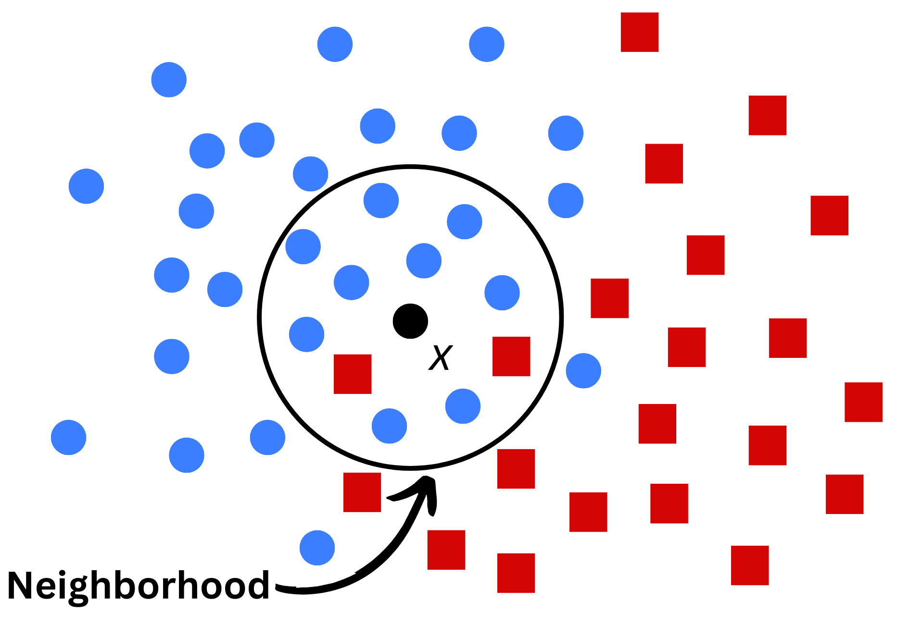
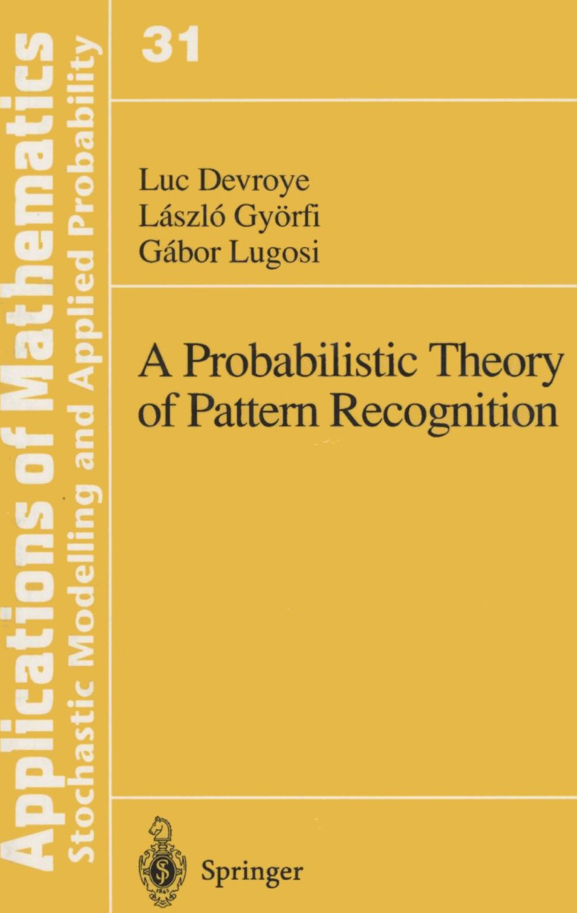
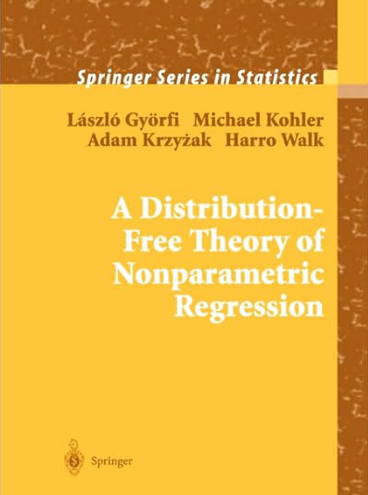
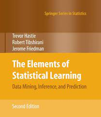
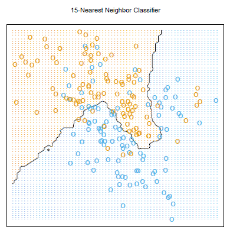
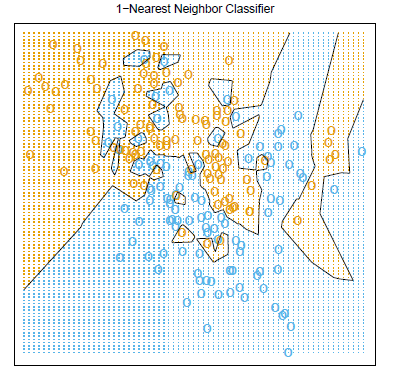
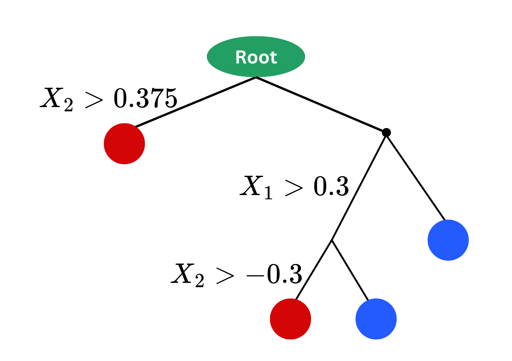

## 🗺️ Content

- [1. Introduction]{.section .secbr} <br>

- [2. Theoretical Motivation]{.section .secbr} <br>

- [3. K-Nearest Neighbors]{.section .secbr} <br>

- [4. Decision Trees]{.section .secbr} <br>

- [5. Kernel Smoothing Methods]{.section .secbr} <br>

# I. Introduction {background-color="#15797A"}

## I. Introduction {auto-animate="true"}
### Supervised Learning Setting
:::{style="font-size: 80%"}
> **Objective:** Predicting target $y$ using input $x$. 

- If $y$ is continuous, the problem is called `Regression`.
- If $y$ is discrete/categorical, it's called `Classification`.

> **Criteria**

- Quality of a prediction $\hat{y}$ is measured by the loss: $\ell(\hat{y},y)$.
- Quality of a model $\hat{f}$ is measured by the risk: $${\cal R}(\hat{f})=\mathbb{E}_{X,Y}[\ell(Y, \hat{f}(X))].$$

:::

## I. Introduction {auto-animate="true"}
### Supervised Learning Setting
:::{style="font-size: 80%"}
- **Parametric models** assume a specific form that depends on a fixed number of parameters. Example:
    - Linear model: $\hat{f}_{\color{blue}{\beta}}(\text{x})=\color{blue}{\beta_0}+\sum_{j=1}^d\color{blue}{\beta_j}x_j$ with $\color{blue}{\beta_0},\dots,\color{blue}{\beta_d}\in\mathbb{R}.$
    - Polynomial model: $\hat{f}_{\color{blue}{\beta}}(\text{x})=\color{blue}{\beta_0}+\sum_{p=0}^m\sum_{k=1}^d\sum_{j\leq k}\color{blue}{\beta_{jkp}}x_j^{p}x_k^{m-p}$ with $\color{blue}{\beta_0},\color{blue}{\beta_{jkp}}\in\mathbb{R},\forall j,k,p.$
    - $2$-layer Neural Networks: $\hat{f}(\text{x})=\sigma_2\left(\color{blue}{W_2}\sigma_1(\color{blue}{W_1}x+\color{blue}{b_1})+\color{blue}{b_2}\right).$
- Building a model is searching for $\color{blue}{\beta^*}$ minimizing the risk, i.e.,
    $${\cal R}(\hat{f}_{\color{blue}{\beta^*}})=\inf_{\color{blue}{\beta}}\Big[\underbrace{{\cal R}(\hat{f}_{\color{blue}{\beta}})}_{\text{Goodness of fit}} + \underbrace{\color{gray}{\Omega(\color{blue}{\beta})}}_{\text{Flexibility}}\Big]$$

:::

## I. Introduction {auto-animate="true"}
### Supervised Learning Setting
:::{style="font-size: 80%"}
- **Nonparametric models** rely directly on the target $y$ without assuming any form of input-output relationship.

:::{.columns}
:::{.column width="65%" style="font-size: 90%"}

- General weighted average form: 
$$\hat{f}(\text{x})=\sum_{i=1}^ny_i\color{blue}{W_{n,i}(\text{x})}.$$
- Interpretation:
    - The prediction of $\text{x}$ is determined by averaging values of targets $y_i$'s.
    - Targets $y_i$ that their input $\text{x}_i$ is **similar** to $\text{x}$ are more important and carry heavier weight $\color{blue}{W_{n,i}(\text{x})}$ in the average.

:::
:::{.column width="35%"}

{width="400px" fig-align="center"}

:::{.fragment style="font-size: 85%"}
🤔 Why does it work?
:::

:::{.fragment style="font-size: 85%"}
🗝️ Because it estimates $\color{red}{\eta(x)=\mathbb{E}(Y|X=x)}$.
:::

:::{.fragment style="font-size: 85%"}
🤔 But what's this $\color{red}{\eta(x)}$?
:::
:::
:::
:::

# II. Theoretical Motivation {background-color="#15797A"}

## II. Theoretical Motivation {auto-animate="true"}
### 1. Regression theory: $L_2$/MSE minimizer
:::{style="font-size:80%" .incremental}
:::{.columns}
:::{.column width="80%"}
- $\color{blue}{\text{Mean Squared Error}}$ of any model $\hat{f}$ is defined by:
$$\color{blue}{\text{MSE}}(\hat{f})=\mathbb{E}[(\hat{f}(X)-Y)^2].$$
- If $\text{x}$ be an input and $\color{red}{\eta(\text{x})=\mathbb{E}(Y|X=\text{x})}$ then $\forall\hat{f}$:
$$\begin{align*}
\color{blue}{\text{MSE}}(\hat{f})&=\mathbb{E}[(\hat{f}(X)-\color{red}{\eta}(X))^2]+\mathbb{E}[(\color{red}{\eta}(X)-Y)^2]
\end{align*}$$
- This implies that $\color{red}{\eta}$ is the **minimizer** of $\color{blue}{\text{MSE}}$ criterion, i.e.,
$$\color{blue}{\text{MSE}}(\color{red}{\eta})=\inf_{\hat{f}}\color{blue}{\text{MSE}}(\hat{f})=\mathbb{E}[(\color{red}{\eta}(X)-Y)^2].$$
- $\color{red}{\eta}$ is called **Regression Function/$L_2$ Bayesian Estimator.**
:::
:::{.column width="20%" .fragment}
[{width="120px"}](https://link.springer.com/book/10.1007/b97848){target="_blank"} <br>
[{width="120px"}](https://www.szit.bme.hu/~gyorfi/pbook.pdf){target="_blank"} <br>
[{width="120px"}](https://www.stat.ntu.edu.tw/download/教學文件/bigdata/The%20Elements%20of%20Statistical%20Learning.pdf){target="_blank"}
:::
:::
:::

## II. Theoretical Motivation {auto-animate="true"}
### 1. Regression theory: $L_2$/MSE minimizer
- $\color{red}{\eta}$ is called **Regression Function/$L_2$ Bayesian Estimator.**

:::{.incremental}
- $\color{red}{\eta(\text{x})=\mathbb{E}(Y|X=\text{x})}$ **is the average of $y$ for inputs that are similar to the query point** $\text{x}$. In discrete case:
$$\begin{align*}\color{red}{\eta}(\text{x})&=\mathbb{E}(Y|X=\text{x})=\sum_{i=1}^{\infty}y_i\color{blue}{\mathbb{P}(Y=y_i|X=\text{x})}
\end{align*}$$

- Recall that nonparam. models: $\hat{f}(\text{x})=\sum_{i=1}^ny_i\color{blue}{W_{n,i}(\text{x})}.$

<!--
- Unfortunately, $\color{red}{\eta}(x)=\mathbb{E}(Y|X=x)$ cannot be computed as the distribution of data $(X,Y)$ is not available.
-->

:::

## II. Theoretical Motivation {auto-animate="true"}
### 1. Regression theory: $L_2$/MSE minimizer
:::{.columns style="font-size: 80%"}
:::{.column width="50%"}
- **Nonparametric models:** $$\hat{f}(\text{x})=\sum_{i=1}^ny_i\color{blue}{W_{n,i}(\text{x})}.$$
:::
:::{.column width="50%"}
- **Regression function:** $$\color{red}{\eta}(\text{x})=\sum_{i=1}^{\infty}y_i\color{blue}{\mathbb{P}(Y=y_i|X=\text{x})}.$$
:::
:::{.incremental style="font-size:90%"}
- [Q1:]{.light-red} Why don't we compute $\color{blue}{\mathbb{P}(Y=y_i|X=\text{x})}$ directly?

- [A1:]{.green} We don't know the distribution of $Y|X$.

- Weights $\color{blue}{W_{n,i}(\text{x})}$ plays a role as an estimate of $\color{blue}{\mathbb{P}(Y=y_i|X=\text{x})}$.

- Different choices of weights lead to different nonparametric models.

- Weights $\color{blue}{W_{n,i}(\text{x})}$ are often defined according to how "close" $\text{x}_i$ to $\text{x}$.

- "Closeness" is often described by "metrics, neighborhoods or topological structures"...
:::
:::

## II. Theoretical Motivation {auto-animate="true"}
### 2. Example: Missing Value Imputation
:::{style="font-size: 80%"}
:::{.columns}
:::{.column width="50%"}
```{python}
#| echo: true
#| code-fold: true
#| fig-align: "center"
from skimage import data
import matplotlib.pyplot as plt
image = data.astronaut()
import numpy as np
from sklearn.impute import KNNImputer
n_miss = 100
np.random.seed(42)
missing_id = np.random.choice(512, size=(n_miss,2))
image_nan = image.copy()

for i in range(n_miss):
    image_nan[(missing_id[i,0]-2):(missing_id[i,0]+2),(missing_id[i,1]-2):(missing_id[i,1]+2),:] = 0
plt.figure(figsize=(4,4))
plt.imshow(image_nan)
plt.axis('off')
plt.show()
```
:::
:::{.column width="50%" .fragment}
```{python}
#| echo: true
#| code-fold: true
#| fig-align: "center"
for i in range(n_miss):
    for ch in range(3):
        temp = image_nan[(missing_id[i,0]-5):(missing_id[i,0]+5), (missing_id[i,1]-5):(missing_id[i,1]+5), ch]
        image_nan[(missing_id[i,0]-2):(missing_id[i,0]+2),(missing_id[i,1]-2):(missing_id[i,1]+2),ch] = temp[temp> 0].mean()
plt.figure(figsize=(4,4))
plt.imshow(image_nan)
plt.axis('off')
plt.show()
```
:::
:::{.fragment style="font-size:90%" .incremental}
- Missing pixels $=\frac{1}{N}\sum_{k=1}^Np_k$ where $p_k$ are neighboring non-missing pixels. 
- [Q2:]{.light-red} What are the weights $\color{blue}{W_{n,i}(\text{x})}$ in this case?
:::
:::
:::

## II. Theoretical Motivation {auto-animate="true"}
### 3. Decision theory for classification
:::{style="font-size: 65%"}
- In classification, **misclassification loss**: $\ell(\hat{f}(x),y)=\mathbb{1}_{\{\hat{f}(x)\neq y\}}=\begin{cases}1,\text{ if }\hat{f}(x)\neq y\\0,\text{ if }\hat{f}(x)=y\end{cases}$.
- The **misclassification risk** is given by: $${\cal R}_c(\hat{f})=\mathbb{E}[\ell(\hat{f}(X),Y)]=\mathbb{E}[\mathbb{1}_{\{\hat{f}(X)\neq Y\}}]=\mathbb{P}(\hat{f}(X)\neq Y).$$
- This is equivalent to classification problems that maximize **accuracy** score because
$$\text{Accuracy}=1-\mathbb{P}(\hat{f}(X)\neq Y)=\mathbb{P}(\hat{f}(X)=Y).$$
:::

:::{.sbr}
:::

:::{.callout-tip icon=false}
### Lemma [[Ch 2, Hastie et al. (2008)](https://www.sas.upenn.edu/~fdiebold/NoHesitations/BookAdvanced.pdf){target="_blank"} & [Sec 1.4, Kyörfi et al. (2002)](https://link.springer.com/book/10.1007/b97848)]
In **balanced** $M$-class classification, $$\text{If } g^*(x)=\arg\max_{1\leq k\leq M}\mathbb{P}(Y=k|X=x)\text{ then }{\cal R}_c(g^*)=\inf_{\hat{f}}{\cal R}_c(\hat{f}).$$
:::

## II. Theoretical Motivation {auto-animate="true"}
### Summary
:::{style="font-size: 80%" .incremental}
- In regression with [MSE]{.light-blue}, $\color{red}{\eta(\text{x})=\mathbb{E}(Y|X=\text{x})}$ is the **best regressor**.
    - We cannot compute it, but we can estimate it.
        - **Parametric models** assume that $\color{red}{\eta}$ takes some forms (linear, polynomial...).
        - **Nonparametric models** attempt to estimate $\color{red}{\eta}$ using weighted average form: $\hat{f}(\text{x})=\sum_{i=1}^ny_i\color{blue}{W_{n,i}(x)}$.
- In balanced $M$-class classification with **Accuracy** score, $g^*(\text{x})=\arg\max_{1\leq k\leq M}\color{blue}{\mathbb{P}(Y=k|X=\text{x})}$ is the **best classifier**.
- We will now look at **three different models** that attempt to estimate regression function $\color{red}{\eta}$ using different form of weights $\color{blue}{W_{n,i}(\text{x})}$.
:::

# III. $K$-Nearest Neighbors ($K$-NN) {background-color="#15797A"}

## III. $K$-Nearest Neighbors ($K$-NN) {auto-animate="true"}
### 1. Setting
:::{style="font-size: 70%"}
- Given `iid` observations: $\{(\text{x}_1,y_1),\dots, (\text{x}_n,y_n)\}\subset \mathbb{R}^d\times{\cal Y}$.
- If $D$ is a distance on $\mathbb{R}^d$ (e.g. Euclidean distance), the **$k$-th nearest neighbor** $\color{red}{\text{x}_{(k)}}$ of $\text{x}\in\mathbb{R}^d$ is defined by
    - $D(\text{x},\text{x}_{(1)})\leq D(\text{x},\text{x}_{(2)})\leq\dots\leq D(\text{x},\color{red}{\text{x}_{(k)}})\leq \dots\leq D(\text{x},\text{x}_{(n)})$.
    - Let $y_{(1)},\dots,y_{(n)}$ be the target of $\text{x}_{(1)},\dots,\text{x}_{(n)}$ respectively.
- If $K\geq 1$, then $K$-NN predicts the target of an input $\text{x}$ by

:::{.columns}
:::{.column width="50%" style="font-size:90%"}
- **Regression:**
$$\begin{align*}\hat{y}&=\frac{1}{K}\sum_{k=1}^Ky_{(k)}\qquad\quad \color{gray}{(\color{blue}{W_{n,i}(\text{x})}=?)}\\
&=\text{Average $y_{(k)}$ among the $K$ neighbors}.\end{align*}$$
:::
:::{.column width="50%" style="font-size:90%"}
- **Classification:**
$$\begin{align*}\hat{y}&=\arg\max_{1\leq m\leq M}\frac{1}{K}\sum_{k=1}^K\mathbb{1}_{\{y^{(k)}=m\}}\\
&=\text{Majority class among the $K$ neighbors.}\end{align*}$$
:::
:::
:::

## III. $K$-Nearest Neighbors ($K$-NN) {auto-animate="true"}
### 2. Example
:::{style="font-size: 70%"}
:::{.columns}
:::{.column width="50%" style="font-size:90%"}
- **Regression:**
$$\begin{align*}\hat{y}&=\frac{1}{K}\sum_{k=1}^Ky_{(k)}\qquad\quad \color{gray}{(\color{blue}{W_{n,i}(\text{x})}=?)}\\
&=\text{Average $y_{(k)}$ among the $K$ neighbors}.\end{align*}$$

:::{.fragment}
```{python}
#| echo: false
#| fig-align: "center"
import numpy as np
np.random.seed(42)
X1 = np.random.uniform(-1,1,size=(30, 2))
y1 = 1 * (X1[:,1] > X1[:,0] ** 3 - X1[:,0] + np.random.normal(0,0.5, size=30))
cir_theta = np.linspace(0,2*np.pi, 50)
cir_df = np.column_stack([np.cos(cir_theta)*0.47, np.sin(cir_theta)*0.47])
cols = {0: "blue", 1: "red"}
hover_text = [f'x1: {np.round(x1,2)}<br> x2: {np.round(x2,2)}<br> Target: {np.round(y,2)}' for x1, x2, y in zip(X1[:,0], X1[:,1], X1[:,0] ** 3 - X1[:,0])]
import plotly.graph_objects as go
fig1 = go.Figure(go.Scatter(
    x=X1[:,0], y=X1[:,1], 
    mode="markers", marker=dict(color=[cols[i] for i in y1], size=10), 
    name="Training data",
    text=hover_text,
    hoverinfo='text'))
fig1.add_trace(go.Scatter(
    x=[0], y=[0], name="Test point", 
    mode="markers", marker=dict(color="black", size=13)))
fig1.add_trace(go.Scatter(
    x=cir_df[:,0], y=cir_df[:,1], 
    mode="lines", line=dict(dash="dash", color="black"), 
    name="Neighborhood"))
fig1.update_layout(title="An example of 5NN", width=450, height=300)
fig1.show()
```
:::

:::
:::{.column width="50%" style="font-size:90%"}
- **Classification:**
$$\begin{align*}\hat{y}&=\arg\max_{1\leq m\leq M}\frac{1}{K}\sum_{k=1}^K\mathbb{1}_{\{y^{(k)}=m\}}\\
&=\text{Majority class among the $K$ neighbors.}\end{align*}$$

:::{.fragment}
```{python}
#| echo: false
#| fig-align: "center"
cir_theta = np.linspace(0,2*np.pi, 50)
cir_df = np.column_stack([np.cos(cir_theta)*0.7, np.sin(cir_theta)*0.7])
fig2 = go.Figure(data=[
    fig1.data[0],
    fig1.data[1]
])
fig2.add_trace(go.Scatter(x=cir_df[:,0], y=cir_df[:,1], mode="lines", line=dict(dash="dash", color="black"), name="Neighborhood"))
fig2.update_layout(title="The same example but with 12NN", width=450, height=310)
fig2.show()
```
:::
:::
:::
:::

```{python}
path = "/Users/hassothea/.cache/kagglehub/datasets/johnsmith88/heart-disease-dataset/versions/2"
```

## III. $K$-Nearest Neighbors ($K$-NN) {auto-animate="true"}
### 2. Example
:::{style="font-size: 70%"}
- Let's work with our [Heart Disease Dataset](https://www.kaggle.com/datasets/johnsmith88/heart-disease-dataset){target='_blank'} (shpe: $1025\times 14$) and choose $K=5$.
- $K$-NN is a distance-based method, it's essential to
    - Scale the inputs
    - Watch out for outliers/missing values
    - Encode categorical inputs
    - Watch out for the effect of imbalanced class...

```{python}
#| echo: true
#| code-fold: true
import numpy as np
import pandas as pd
data = pd.read_csv(path + "/heart.csv")
quan_vars = ['age','trestbps','chol','thalach','oldpeak']
qual_vars = ['sex','cp','fbs','restecg','exang','slope','ca','thal','target']

# Convert to correct types
for i in quan_vars:
  data[i] = data[i].astype('float')
for i in qual_vars:
  data[i] = data[i].astype('category')

# Train test split
from sklearn.model_selection import train_test_split
X, y = data.iloc[:,:-1], data.iloc[:,-1]
X_train, X_test, y_train, y_test = train_test_split(X, y, test_size=0.2, stratify=y, random_state=42)

from sklearn.preprocessing import MinMaxScaler, StandardScaler
scaler = MinMaxScaler()

# OnehotEncoding and Scaling
X_train_cat = pd.get_dummies(X_train.select_dtypes(include="category"), drop_first=True)
X_train_encoded = scaler.fit_transform(np.column_stack([X_train.select_dtypes(include="number").to_numpy(), X_train_cat]))
X_test_cat = pd.get_dummies(X_test.select_dtypes(include="category"), drop_first=True)
X_test_encoded = scaler.transform(np.column_stack([X_test.select_dtypes(include="number").to_numpy(), X_test_cat]))

# KNN
from sklearn.neighbors import KNeighborsClassifier 

knn = KNeighborsClassifier(n_neighbors=5)
knn = knn.fit(X_train_encoded, y_train)
y_pred = knn.predict(X_test_encoded)

from sklearn.metrics import roc_auc_score, accuracy_score, precision_score, recall_score, f1_score, confusion_matrix, ConfusionMatrixDisplay

test_perf = pd.DataFrame(
    data={'Accuracy': accuracy_score(y_test, y_pred),
          'Precision': precision_score(y_test, y_pred),
          'Recall': recall_score(y_test, y_pred),
          'F1-score': f1_score(y_test, y_pred),
          'AUC': roc_auc_score(y_test, y_pred)},
    columns=["Accuracy", "Precision", "Recall", "F1-score", "AUC"],
    index=["5NN"])
test_perf
```

:::{.incremental}
- [Q3]{.light-red}: Can we do better?
- [A3]{.green}: Yes! $K=5$ is arbitrary. We should fine-tune it!
:::
:::

## III. $K$-Nearest Neighbors ($K$-NN) {auto-animate="true" .scrollable}
### 3. Influence of $K$
{width="400"}
{width="400"}

:::{style="font-size: 80%"}
- **Too small $K\Leftrightarrow$ too flexible $\Leftrightarrow$ high variance $\Leftrightarrow$ Overfitting.**
:::

## III. $K$-Nearest Neighbors ($K$-NN) {auto-animate="true" .scrollable}
### 4. Fine-tuning $K$: Cross-validation
:::{style="font-size: 70%"}
- There are many way to perform Cross-validation in `python`.
- Let's use `GridSearchCV` from `sklearn.model_selection` module.
```{python}
#| echo: true
#| code-fold: true
knn = KNeighborsClassifier()
from sklearn.model_selection import GridSearchCV
from sklearn.metrics import f1_score, make_scorer
scorer = make_scorer(f1_score, pos_label=1)
param_grid = {'n_neighbors': list(range(2,31))}
knn = KNeighborsClassifier()
grid_search = GridSearchCV(knn, param_grid, cv=10, scoring=scorer, return_train_score=True)
grid_search.fit(X_train_encoded, y_train)

knn = KNeighborsClassifier(n_neighbors=grid_search.best_params_['n_neighbors'])
knn = knn.fit(X_train_encoded, y_train)
y_pred = knn.predict(X_test_encoded)

test_perf = pd.concat([test_perf, pd.DataFrame(
    data={'Accuracy': accuracy_score(y_test, y_pred),
          'Precision': precision_score(y_test, y_pred),
          'Recall': recall_score(y_test, y_pred),
          'F1-score': f1_score(y_test, y_pred),
          'AUC': roc_auc_score(y_test, y_pred)},
    columns=["Accuracy", "Precision", "Recall", "F1-score", "AUC"],
    index=[f"{grid_search.best_params_['n_neighbors']}NN"])], axis=0)
test_perf
```

:::{.center}
```{python}
#| fig-align: "center"
cv_results = grid_search.cv_results_
fig2 = go.Figure(go.Scatter(
    x=param_grid['n_neighbors'], y=cv_results['mean_test_score'],
    mode="markers+lines", name="CV F1 score"))
fig2.add_trace(go.Scatter(x=[grid_search.best_params_['n_neighbors'], grid_search.best_params_['n_neighbors']], 
        y=[np.max(cv_results['mean_test_score']), np.min(cv_results['mean_test_score'])], 
        name="Optimal K", mode="lines", line=dict(color='red', dash="dash")))
fig2.update_layout(title="CV f1-score vs Number of Neighbors (K)",
        width=1000, height=250, xaxis_title="Number of Neighbors (K)", yaxis_title="CV f1-score")
fig2.show()
```
:::
:::

## III. $K$-Nearest Neighbors ($K$-NN) {auto-animate="true"}
### 4. Fine-tuning $K$: Cross-validation
:::{.columns}
:::{.column width="30%"}
- What can go wrong?

{width="250px" fig-align="center"}
:::
:::{.column width="70%" .fragment}
:::{style="font-size: 75%"}
- [Duplicated data!]{.light-red}
- Let's try again.

:::{style='font-size: 80%'}
```{python}
# Drop duplicated data
data_no_dup = data.drop_duplicates()

# Train test split
from sklearn.model_selection import train_test_split
X, y = data_no_dup.iloc[:,:-1], data_no_dup.iloc[:,-1]
X_train, X_test, y_train, y_test = train_test_split(X, y, test_size=0.2, stratify=y, random_state=42)

from sklearn.preprocessing import MinMaxScaler, StandardScaler
scaler = MinMaxScaler()

# OnehotEncoding and Scaling
X_train_cat = pd.get_dummies(X_train.select_dtypes(include="category"), drop_first=True)
X_train_encoded = scaler.fit_transform(np.column_stack([X_train.select_dtypes(include="number").to_numpy(), X_train_cat]))
X_test_cat = pd.get_dummies(X_test.select_dtypes(include="category"), drop_first=True)
X_test_encoded = scaler.transform(np.column_stack([X_test.select_dtypes(include="number").to_numpy(), X_test_cat]))

knn = KNeighborsClassifier()
grid_search = GridSearchCV(knn, param_grid, cv=10, scoring=scorer, return_train_score=True)
grid_search.fit(X_train_encoded, y_train)

# CV F1 score
cv_results = grid_search.cv_results_
fig2 = go.Figure(go.Scatter(
    x=param_grid['n_neighbors'], y=cv_results['mean_test_score'],
    mode="markers+lines", name="CV F1 score"))
fig2.add_trace(go.Scatter(x=[grid_search.best_params_['n_neighbors'], grid_search.best_params_['n_neighbors']], 
        y=[np.max(cv_results['mean_test_score']), np.min(cv_results['mean_test_score'])], 
        name="Optimal K", mode="lines", line=dict(color='red', dash="dash")))
fig2.update_layout(title="CV f1-score vs Number of Neighbors (K)",
        width=500, height=250, xaxis_title="Number of Neighbors (K)", yaxis_title="CV f1-score")
fig2.show()

knn = KNeighborsClassifier(n_neighbors=grid_search.best_params_['n_neighbors'])
knn = knn.fit(X_train_encoded, y_train)
y_pred = knn.predict(X_test_encoded)

test_perf = pd.concat([test_perf, pd.DataFrame(
    data={'Accuracy': accuracy_score(y_test, y_pred),
          'Precision': precision_score(y_test, y_pred),
          'Recall': recall_score(y_test, y_pred),
          'F1-score': f1_score(y_test, y_pred),
          'AUC': roc_auc_score(y_test, y_pred)},
    columns=["Accuracy", "Precision", "Recall", "F1-score", "AUC"],
    index=[f"{grid_search.best_params_['n_neighbors']}NN_No_Dup"])], axis=0)
test_perf
```
:::
:::
:::
:::


## III. $K$-Nearest Neighbors ($K$-NN) {auto-animate="true"}
### 5. Curse of dimensionality
:::{style="font-size:75%"}
:::{.columns}
:::{.column width="60%" style="font-size: 80%" .incremental}
- **[Curse of dimensionality]{.light-red}** refers to various challenges and phenomena that arise when working with high-dimensional data.
- The main challenge for $K$-NN is that **[distances]{.light-blue}** or **[closeness]{.light-blue}** lose its meaning in high-dimensional spaces.
- In this scenario, data points tend to be equally distant from one another.
- Example: Simulate $\text{x}_1,\dots,\text{x}_n\sim{\cal U}[-5,5]^d$ with $d=1,10,100,500,1000, 5000, 10000, 50000$.
    - For each dimension $d$, we compute:
$$r(d)=\frac{\max_{i\neq j}D(\text{x}_i,\text{x}_j)}{\min_{i\neq j}D(\text{x}_i,\text{x}_j)}.$$
    - Obtain the following graph 👉
:::
:::{.column width="40%" .fragment}
```{python}
#| echo: true
#| code-fold: true
N = 10
Ds = np.zeros(shape=(N*(N-1)//2, 8))
j = 0
for d in [1,10,100, 500, 1000, 5000, 10000, 50000]:
    Xd = np.random.uniform(-5,5,size=(N,d))
    i = 0
    for s in range(1, N):
        for k in range(s):
            Ds[i,j] = np.linalg.norm(Xd[s,:] - Xd[k,:])
            i += 1
    j += 1
import plotly.express as px
df_dist = pd.DataFrame({'Ratio': np.round(Ds.max(axis=0)/Ds.min(axis=0), 2), 'Dim': ['1','10','100', '500', '1000', '5000', '10000', '50000']})
fig4 = px.line(df_dist, x='Dim', y="Ratio", text="Ratio")
fig4.update_layout(
    width=400, height=450, 
    title="Max-min distance ratio at various dimension")
fig4.update_xaxes(title='Dimension')
fig4.update_yaxes(title='Max-Min Distance Ratio')
fig4.update_traces(textposition="top right")
fig4.show()
```
:::
:::
:::

## III. $K$-Nearest Neighbors ($K$-NN) {auto-animate="true" .scrollable}
### Summary
:::{style="font-size: 70%"}
- $K$-NN is a nonparametric model with weights: $\color{blue}{W_{n,i}(\text{x})=\frac{\mathbb{1}_{\{\text{x}_i\in{\cal N}_{\text{x}}\}}}{K}}$, where ${\cal N}_{\text{x}}=\{\text{x}_{(1)},\dots,\text{x}_{(K)}\}$ the set of the first $K$-nearest neighbors of $\text{x}$.
:::
:::{.columns}
:::{.column width="50%" style="font-size: 70%"}
- Data preprocessing is essential: scaling, encoding, outliers...

- The key parameter $K$ can be tuned using **cross-validation** technique.

- $K$-NN may not be suitable in high-dimensional cases due to **Curse of dimensionality**. However, we can try:
    - Feature selection
    - Dimensional reduction
    - Distance metric
:::
:::{.column width="50%"}

```{python}
fig1.update_layout(width=500, height=360)
fig1.show()
```
:::
:::

## III. $K$-Nearest Neighbors ($K$-NN) {auto-animate="true" .scrollable}
### $K$-NN on [`Mnist`](https://www.kaggle.com/datasets/hojjatk/mnist-dataset){target="_blank"}
:::{style="font-size: 80%"}
- We try some different approaches:
    - Normal $3$NN (various sources, for example, see [here](https://www.kaggle.com/code/maharshipandya/mnist-using-knn-97){target="_blank"})
    - Dimensional reduction with PCA with **cross-validation**
    - Fourier transform method with **cross-validation**.

```{python}
#| echo: true
#| code-fold: true
#| eval: true
from keras.datasets import mnist
(X_train, y_train), (X_test, y_test) = mnist.load_data()

# Reshape data from 3D array to (n, 784)
X_train_reshaped = X_train.reshape(-1, 28*28)/255.0
X_test_reshaped = X_test.reshape(-1, 28*28)/255.0

# Model
knn = KNeighborsClassifier(n_neighbors=3)
knn = knn.fit(X_train_reshaped, y_train)
y_pred = knn.predict(X_test_reshaped)

test_mnist = pd.DataFrame(
    data={'Accuracy': accuracy_score(y_test, y_pred),
          'Precision': precision_score(y_test, y_pred, average="macro"),
          'Recall': recall_score(y_test, y_pred, average="macro"),
          'F1-score': f1_score(y_test, y_pred, average="macro")},
    columns=["Accuracy", "Precision", "Recall", "F1-score"],
    index=[f"3NN"])

# PCA
from sklearn.preprocessing import StandardScaler
from sklearn.decomposition import PCA
pca = PCA(n_components=150)
X_proj_train = pca.fit_transform(X_train_reshaped)
X_proj_test = pca.transform(X_test_reshaped)

# Model
param_grid = {'n_neighbors': [1,2,3]}#list(range(2,31))}
knn = KNeighborsClassifier()
grid_search = GridSearchCV(knn, param_grid, cv=5, scoring=scorer, return_train_score=True)
grid_search.fit(X_proj_train, y_train)

knn = KNeighborsClassifier(n_neighbors=grid_search.best_params_['n_neighbors'])
knn = knn.fit(X_proj_train, y_train)
y_pred = knn.predict(X_proj_test)

test_mnist = pd.concat([test_mnist, pd.DataFrame(
    data={'Accuracy': accuracy_score(y_test, y_pred),
          'Precision': precision_score(y_test, y_pred, average="macro"),
          'Recall': recall_score(y_test, y_pred, average="macro"),
          'F1-score': f1_score(y_test, y_pred, average="macro")},
    columns=["Accuracy", "Precision", "Recall", "F1-score"],
    index=[f"{grid_search.best_params_['n_neighbors']}NN_PCA"])], axis=0)

# Fourier transform
from scipy.fftpack import fft2, fftshift
def compute_fourier_transform(image): 
    f_transform = fft2(image) 
    f_transform_shifted = fftshift(f_transform) 
    magnitude_spectrum = np.abs(f_transform_shifted) 
    return magnitude_spectrum

X_train_fft = np.array([compute_fourier_transform(img) for img in X_train]).reshape(-1, 28*28)
X_test_fft = np.array([compute_fourier_transform(img) for img in X_test]).reshape(-1, 28*28)

# Model
knn = KNeighborsClassifier()
grid_search = GridSearchCV(knn, param_grid, cv=5, scoring=scorer, return_train_score=True)
grid_search.fit(X_train_fft, y_train)

knn = KNeighborsClassifier(n_neighbors=grid_search.best_params_['n_neighbors'])
knn = knn.fit(X_train_fft, y_train)
y_pred = knn.predict(X_test_fft)

test_mnist = pd.concat([test_mnist, pd.DataFrame(
    data={'Accuracy': accuracy_score(y_test, y_pred),
          'Precision': precision_score(y_test, y_pred, average="macro"),
          'Recall': recall_score(y_test, y_pred, average="macro"),
          'F1-score': f1_score(y_test, y_pred, average="macro")},
    columns=["Accuracy", "Precision", "Recall", "F1-score"],
    index=[f"{grid_search.best_params_['n_neighbors']}NN_FT"])], axis=0)
test_mnist
```
:::

# IV. Decision Trees {background-color="#15797A"}

## IV. Decision Trees 🌲
### 1. CART: Classification And Regression Trees
:::{style="font-size:80%" .fragment}
- In CART, "neighbors" are defined by [rectangular regions]{.light-blue} within inputs space.
:::
:::{.columns .fragment}
:::{.column width="50%"}
```{python}
fig1.update_layout(width=480, height=350)
fig1.show()
```

- Neighbors in $k$-NN are based on straight [**distance**]{.light-red}.
:::
:::{.column width="50%"}
```{python}
fig_tr = go.Figure(data=[
    fig1.data[0],
    fig1.data[1]
])
L1 = np.array([[-1.1, 1.1], [0.375, 0.375]])
L2 = np.array([[0.3, 0.3], [-1, 0.375]])
L3 = np.array([[0.3, 1.1], [-0.3, -0.3]])
fig_tr.add_trace(go.Scatter(x=L1[0,:], y=L1[1,:], mode='lines', line=dict(color="black", dash="dot"), name="1st split"))
fig_tr.add_trace(go.Scatter(x=L2[0,:], y=L2[1,:], mode='lines', line=dict(color="black", dash="dot"), name="2nd split"))
fig_tr.add_trace(go.Scatter(x=L3[0,:], y=L3[1,:], mode='lines', line=dict(color="black", dash="dot"), name="3rd split"))
fig_tr.update_layout(title="Partitions of input space", width=460, height=350)
fig_tr.show()
```

- Neighbors in CART are based on [**blocks**]{.light-blue}.
:::
:::

## IV. Decision Trees 🌲
### 1. CART: Classification And Regression Trees
:::{style="font-size:80%"}
:::{.columns}
:::{.column width="50%"}
:::{style="font-size: 80%"}
```{python}
fig_tr.show()
```

:::{.incremental}
- Building a **CART** consists of:
    - Start at root (no split yet).
    - **Recursively split** into smaller **regions**.
    - [**Stop**]{.light-red} when a stopping [**criterion**]{.light-red} is met.
- [**Regions**]{.light-blue} $\color{blue}{\Rightarrow}$ [**neighbors**]{.light-blue} $\color{blue}{\Rightarrow}$ [**prediction**]{.light-blue}.
:::
:::
:::
:::{.column width="50%"}
:::{.incremental style="font-size: 80%"}

- At each split, 
    - We try column $\color{red}{X_j}$ at threshold $\color{red}{a}\in\mathbb{R}$ into two subregions $R_1$ and $R_2$.
    - We **decision** to split along $\color{red}{X_j}$ at $\color{red}{a}$ so that $R_1$ and $R_2$ are [**as pure as possible**]{.light-blue}.
- [**Impurity**]{.light-red} is defined by impurity measures:
    - [Regression: Within-region variation]{.light-red} $\sum_{y\in R_1}(y-\overline{y}_1)^2+\sum_{y\in R_2}(y-\overline{y}_2)^2.$
    - [Classification]{.light-blue} ($M$ classes):
        - **Missclassification error** $=1-\hat{p}_{k^*}$ where $k^*$ is the majority class.
        - **Gini impurity** $=\sum_{k=1}^M\hat{p}_{k}(1-\hat{p}_{k})$.
        - **Entropy** $=-\sum_{k}\hat{p}_{k}\log(\hat{p}_{k})$ where $\hat{p}_{k}$: proportion of class $k$ in region $R$.

:::
:::
:::
:::

## IV. Decision Trees 🌲
### 1. CART: Classification And Regression Trees
:::{style="font-size:80%"}
:::{.columns}
:::{.column width="50%"}
:::{style="font-size: 80%"}
```{python}
fig_tr.show()
```

- Building a **CART** consists of:
    - Start at root (no split yet).
    - **Recursively split** into smaller **regions**.
    - [**Stop**]{.light-red} when a stopping [**criterion**]{.light-red} is met.
- [**Regions**]{.light-blue} $\color{blue}{\Rightarrow}$ [**neighbors**]{.light-blue} $\color{blue}{\Rightarrow}$ [**prediction**]{.light-blue}.
:::
:::
:::{.column width="50%"}
:::{style="font-size: 80%"}
- At each split, 
    - We try column $\color{red}{X_j}$ at threshold $\color{red}{a}\in\mathbb{R}$ into two subregions $R_1$ and $R_2$.
    - We **decision** to split along $\color{red}{X_j}$ at $\color{red}{a}$ so that $R_1$ and $R_2$ are [**as pure as possible**]{.light-blue}.
- [**Impurity**]{.light-red} is defined by impurity measures:

![The [**smaller**]{.light-blue} $\Leftrightarrow$ the [**purer**]{.light-blue} the regions!](img/Impurity.png){height="230" width="500" fig-align="center"}

:::
:::
:::
:::


## IV. Decision Trees 🌲
### 1. CART: Classification And Regression Trees
:::{style="font-size:80%"}
:::{.columns}
:::{.column width="50%" style="font-size: 80%"}
```{python}
fig_tr.show()
```

:::{style="font-size: 75%" .incremental}
- First split:
    - $\text{En}(R_1)=-1\log(1)=0$
    - $\begin{align*}\\ \text{En}(R_2)&=-\color{blue}{16/19\log(16/19)}-\color{red}{3/19\log(3/19)}\\ &=0.436.\end{align*}$
    - $\text{En}_1=(0)11/30+(0.436)19/30=0.276.$
    - **Information gain:** $\text{En}_0-\text{En}_1.$
:::
:::
:::{.column width="50%" style="font-size: 80%" .fragment .incremental}
{fig-align="center" height="330"}

- `Prediction rule:` 
    - **Regression:** $\color{blue}{\hat{y}}=$ [**average**]{.light-blue} targets within the same block.
    - **Classification:** $\color{blue}{\hat{y}}=$ [**majority vote**]{.light-blue} among points within the same block.
:::
:::
:::

## IV. Decision Trees 🌲
### 1. CART: Classification And Regression Trees
:::{style="font-size:80%"}
:::{.columns}
:::{.column width="50%" style="font-size: 78%" .incremental}
```{python}
fig_tr.show()
```

- `Hyperparameters:` 
    - `max_depth`
    - `max_features`
    - `min_samples_split`
    - `min_samples_leaf`
    - `criterion`... [see explanation [here](https://www.google.com/search?q=hyperparameters+of+cart+and+its+meaning&sca_esv=8ae5a86d4bb72295&sxsrf=AE3TifMqWjlRUFjepn7SaittWlTmMNpevA%3A1760029429473&udm=50&fbs=AIIjpHxU7SXXniUZfeShr2fp4giZ1Y6MJ25_tmWITc7uy4KIemkjk18Cn72Gp24fGkjjh6wQFVCbKXb4P6swJy4x5wjmC_909EqiJuKoJVBAt1bQqxuAxTVm5FaXw1YXOj1toa8WPxcw1gn6LYXewwLEtDLrjlF1DF5gsE1oM13IUcRi9WoWLy0RheFkcZrCqX8fIc9hqBDd7QkjIMco9MHF-AJTiny_Vw&aep=1&ntc=1&sa=X&ved=2ahUKEwiTpMDHzJeQAxU0R2wGHXuzBxIQ2J8OegQICxAE&biw=1707&bih=825&dpr=2.25&mtid=_ernaJeDFp2sseMP2ujAgAI&mstk=AUtExfAdpaepXuD-MYEHYZ6_074JT7g6h2OkwWVTZPOcC3xrQ86TtxA3Dl_Sq1_LcISq1mOxnqrijvyfPc3QePzxV2x6VKWcgumwZ5xpthnl5ETXr4VjH37ILXC3qM14hNDrVeZu1Qtp4uMR0VfkQ68FZWMm2awkeb-mYblQO-vw6AJMLd1Mwwx-89pNwFLbOhwsebLroj3XFMqCyacA4zdxByym4gaKucBShBo3HWWgUVCY45tPjM0rzkkOeoy0WSrg08wfOn0fKXCrX1cpYEDiGAddc5n4TCJAqKyfVIvgKtWwdR0YnL8rUXbyvrJL4uYtt5PWoTpBEKGJPw&csuir=1){target='_blank'}]
:::
:::{.column width="50%" style="font-size: 80%" .incremental}
{fig-align="center" height="330"}

- [**Deep trees**]{.light-red} $\Leftrightarrow$ [**less neighbors**]{.light-red} $\Rightarrow$ [**Overfitting**]{.light-red}.
- In this case of [**smaller leaves**]{.light-red}, it's similar to smaller $k$ in $k$-NN.
- These hyperparameters should be [**fine-tuned**]{.light-blue} using **CV** to [**optimize its performance**]{.light-blue}.
:::
:::
:::

## IV. Decision Trees 🌲
### 2. Pruning Tree
:::{style="font-size:80%"}
:::{.columns}
:::{.column width="50%" style="font-size: 78%"}
```{python}
fig_tr.show()
```
- `Hyperparameters:` 
    - `max_depth`
    - `max_features`
    - `min_samples_split`
    - `min_samples_leaf`
    - `criterion`... [see explanation [here](https://www.google.com/search?q=hyperparameters+of+cart+and+its+meaning&sca_esv=8ae5a86d4bb72295&sxsrf=AE3TifMqWjlRUFjepn7SaittWlTmMNpevA%3A1760029429473&udm=50&fbs=AIIjpHxU7SXXniUZfeShr2fp4giZ1Y6MJ25_tmWITc7uy4KIemkjk18Cn72Gp24fGkjjh6wQFVCbKXb4P6swJy4x5wjmC_909EqiJuKoJVBAt1bQqxuAxTVm5FaXw1YXOj1toa8WPxcw1gn6LYXewwLEtDLrjlF1DF5gsE1oM13IUcRi9WoWLy0RheFkcZrCqX8fIc9hqBDd7QkjIMco9MHF-AJTiny_Vw&aep=1&ntc=1&sa=X&ved=2ahUKEwiTpMDHzJeQAxU0R2wGHXuzBxIQ2J8OegQICxAE&biw=1707&bih=825&dpr=2.25&mtid=_ernaJeDFp2sseMP2ujAgAI&mstk=AUtExfAdpaepXuD-MYEHYZ6_074JT7g6h2OkwWVTZPOcC3xrQ86TtxA3Dl_Sq1_LcISq1mOxnqrijvyfPc3QePzxV2x6VKWcgumwZ5xpthnl5ETXr4VjH37ILXC3qM14hNDrVeZu1Qtp4uMR0VfkQ68FZWMm2awkeb-mYblQO-vw6AJMLd1Mwwx-89pNwFLbOhwsebLroj3XFMqCyacA4zdxByym4gaKucBShBo3HWWgUVCY45tPjM0rzkkOeoy0WSrg08wfOn0fKXCrX1cpYEDiGAddc5n4TCJAqKyfVIvgKtWwdR0YnL8rUXbyvrJL4uYtt5PWoTpBEKGJPw&csuir=1){target='_blank'}]
:::
:::{.column width="50%" style="font-size: 80%"}
{fig-align="center" height="330"}

- Pruning criterion to be minimized: $C_{\alpha}(T)=\sum_{j=1}^{|T|}N_j\text{Imp}_j(T)+\alpha|T|$ where 
    - $|T|$: num. of leaves of the tree $T$ and
    - $\text{Imp}_j(T)$: the impurity at leave $j$-th.
:::
:::
:::

## IV. Decision Trees 🌲
### 3. [Tree Playground](https://nlhlong01.github.io/playground/decisiontree.html#dataset=circle&regDataset=reg-plane&noise=10&showTestData=false&percTrainData=70&problem=classification&seed=0.67310&percSamples=80&maxDepth=3){target='_blank'}

<iframe src="https://nlhlong01.github.io/playground/decisiontree.html#dataset=circle&regDataset=reg-plane&noise=10&showTestData=false&percTrainData=70&problem=classification&seed=0.67310&percSamples=80&maxDepth=3" width="100%" height="550" style="border:1px solid black;">
</iframe>


## IV. Decision Trees 🌲
### 3. Application: [Heart Disease Dataset](https://www.kaggle.com/datasets/johnsmith88/heart-disease-dataset){target='_blank'}
:::{style="font-size: 90%"}
- We use `GridsearchCV` to search over the hyperparameters:
    - Impurity (`criterion`)
    - Depth (`max_depth`)
    - Mininum size of leave nodes (`min_samples_leaf`)
    - Maximum features (`max_features`).
:::

```{python}
#| echo: true
#| code-fold: true
data = pd.read_csv(path + "/heart.csv")
quan_vars = ['age','trestbps','chol','thalach','oldpeak']
qual_vars = ['sex','cp','fbs','restecg','exang','slope','ca','thal','target']

# Convert to correct types
for i in quan_vars:
  data[i] = data[i].astype('float')
for i in qual_vars:
  data[i] = data[i].astype('category')

data = data.drop_duplicates()
# Train test split
from sklearn.model_selection import train_test_split
X, y = data.iloc[:,:-1], data.iloc[:,-1]
X_train, X_test, y_train, y_test = train_test_split(X, y, test_size=0.2, stratify=y, random_state=42)

from sklearn.model_selection import GridSearchCV 
from sklearn.tree import DecisionTreeClassifier 
from sklearn.metrics import accuracy_score
from sklearn.metrics import roc_auc_score, accuracy_score, precision_score, recall_score, f1_score, confusion_matrix, ConfusionMatrixDisplay

clf = DecisionTreeClassifier()
param_grid = {'criterion': ['gini', 'entropy'], 
              'max_depth': [10, 20, 30, 40, 50], 
              'min_samples_split': [2, 5, 10], 
              'min_samples_leaf': [1, 2, 4], 
              'max_features': ['auto', 'sqrt', 'log2'] }
grid_search = GridSearchCV(estimator=clf, param_grid=param_grid, cv=5, scoring='accuracy', n_jobs=-1) 
grid_search.fit(X_train, y_train)

best_model = grid_search.best_estimator_ 
y_pred = best_model.predict(X_test)

test_tr = pd.DataFrame(
    data={'Accuracy': accuracy_score(y_test, y_pred),
          'Precision': precision_score(y_test, y_pred),
          'Recall': recall_score(y_test, y_pred),
          'F1-score': f1_score(y_test, y_pred),
          'AUC': roc_auc_score(y_test, y_pred)},
    columns=["Accuracy", "Precision", "Recall", "F1-score", "AUC"],
    index=["Tree"])
test_tr
```


## IV. Decision Trees 🌲
### Summary
:::{style="font-size: 70%"}
- CART is a nonparametric model with weights: $\color{blue}{W_{n,i}(\text{x})=\frac{\mathbb{1}_{\{\text{x}_i\in R_{\text{x}}\}}}{|R_{\text{x}}|}}$, where $R_{\text{x}}$ the is the leave node containing $\text{x}$.
:::
:::{.columns}
:::{.column width="50%" style="font-size: 70%"}
- They are **not sensitive to scaling**.
- The key parameters includes 
    - **depth**, **minimum leave size**, 
    - **impurity measures**, **number of splits**, 
    - **maximum features considered at each split**... 
- They should be fine-tuned to optimize the model performance.
- It can handle categorical data as well.
- Just ike $K$-NN with small $K$, deep trees are prone to overfitting. 
- They should be pruned.
:::
:::{.column width="50%"}

```{python}
fig_tr.update_layout(width=500, height=360)
fig_tr.show()
```
:::
:::


# V. Kernel Smoothing Methods {background-color="#15797A"}

## V. Kernel Smoothing Methods
### 1. Smoother weights
:::{style="font-size: 80%"}
- This is inspired by density estimation. 
- It aims at directly estimating $\eta(x)=\mathbb{E}(Y|X=x)$ for regression or $\mathbb{P}(Y=k|X=x)$ in classifications.

:::{.columns}
:::{.column width="50%" style="font-size: 90%"}
- [**Regression**]{.light-blue}: $$\hat{y}=\sum_{i=1}^ny_i\color{blue}{W_{n,i}(\text{x})},$$ where $\color{blue}{W_{n,i}(\text{x})}=\frac{K_h(\|\text{x}_i-\text{x}\|)}{\sum_{j=1}^nK_h(\|\text{x}_j-\text{x}\|)}$
with $K_h(t)=K(t/h)$ for some moothing parameter $h>0$.
:::
:::{.column width="50%" style="font-size: 90%"}
- [**Classification**]{.light-red}: $$\hat{y}=\arg\max_{1\leq k\leq M}\sum_{i=1}^n\mathbb{1}_{\{y_i=k\}}\color{blue}{W_{n,i}(\text{x})}.$$
- A common ex. Gaussian Kernel $K(t)=\exp(-t^2/2\sigma^2)$ for some $\sigma>0$.
:::
:::
:::

## V. Kernel Smoothing Methods
### 1. Smoother weights
### 1.1. Example: Gaussian Kernel
:::{style="font-size: 90%"}
{fig-align="center" height=360}

:::{.br20}
- Building a kernel smoother $\Leftrightarrow$ tuning $h>0$ (cross-validation).
:::
:::

## V. Kernel Smoothing Methods
### 1. Smoother weights
### 1.2. Example: [`Auto-MPG Dataset`](https://www.kaggle.com/datasets/uciml/autompg-dataset)
:::{style="font-size:70%"}
```{python}
#| code-fold: true
import kagglehub

# Download latest version
path = kagglehub.dataset_download("uciml/autompg-dataset")
auto = pd.read_csv(path + '/auto-mpg.csv')
X = auto.loc[auto['horsepower'] != '?']
X['horsepower'] = X.horsepower.astype(int)
X = X.iloc[:,:-1]
X.corr().style.background_gradient()
```
:::

## V. Kernel Smoothing Methods
### 2. Application: [`Auto-MPG Dataset`](https://www.kaggle.com/datasets/uciml/autompg-dataset)
:::{style="75%"}
:::{.columns}
:::{.column width="50%"}
```{python}
#| code-fold: true
#| echo: true
X = X.drop_duplicates()
X_train, X_test, y_train, y_test = train_test_split(X.iloc[:,1:], X.iloc[:,0], test_size=0.2, random_state=42)
from sklearn.neighbors import KNeighborsRegressor 
from sklearn.tree import DecisionTreeRegressor 
from sklearn.metrics import mean_squared_error, mean_absolute_error
from sklearn.preprocessing import MinMaxScaler, StandardScaler
scaler = MinMaxScaler()
X_train_scaled = scaler.fit_transform(X_train)
X_test_scaled = scaler.fit_transform(X_test)

# Define the KNN and Decision Tree Regressor 
knn = KNeighborsRegressor()
param_grid = {'n_neighbors': [2, 3, 5, 7, 9, 11, 13, 15, 17, 20]}
grid_search = GridSearchCV(knn, param_grid, cv=5, scoring='neg_mean_squared_error', n_jobs=-1) 
# Fit the model
grid_search.fit(X_train_scaled, y_train) 

# Extract the best model and parameters 
knn = KNeighborsRegressor(n_neighbors = grid_search.best_params_['n_neighbors'])
knn = knn.fit(X_train_scaled, y_train)
y_pred = knn.predict(X_test_scaled)
df_mse = pd.DataFrame(
    {'RMSE': np.round(np.sqrt(mean_squared_error(y_test, y_pred)), 3),
    'MAE': np.round(mean_absolute_error(y_test, y_pred), 3)},
    index = [f"{grid_search.best_params_['n_neighbors']}NN"]
)

tree = DecisionTreeRegressor() 
param_grid = {'criterion': ['squared_error', 'absolute_error'], 
              'min_samples_leaf': [2, 3, 5, 7, 10],
              'max_depth' : [5, 10, 15, 20, 30]}
grid_search = GridSearchCV(tree, param_grid, cv=5, scoring='neg_mean_squared_error', n_jobs=-1) 
# Fit the model
grid_search.fit(X_train, y_train)
best_params = grid_search.best_params_
tree = DecisionTreeRegressor(**best_params)
tree = tree.fit(X_train, y_train)
y_pred = tree.predict(X_test)

df_mse = pd.concat([df_mse, pd.DataFrame(
    {'RMSE': np.round(np.sqrt(mean_squared_error(y_test, y_pred)), 3),
    'MAE': np.round(mean_absolute_error(y_test, y_pred), 3)},
    index = [f"Tree"])])

# Kernel smoother
from gradientcobra.gradientcobra import KernelSmoother
ks = KernelSmoother(opt_method='grid',
                    bandwidth_list = np.linspace(0.00001, 50, 300),
                    show_progress = False)
ks = ks.fit(X_train_scaled, y_train)
y_pred = ks.predict(X_test_scaled)

df_mse = pd.concat([df_mse, pd.DataFrame(
    {'RMSE': np.round(np.sqrt(mean_squared_error(y_test, y_pred)), 3),
    'MAE': np.round(mean_absolute_error(y_test, y_pred), 3)},
    index = [f"Kernel Smoother"])])
df_mse
```
:::
:::{.column width="50%"}
:::{style="font-size: 50%"}
```{python}
ks.draw_learning_curve()
```
:::
:::
:::
:::

## V. Kernel Smoothing Methods
### Summary
:::{style='font-size:80%'}
- Kernel smoother is a nonparametric model that assigns weight to each points using some kernel function $K$, i.e.,
$$W_{n,i}(\text{x})=\frac{K_h(\|\text{x}_i-\text{x}\|)}{\sum_{j=1}^nK_h(\|\text{x}_j-\text{x}\|)}.$$
- Training a Kernel Smoother is equivalent to tuning the smoothing parameter $h>0$ using, for example, cross validation error.
- Preprocessing is essential: scaling, encoding, transformation,...
- Just like in $K$-NN, it might not work well in high-dimensional case but can be improved using the same methods.
:::

## Nonparametric Methods (Summary)
:::{.columns}
:::{.column width="50%"}
::: {.callout-tip icon=false}
### Pros
- **Flexibility:** Do not assume specific form of model.
- **No Distribution Assumptions:** Do not require assumptions about the data distribution.
- **Performance on Large Datasets:** Decision Trees can handle high dimensional and large datasets.
- **Model Complexity:** Its complexity grows with data complexity. Less parameter to tune.
:::
:::
:::{.column width="50%"}
::: {.callout-caution icon=false}
### Cons
- **Computationally Intensive:** Can be computationally expensive, often require memory and processing power.
- **Overfitting:** Due to its flexibility, it might overfit the data without careful fine-tuning.
- **Interpretability:** Mostly not interpretable except for decision trees.
- **Key Parameter Tuning:** It requires proper key parameter tuning.
:::
:::
:::

:::{.center}

## 🥳 It's party time 🥂 {background-image="./img/end_page.jpg" background-opacity="0.3"}

<br>
<br>
<br>
<br>
<br>
<br>
<br>
<br>


:::
