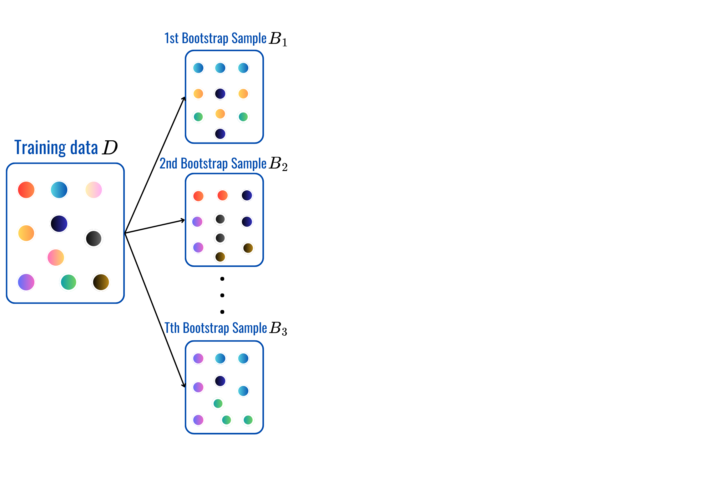
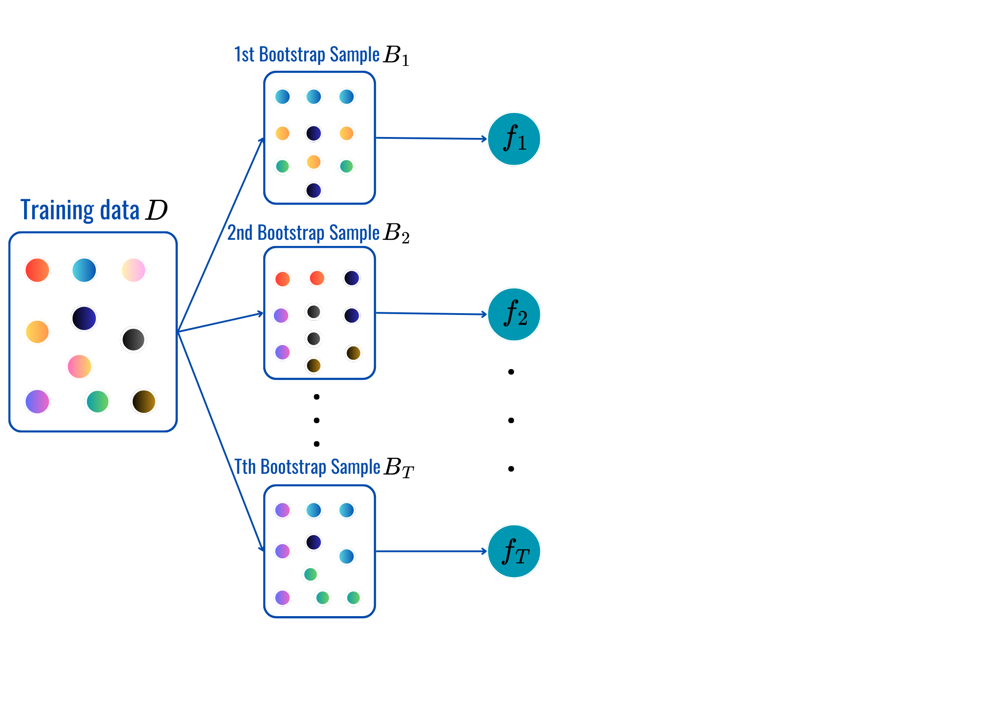
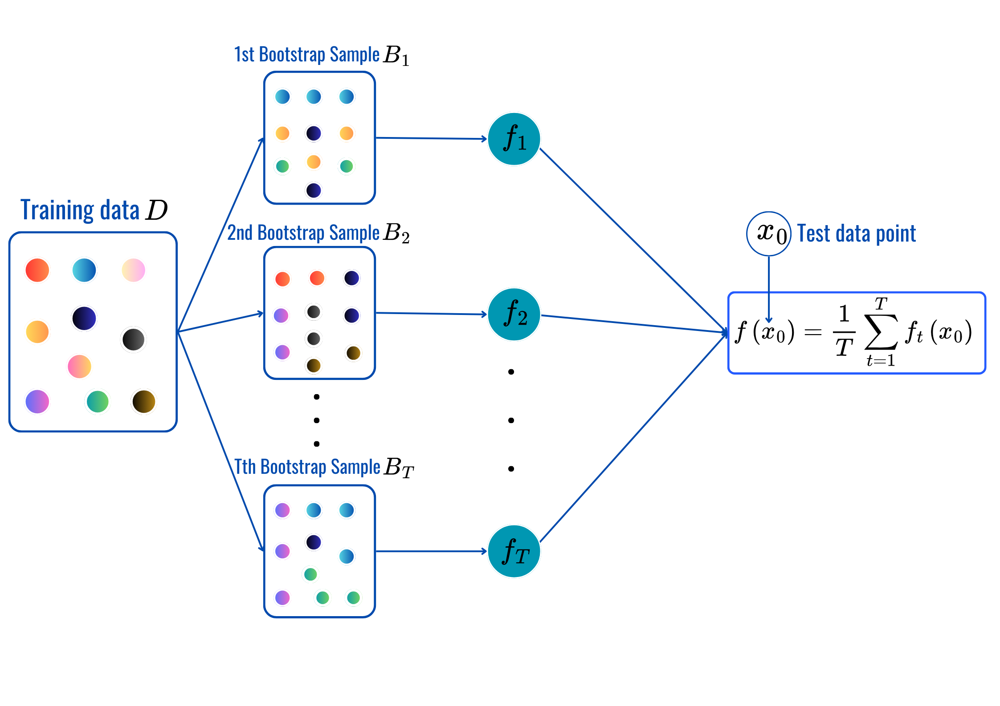
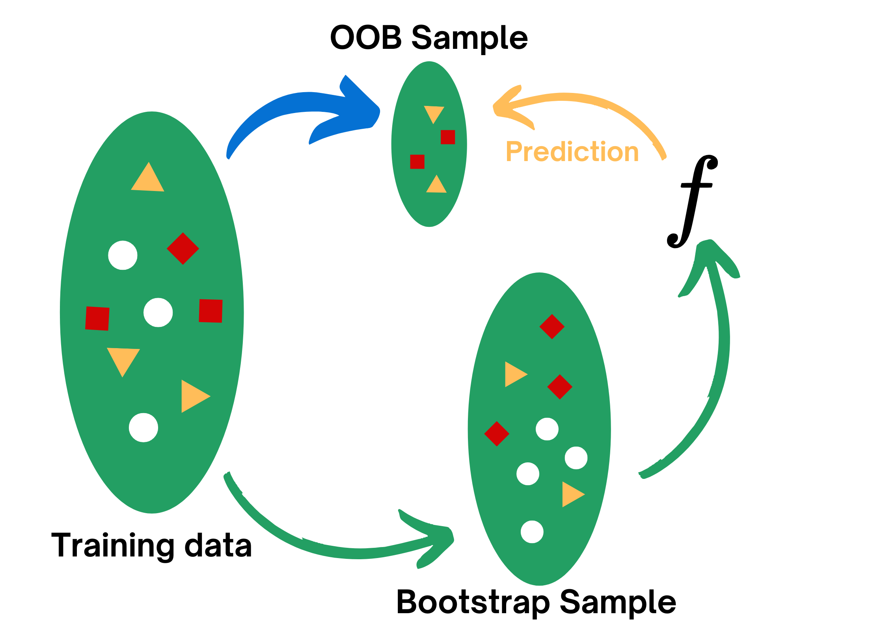
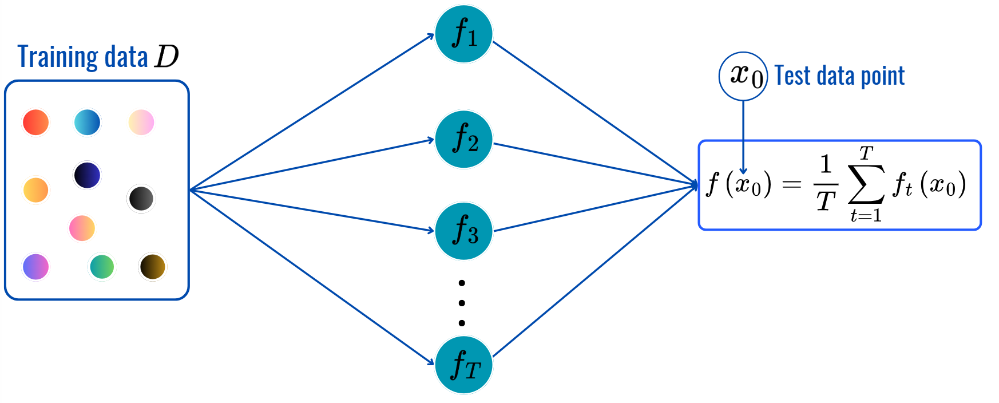
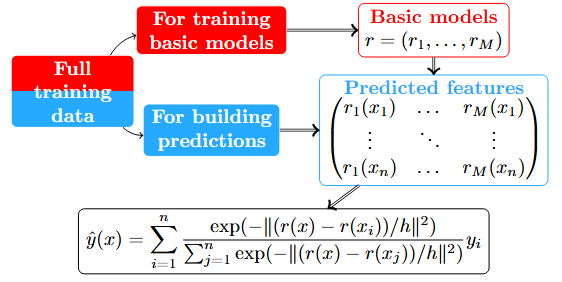
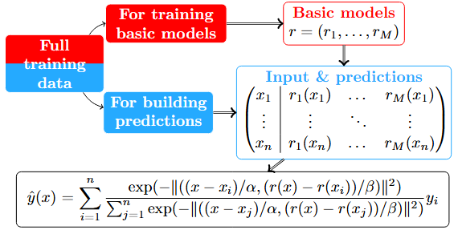
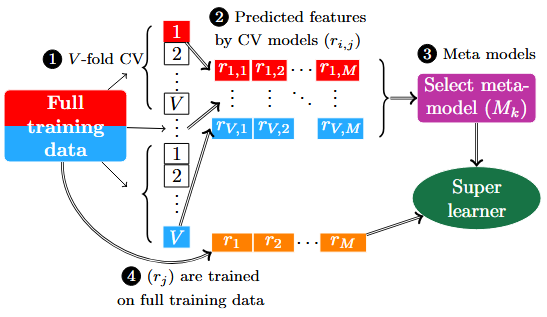

## 🗺️ Content

- [Motivation & Introducion]{.section .secbr} <br>

- [Bootstrap Aggregating: Bagging]{.section .secbr} <br>

- [Random Forest]{.section .secbr} <br>

- [Boosting: Adaboost & XGBoost]{.section .secbr} <br>

- [Concensual aggregation: Gradient COBRA]{.section .secbr} <br>

# Motivation & Introducion {background-color="#345a8b"} 

## Motivation & Introducion {auto-animate="true"}
### Recap
:::{.incremental}
:::{style="font-size: 80%"}
- **Recap:**
    - [**Parametric models:**]{.light-blue}
        - Assume input-to-target relation: $X\rightarrow y$.
            - Linear regression: $\hat{y}=\color{blue}{\beta_0}+\color{blue}{\beta_1}\text{x}_1+\dots+\color{blue}{\beta_d}\text{x}_d$.
            - Logistic regression: $p(\color{blue}{Y=1}|\text{X}=\text{x})=\sigma(\color{blue}{\beta_0}+\sum_{j=1}^d\color{blue}{\beta_j}\text{x}_j)$.
    - [**Nonparametric models:**]{.light-red}
        - Do not assume any input-output form.
        - Predict based only on neigboring data.
            - $k$-Nearest Neighbors: neighbors are based on Euclidean distance.
            - Decision tree: neighbors are based on block/region.
- 🤔 What remains to be explored?
:::
:::

## Motivation & Introducion {auto-animate="true"}
### Motivation

:::{.incremental style="font-size: 80%"}
:::{.columns}
:::{.column width='60%'}
- Why do we trust a [**panel of judges**]{.light-blue} more than a [single judge]{.light-red} in competitions?

- In medicine, why do doctors often seek [second or third opinions]{.light-blue} for complex cases?

- Have you noticed that weather forecasts often give a [probability]{.light-blue} of rain rather than a [simple yes/no]{.light-red} prediction?

- Would the famous "[Wisdom of Crowds](https://en.wikipedia.org/wiki/The_Wisdom_of_Crowds){target="_blank"}" principle applies to machine learning?

- The keys idea of ensemble learning is [**combining multiple base models/learners to create a better/stronger one**]{.light-blue}.
:::
:::{.column width='40%' .fragment}
<br>

{fig-align="center"}
:::
:::
:::


## Motivation & Tools {auto-animate="true"}
### Main methods
:::{style='font-size:78%'}

{fig-align="center" width="500"}

<!--
- [**Ensemble Learning (EL):**]{.light-blue} Combining several based learners/models is possible thanks to different theories of
    - **Probability:** Bayesian, Law of Large Number, Conditional Probability...
    - **Statistics:** Bias-variance trade-off, bootstrap theory...
    - **Computational Learning:** Probably Approximately Correct (PAC), Gradient-based optimization, and more...
-->

:::{.incremental}
- We're going to explore $3$ main EL methods:
    - [**Bagging:**]{.light-blue} Combine **nearly decorrelated [high-varianced models]{.light-red}**.

    - [**Boosting:**]{.light-blue} Sequentially combine [**weak learners**]{.light-blue} to create a strong final model.

    - [**Stacking:**]{.light-blue} Combination is based on the [**predicted features**]{.blue}.
:::
:::


<!--

- [**Bagging:**]{.light-blue} Combine **nearly decorrelated high-varianced models** to produce a more powerful final model with reduced variance.
- [**Boosting:**]{.light-blue} Sequentially combine **weak learners** to reduce bias and enhance predictive performance by iteratively focusing on the residual errors of previous models.
- [**Stacking:**]{.light-blue} Combination is based on the predicted features.

-->


# Bootstrap Aggregating: Bagging {background-color="#345a8b"} 

## [Bagging]{.blue}: [B]{.blue}ootstrap [Agg]{.blue}regat[ing]{.blue}
:::{style="font-size: 78%"}
:::{.columns}
:::{.column width="50%"}
### Purpose 

- Reduce variance of high-varianced base learners (trees) to produce a more stable and accurate final model.

::: {.fragment}
### Methodology

- **Bootstrap Sampling:** Generate multiple subsets of the training data by sampling with replacement.
:::
:::
:::{.column width="50%"}
:::{.fragment}
{width="60%" .absolute top="30%"}
:::
:::
:::
:::

## [Bagging]{.blue}: [B]{.blue}ootstrap [Agg]{.blue}regat[ing]{.blue}
:::{style="font-size: 78%"}
:::{.columns}
:::{.column width="50%"}
### Purpose 

- Reduce variance of high-varianced base learners (trees) to produce a more stable and accurate final model.

### Methodology

- **Bootstrap Sampling:** Generate multiple subsets of the training data by sampling with replacement.
- **Train Models:** Train a separate model (typically the same type) on each bootstrap sample.
:::
:::{.column width="50%"}
{width="60%" .absolute top="30%"}
:::
:::
:::

## [Bagging]{.blue}: [B]{.blue}ootstrap [Agg]{.blue}regat[ing]{.blue}
:::{style="font-size: 78%"}
:::{.columns}
:::{.column width="50%"}
### Purpose 

- Reduce variance of high-varianced base learners (trees) to produce a more stable and accurate final model.

### Methodology

- **Bootstrap Sampling:** Generate multiple subsets of the training data by sampling with replacement.
- **Train Models:** Train a separate model (typically the same type) on each bootstrap sample.
- **Aggregate Predictions:** Combine the predictions of all models by averaging (for regression) or majority voting (for classification).
:::
:::{.column width="50%"}
{width="60%" .absolute top="30%"}
:::
:::
:::

## [Bagging]{.blue}: [B]{.blue}ootstrap [Agg]{.blue}regat[ing]{.blue}
:::{style="font-size: 78%"}
:::{.columns}
:::{.column width="50%"}
### Purpose 

- Reduce variance of high-varianced base learners (trees) to produce a more stable and accurate final model.

### Methodology

- **Bootstrap Sampling:** Generate multiple subsets of the training data by sampling with replacement.
- **Train Models:** Train a separate model (typically the same type) on each bootstrap sample.
- **Aggregate Predictions:** Combine the predictions of all models by averaging (for regression) or majority voting (for classification).
:::
:::{.column width="50%"}
### Pseudocode
:::{style="font-size: 80%"}
- Number of trees: $T$
- `for t=1,...,T`:
    - **Sampling:** $B_t$ from training data $\cal D$.
    - **Training models:** $f_t$ on $B_t$
- **Predictions:**
    - [**Regression:**]{.light-blue}
        $$\begin{align*}\color{blue}{\hat{y}}&\color{blue}{=\frac{1}{T}\sum_{t=1}^Tf_t(x)}\\ &\color{blue}{=\text{Averaging.}}\end{align*}$$
    - [**Classification:**]{.light-red} $$\begin{align*}\color{red}{\hat{y}}&\color{red}{=\arg\max_{1\leq k\leq M}\sum_{t=1}^T\mathbb{1}_{\{f_t(x)=k\}}}\\ &\color{red}{=\text{Majority vote.}}\end{align*}$$
:::
:::
:::
:::

## [Bagging]{.blue}: [B]{.blue}ootstrap [Agg]{.blue}regat[ing]{.blue}
### Why does it work?
:::{style="font-size:60%" .sbr}
- **Bias-variance trade-off:** Assuming $y_i=f(\text{x}_i)+\varepsilon_i$ where $\varepsilon_i\overset{iid}{\sim}{\cal N}(0,\sigma^2)$, then for any model $\hat{f}$ built using training data $\cal D$, we can decompose **MSE** of $\hat{f}$ at any fixed input $\text{x}_0$ as
$$\begin{align*}
\mathbb{E}_{\cal D}[(\hat{f}(\text{x}_0)-y_0)^2]&=\mathbb{E}_{\cal D}[(\hat{f}(\text{x}_0)-\mathbb{E}[\hat{f}(\text{x}_0)])^2] + \mathbb{E}_{\cal D}[(\mathbb{E}[\hat{f}(\text{x}_0)]-f(\text{x}_0))^2] + \sigma^2\\
&=\underbrace{\mathbb{V}(\hat{f}(\text{x}_0))}_{\color{blue}{\text{Flexibility of }\hat{f}}}+\underbrace{(\text{Bias})^2}_{\color{darkgreen}{\text{How far }\hat{f}\text{ from } f}}+\underbrace{\sigma^2}_{\color{red}{\text{Uncontrollable Term}}}.
\end{align*}$$

:::{.fragment .up2}
```{python}
#| fig-align: 'center'

import numpy as np
import pandas as pd
import plotly.graph_objs as go
import plotly.express as px
from sklearn.preprocessing import PolynomialFeatures
from sklearn.linear_model import LinearRegression
n = 10
t = 15
np.random.seed(42)
x0 = np.random.uniform(-2,2,size=(n+t,1))
y0 = 1 - x0.reshape(-1) + 0.5*x0.reshape(-1) ** 3 + np.random.normal(size=n+t)
x_tr, y_tr, x_te, y_te = x0[:-t,:], y0[:-t], x0[n:,:], y0[n:]
id_sort = np.argsort(x_tr.reshape(-1))
fig = go.Figure(go.Scatter(
    x=x_tr.reshape(-1), y=y_tr, name="Train Data", 
    mode="markers", marker=dict(size=10)))
fig.add_trace(go.Scatter(
    x= x_tr.reshape(-1)[id_sort], y=1 - x0.reshape(-1)[:-t][id_sort] + 0.5*x0.reshape(-1)[:-t][id_sort] ** 3, name="True relation", 
    mode="lines", line=dict(dash="dash", color="black"), visible="legendonly",))
fig.add_trace(go.Scatter(
    x=x_te.reshape(-1), y=y_te, name="Test data",
    mode="markers", marker=dict(size=12, color='#29b058', symbol='star')))

degree = np.arange(1,11)
frames = []

for i, deg in enumerate(degree):
    poly = PolynomialFeatures(deg)
    X_poly = poly.fit_transform(x_tr)
    lm = LinearRegression().fit(X_poly, y_tr)
    y_hat = lm.predict(X_poly)
    var = np.var(y_hat)
    bias = np.mean((lm.predict(poly.transform(x_te)) - y_te) ** 2)
    if i == 0:
        var0, bias0 = var, bias
    frames.append(go.Frame(
        data=[fig.data[0],
              fig.data[1],
              fig.data[2],
              go.Scatter(
                x=x_tr.reshape(-1)[id_sort],
                y=y_hat[id_sort],
                name=f'Var + Bias = {np.round(var,2)} + {np.round(bias,2)} = {np.round(var+bias,2)}',
                line=dict(color="red"))],
        name=f'{deg}'))
lm = LinearRegression().fit(x_tr, y_tr)
y_hat = lm.predict(x_tr)
fig1 = go.Figure(
    data=[
        fig.data[0],
        fig.data[1],
        fig.data[2],
        go.Scatter(
            x=x_tr.reshape(-1)[id_sort],
            y=y_hat[id_sort],
            name=f'Var + Bias = {np.round(var0,2)} + {np.round(bias0,2)} = {np.round(var0+bias0,2)}',
            line=dict(color="red"))],
    layout=go.Layout(
        title="Regression data",
        xaxis=dict(title="x"),
        yaxis=dict(title="y"),
        updatemenus=[{
            "buttons": [
                {
                    "args": [None, {"frame": {"duration": 800, "redraw": True}, "fromcurrent": True, "mode": "immediate"}],
                    "label": "Play",
                    "method": "animate"
                },
                {
                    "args": [[None], {"frame": {"duration": 0, "redraw": False}, "mode": "immediate"}],
                    "label": "Stop",
                    "method": "animate"
                }
            ],
            "type": "buttons",
            "showactive": False,
            "x": -0.1,
            "y": 1.25,
            "pad": {"r": 10, "t": 50}
        }],
        sliders=[{
            "active": 0,
            "currentvalue": {"prefix": "Degree: "},
            "pad": {"t": 50},
            "x": 1.05, # Move to the right 
            "xanchor": "left", # Anchor to the left 
            "y": 0.5, # Center vertically 
            "yanchor": "middle", # Anchor in the middle 
            "len": 0.6, # Adjust the length of the slider 
           # "orientation": "v", # Set orientation to vertical
            "steps": [{"label": f"{deg}",
                       "method": "animate",
                       "args": [[f'{deg}'], {"frame": {"duration": 800, "redraw": True}, "mode": "immediate", 
                       "transition": {"duration": 0}}]}
                      for i, deg in enumerate(degree)]
        }]
    ),
    frames=frames
)

fig1.update_layout(height=300, width=1000)

fig1.show()

```
:::

<!--
:::{.fragment}
<iframe src="https://www.desmos.com/calculator/9qyz8huu8y" width="1000" height="250" style="border: 1px solid #ccc" frameborder=0></iframe>
:::
-->

:::

## [Bagging]{.blue}: [B]{.blue}ootstrap [Agg]{.blue}regat[ing]{.blue}
### Why does it work?
:::{style="font-size:68%" .sbr .incremental}
- **Bias-variance trade-off:** Assuming $y_i=f(\text{x}_i)+\varepsilon_i$ where $\varepsilon_i\overset{iid}{\sim}{\cal N}(0,\sigma^2)$, then for any model $\hat{f}$ built using training data $\cal D$, we can decompose **MSE** of $\hat{f}$ at any fixed input $\text{x}_0$ as
[$$\begin{align*}
\mathbb{E}_{\cal D}[(\hat{f}(\text{x}_0)-y_0)^2]&=\mathbb{E}_{\cal D}[(\hat{f}(\text{x}_0)-\mathbb{E}[\hat{f}(\text{x}_0)])^2] + \mathbb{E}_{\cal D}[(\mathbb{E}[\hat{f}(\text{x}_0)]-f(\text{x}_0))^2] + \sigma^2\\
&=\underbrace{\mathbb{V}(\hat{f}(\text{x}_0))}_{\color{blue}{\text{Flexibility of }\hat{f}}}+\underbrace{(\text{Bias})^2}_{\color{darkgreen}{\text{How far }\hat{f}\text{ from } f}}+\underbrace{\sigma^2}_{\color{red}{\text{Uncontrollable Term}}}.
\end{align*}$$]{style="font-size: 95%" .fragment}

- **Begging:** seeks to balance these terms by averaging [**nearly independent high-varianced models**]{.light-blue} to reduce more stable predictive model.

- $^{\color{blue}{1}}$If $\color{blue}{\hat{f}(\text{x}_0)=\frac{1}{T}\sum_{t=1}^Tf_t(\text{x})}$ then $\mathbb{E}_{\cal D}\left[\color{blue}{(\hat{f}(\text{x}_0)-y_0)^2}\right]\leq \min_{1\leq t\leq T}\mathbb{E}_{\cal D}\left[\color{red}{(f_t(\text{x}_0)-y_0)^2}\right].$

:::{.fragment .up2}
- **Bagging** is suitable with
    - High-varianced models: deep trees, $K$-NN with small $K$...
    - Simplicity and scalability...

:::{.hline .fragment .br10}
[$^{\color{blue}{1}}$Bagging predictors, Breiman L. (1996)](https://link.springer.com/article/10.1007/BF00058655){target='_blank'}
:::
:::


<!--

https://www.stat.cmu.edu/~larry/=sml/Boot.pdf

:::{.fragment}
<iframe src="https://www.desmos.com/calculator/9qyz8huu8y" width="1000" height="250" style="border: 1px solid #ccc" frameborder=0></iframe>
:::
-->

:::

# Random Forest {background-color="#345a8b"}

## [Bagging]{.blue}: [B]{.blue}ootstrap [Agg]{.blue}regat[ing]{.blue}
### Random Forest
:::{style="font-size: 80%"}
- In practice, **Bagging** doesn't work so well as the base learners (trees) are not as *decorrelated* as expected (due to correlated bootstrap samples).

:::{.r-stack .br20}
:::{.fragment .incremental .up5}
- [**Random Forest:** (What a cool name! 😎)]{.blue}
    - Number of trees: $T$
    - `for t = 1,2,...,T:`
        - **Bootstrap sampling**: sample $B_t$ with replacement from $\cal D$.
        - [**Random Features:**]{.light-red} select subset $S_t$ from full $d$ input features.
        - **Build** tree $f_t$ on $B_t$ using only features from $S_t$.
    - `Prediction`: (same as before).

- It works well as [**Random Features**]{.light-red} part introduces even more randomness on top of **bootstrap sampling**.
:::
:::{.fragment}
{fig-align="center"}
:::
:::
:::


## [Bagging]{.blue}: [B]{.blue}ootstrap [Agg]{.blue}regat[ing]{.blue}
### Have fun at 👉 [Random Forest Playground](https://nlhlong01.github.io/playground/#dataset=circle&regDataset=reg-plane&noise=0&seed=0.73879&showTestData=false&discretize=false&percTrainData=70&problem=classification&percSamples=80&nTrees=100&maxDepth=5){target='_blank'}

<iframe src="https://nlhlong01.github.io/playground/#dataset=circle&regDataset=reg-plane&noise=0&seed=0.73879&showTestData=false&discretize=false&percTrainData=70&problem=classification&percSamples=80&nTrees=100&maxDepth=5" width="100%" height="550" style="border:1px solid black;">
</iframe>


## [Bagging]{.blue}: [B]{.blue}ootstrap [Agg]{.blue}regat[ing]{.blue}
### Cool things in bagging/ random forest
#### Out-Of-Bag (OOB) Error
:::{style="font-size: 75%" .incremental}
:::{.columns}
:::{.column width="40%"}


- For each bootstrap sample $B_t$, $\text{x}_O\notin B_t$ are called **Out-Of-Bag** samples ($\approx 37\%$).
:::
:::{.column width="60%"}
- [**Tree's OOB Error:**]{.green} The average error for a tree, calculated using its **out-of-bag samples**.
- [**OOB Sample Error:**]{.orange} The average error for a given observation, computed from all trees whose bootstrap samples did not include that observation.
- [**Overall or Average OOB Error:**]{.light-red} The average of all [**OOB Sample Errors**]{.orange}, providing an overall measure of the model's performance.
- The [**Overall OOB Error**]{.light-red} can be used as an approximation of cross-validation error. However, it tends to overestimate the true error in classification according to [Silke Janitza and Roman Hornung (2018)](https://journals.plos.org/plosone/article?id=10.1371/journal.pone.0201904){target="_blank"}.
:::
:::
:::

## [Bagging]{.blue}: [B]{.blue}ootstrap [Agg]{.blue}regat[ing]{.blue}
### Cool things in bagging/ random forest
#### Feature Importances (FI)
:::{style="font-size: 67%" .incremental}
:::{.columns}
:::{.column width="60%"}
#### Mean Decrease in Impurity (MDI)
- The [**R**]{.light-blue}eduction of [**I**]{.light-blue}mpurity [**M**]{.light-blue}easures when spliting at $X_j$ is denoted by $$\color{blue}{\text{RIM}}_t(X_j)=\text{Imp}_{t-1}(X_j)-\text{Imp}_t(X_j).$$
- The importance of feature $X_j$ within a tree: $\sum_{t\in S_j}\color{blue}{\text{RIM}_t(X_j)},$ where $S_j$ is the set of indices $t$ when a split is performed at $X_j$.
- Unnormaized [**MDI**]{.light-blue} of variable $X_j$ is the sum of **FIs** from all the built trees.
- ⚠️ Might be biased toward high cardinality features and might not be accurate with highly correlated features.
:::
:::{.column width='40%' .fragment}
<br><br><br>

{fig-align='center'}

:::
:::
:::

## [Bagging]{.blue}: [B]{.blue}ootstrap [Agg]{.blue}regat[ing]{.blue} {visibility='uncount'}
### Cool things in bagging/ random forest
#### Feature Importances (FI)
:::{style="font-size: 67%"}
:::{.columns}
:::{.column width="60%"}
#### Mean Decrease in Impurity (MDI)
- The [**R**]{.light-blue}eduction of [**I**]{.light-blue}mpurity [**M**]{.light-blue}easures when spliting at $X_j$ is denoted by $$\color{blue}{\text{RIM}}_t(X_j)=\text{Imp}_{t-1}(X_j)-\text{Imp}_t(X_j).$$
- The importance of feature $X_j$ within a tree: $\sum_{t\in S_j}\color{blue}{\text{RIM}_t(X_j)},$ where $S_j$ is the set of indices $t$ when a split is performed at $X_j$.
- Unnormaized [**MDI**]{.light-blue} of variable $X_j$ is the sum of **FIs** from all the built trees.
- ⚠️ Might be biased toward high cardinality features and might not be accurate with highly correlated features.
:::
:::{.column width='40%' .incremental}
#### Permutation Feature Importance
- Train initial random forest model, then compute validation error denoted by $\color{red}{\text{Er}_0}$
- For each $X_j$, shuffle its values in the dataset, then trains and measures validation error $\color{red}{\text{Er}_j}$.
- The [**PFI**]{.light-blue} for $X_j$ is proportional to $\color{red}{\text{Er}_0-\text{Er}_j}$.
- It reflexes more direct influence of each feature in the model.
- ⚠️ Might be sensitive to data splits and a bit computationally expensive.
:::
:::
:::

## [Bagging]{.blue}: [B]{.blue}ootstrap [Agg]{.blue}regat[ing]{.blue}
### Extremely Randomized Trees (Extra-trees)
:::{style="font-size: 70%" .incremental}
- Number of trees: $T$
- `for t = 1,2,...,T:`
    - **Build tree:** $f_t$ is built on the **Full dataset** but a bit differently. At each split,
        - [**Random Features:**]{.light-blue} A random subset $S_t$ of the full input features is considered.
        - [**Random Split Points:**]{.light-red} Random points $\{a_1,\dots,a_p\}$ is considered at each split.
- **Prediction:** (same as before).

{width="650" fig-align="center" .fragment}

:::

## [Bagging]{.blue}: [B]{.blue}ootstrap [Agg]{.blue}regat[ing]{.blue}
### Numerical experiment
:::{style="font-size: 70%"}
- Let's consider [Kaggle Abalone Dataset](https://www.kaggle.com/datasets/rodolfomendes/abalone-dataset){target='_blank'} of shape: $4177\times 9$.

```{python}
import kagglehub
path = kagglehub.dataset_download('rodolfomendes/abalone-dataset')
import pandas as pd

data = pd.read_csv(path + '/abalone.csv')
data.head()
```

<br>

:::{.r-fit-text}
👉 Check out the [notebook](https://colab.research.google.com/drive/1d2Ko600ynHuxhhKgZOTJ7wonVOfBA_Br?usp=sharing){target="_blank"}.
:::
:::


```{python}
#| eval: false
import pandas as pd
data = pd.read_csv(path + "/healthcare-dataset-stroke-data.csv")
data = data.drop(columns=['id'])
quan_col = ["age", "avg_glucose_level", "bmi"]
for va in data.columns:
    if va not in quan_col + ['stroke']:
        data[va] = data[va].astype(object)
data.head()
```

# Boosting: Adaboost & XGBoost {background-color="#345a8b"}

## Boosting
### General framework
:::{style="sont-size: 80%" .incremental}
- **Boosting** combines **weak learners** (models that perform a bit better than random guess: [**trees**]{.green} with a few splits called **stumps**) to create a strong model, firstly introduce by [Robert E. Schapire (1990)](https://link.springer.com/article/10.1007/BF00116037){target="_blank"}.
- **Main framework:** Sequentially train a new weak learner to **correct mispredicted points** of the previous learners. The resulting model is the weighted average of all the trained learners.
- **Form:** $\color{blue}{\hat{f}(x)=\sum_{t=1}^Tw_tf_t(x)}$ where $\color{blue}{f_t}$ are weak learners built on updated data $\color{blue}{D_t}$.
- It focuses more on improving bias than the variance.
:::

## Boosting {auto-animate="true"}
### Algorithm
:::{style="sont-size: 75%"}
- Number of trees: $T$
- `for t = 1, 2,..., T`:
    - **Build weak learner** $f_t$ by minimizing error $\varepsilon_t$.
    - **Learn and ajust weights:** 
        - Compute **learner weight** $w_t>0$ computed based on weighted data with weight $\{D_t(i):i=1,\dots,n\}$.
        - Compute **sample weight** $D_t(i)\to D_{t+1}(i)$ for obs $i$.
- Combined model: $\color{blue}{\hat{f}(x)=\sum_{t=1}^Tw_tf_t(x)}$.
:::

## Boosting {auto-animate="true"}
### Algorithm
:::{style="sont-size: 75%"}
- Combined model: $\color{blue}{\hat{f}(x)=\sum_{t=1}^Tw_tf_t(x)}$.

:::{.r-stack}
{.fragment height="400" fig-align="center"}

{.fragment height="400" fig-align="center"}

{.fragment height="400" fig-align="center"}

{.fragment height="400" fig-align="center"}

{.fragment height="400" fig-align="center"}
:::
:::

## Boosting {auto-animate="true"}
### [Adaboost]{.blue}: [Ada]{.blue}ptive [Boost]{.blue}ing
:::{style="font-size: 75%" .up1 .incremental}
- It's for binary classification with $(\text{x}_i,y_i)\in\mathbb{R}^d\times\{-1,1\},i=1,\dots,n$.
- Initialize the [**sample weight**]{.purple}: $\color{purple}{D_1(i)=1/n}$ for all data point $\text{x}_i$.
- `for t = 1, . . . , T:`
    - Train the base classifier $\color{blue}{f_t}$ by minimizing [$$\color{red}{\varepsilon_t}=\mathbb{P}(\color{blue}{f_t}(X)\neq Y)=\sum_{i=1}^n\color{purple}{D_t(i)}\mathbb{1}_{\{\color{blue}{f_t}(\text{x}_i)\neq y_i\}}.$$]{.br20}
    - Calculate the [**learner weight**]{.light-blue}:  $\color{blue}{w_t}=\frac{1}{2}\ln\left(\frac{1-\color{red}{\varepsilon_t}}{\color{red}{\varepsilon_t}}\right).$
    - Update the [**sample weight**]{.purple} using $\color{purple}{D_{t+1}}=\frac{\color{purple}{D_t(i)}}{Z_t}e^{\color{blue}{-w_t}y_i\color{blue}{f_t}(\text{x}_i)}$ where $Z_t$ is the normalized constant.
- **The final model**: $\color{blue}{\hat{f}}(\text{x}_0)=\text{sign}(\color{blue}{\sum_{t=1}^Tw_tf_t}(\text{x}_0))$. (**Read:** [Freund & Schapire (1999)](https://cseweb.ucsd.edu/~yfreund/papers/IntroToBoosting.pdf){target="_blank" style="font-size:90%"})
:::

## Boosting {auto-animate="true"}
### [XGBoost]{.blue}: E[X]{.blue}treme [G]{.blue}radient [Boost]{.blue}ing
:::{style="font-size: 70%" .sbr .incremental}
:::{.columns}
:::{.column width="80%"}
- It's a special case of [**Gradient Boosting**](https://arxiv.org/abs/1908.06951){target='_blank'}: $F_M(\text{x})=\sum_{t=1}^Mw_tf_t(\text{x})$.
- Let $L$ be the loss function of the problem:
    - Initial model: $F_0=\arg\min_{c}\sum_{i=1}^nL(y_i,c).$
    - `for t = 1, 2, ..., M:`
        - Compute false residuals: $r_{t,i}=\frac{\partial L(y_i,f(\text{x}))}{\partial f(\text{x})}\Big|_{f(\text{x})=f_{t-1}(\text{x}_i)}$.
        - Train a base learner on the new data: $\{(\text{x}_i,y_i),r_{t,i}\}.$
        - Solve for $\color{blue}{f_t}$ and $\color{blue}{w_t}$ from: $$(\color{blue}{w_t}, \color{blue}{f_t(\text{x})})=\arg\min_{\color{blue}{w,f}}\sum_{i=1}^nL(y_i,F_{t-1}(\text{x}_i)+\color{blue}{wf(\text{x}_i)}).$$
        - [**Update the model:**]{.light-blue} $F_t(\text{x})=F_{t-1}(\text{x})+\color{blue}{w_tf_t(\text{x})}$.
:::
:::{.column width="20%"}
- In XGBoost:

:::{style="font-size: 50%" .fragment}
$$\begin{align*}L(F_t)&=\sum_{i=1}^nL(y_i,F_t(\text{X}_i))+\sum_{m=1}^t\Omega(f_m)\\
\Omega(f_t)&=\gamma T+\frac{1}{2}\lambda\|w\|^2.\\
L(F_t)&\approx \sum_{i=1}^n[g_iF_t(\text{x}_i)+\frac{1}{2}h_iF_t^2(\text{x}_i)]+\Omega(F_t),\\
g_i&=\frac{\partial L(y_i,F_t(\text{x}))}{\partial F_t(\text{x})}\|_{F_t(\text{x})=F_t(\text{x}_i)}\\
h_i&=\frac{\partial^2 L(y_i,F_t(\text{x}))}{\partial F_t(\text{x})^2}\|_{F_t(\text{x})=F_t(\text{x}_i)}.
\end{align*}$$

:::{.hline}
Read [Chen & Guestrin (1999)](https://www.kdd.org/kdd2016/papers/files/rfp0697-chenAemb.pdf){target="_blank"}
:::
:::
:::
:::
:::


## Boosting {auto-animate="true"}
### Have fun at 👉 [Gradient Boosting Playground](https://arogozhnikov.github.io/2016/07/05/gradient_boosting_playground.html){target='_blank'}

<iframe src="https://arogozhnikov.github.io/2016/07/05/gradient_boosting_playground.html" width="100%" height="550" style="border:1px solid black;">
</iframe>

## Boosting {auto-animate="true"}
### Other variants
- **LightGBM**: Light Gradient Boosting Machine by [researchers at  Microsof (2017)](https://proceedings.neurips.cc/paper_files/paper/2017/file/6449f44a102fde848669bdd9eb6b76fa-Paper.pdf){target='_blank'}. It works for regression, classification and ranking problems. Main improvement:
    - Gradient-based One-Sided Sampling (GOSS)
    - Exclusive Feature Bundling (EFB),

:::{.sbr}
:::

to ensure the efficiency and accuracy of the method.

- **CatBoost:** Efficient with categorical features (auto transformation) and unbiased estimation of gradient at each iteration (see: [Prokhorenkova et al. (2017)](https://proceedings.neurips.cc/paper_files/paper/2018/file/14491b756b3a51daac41c24863285549-Paper.pdf){target='_blank'}).

## Boosting {auto-animate="true"}
### Numerical Experiment: Abalone Dataset

<br>
<br>
<br>

:::{.r-fit-text}
👉 Check out the [notebook](https://colab.research.google.com/drive/1d2Ko600ynHuxhhKgZOTJ7wonVOfBA_Br?usp=sharing){target="_blank"}.
:::

# Stacking: Consensual Aggregation {background-color="#345a8b"}

## Stacking: Consensual Aggregation {auto-animate="true"}
### General framework

:::{.incremental style='font-size: 80%'}
- **Stacking: Consensual Aggregation** combines $M$ base learners $f_1,\dots,f_M$ based on how "**close**" the predictions given by these learners are.
-  Roughly speaking, it's the nonparametric methods on predicted features: $$\color{red}{\tilde{\text{x}}=(f_1(\text{x}),\dots,f_m(\text{x}))}.$$
- **General form:** $\hat{y}=\sum_{i=1}^nW_{n,i}(\color{red}{\tilde{\text{x}}})y_i$

:::{.fragment .up2}
{fig-align='center' width='500'}
:::
:::

## Stacking: Consensual Aggregation {auto-animate="true"}
### Concensual Classifier: [Mojirsheibani (1999)](https://www.tandfonline.com/doi/abs/10.1080/01621459.1999.10474154){target='_blank'}
:::{style="font-size: 80%"}
- Suppose we have 3 binary classifiers: $C=(C_1, C_2, C_3)$ with training data:

| Id | $C_1$ | $C_2$ | $C_3$ | $Y$ |
|:---:|:----:|:-----:|:-----:|:---:|
| 1  | $0$ | $1$ | $1$ | $1$ |
| 2  | **1** | **1** | **0** | $\color{blue}{1}$ |
| 3  | $0$ | $0$ | $0$ | $0$ |
| 4  | **1** | **1** | **0** | $\color{blue}{1}$ |
| 5  | **1** | **1** | **0** | $\color{red}{0}$ |
| $\text{x}$ | **1** | **1** | **0** | $?$ |

:::{.fragment}
- Majority class among data points with the same predictions as the prediction of $\text{x}:\hat{y}=1$.
:::
:::

## Stacking: Consensual Aggregation {auto-animate="true"}
### COBRA by [Beau et al. (2016)](https://www.sciencedirect.com/science/article/pii/S0047259X15000950){target="_blank"} <br>Gradient COBRA by [Has (2023)](https://jdssv.org/index.php/jdssv/article/view/70/45){target="_blank"}
:::{style="font-size: 80%" .incremental}
:::{.columns}
:::{.column width="50%"}
- Given base regressors: ${\bf r}=(r_1,\dots,r_M)$, the combination takes the form:
$$\hat{y}=\sum_{i=1}^nW_{n,i}(\text{x})y_i.$$
:::
:::{.column width="50%" .fragment}

:::{data-id="kcobra"}

:::
:::
:::
- Training such a model is equivalent to finding an optimal smoothing parameter $\color{blue}{h}$ minimizing cross-validation error:

:::{style="font-size: 80%" .br30 .fragment}
$$\varphi(\color{blue}{h})=\frac{1}{K}\sum_{k=1}^K\sum_{(\text{x}_i,y_i)\in F_j}(\hat{y}_i-y_i)^2.$$
:::
:::

## Stacking: Consensual Aggregation
### COBRA by [Beau et al. (2016)](https://www.sciencedirect.com/science/article/pii/S0047259X15000950){target="_blank"} <br>Gradient COBRA by [Has (2023)](https://jdssv.org/index.php/jdssv/article/view/70/45){target="_blank"}

:::{data-id="kcobra"}
{width="700" fig-align="center"}

:::{.br30 .frgament}
- Python package available at [{width='30pt' style='position: relative; bottom: -20px'} Gradient Cobra Library](https://pypi.org/project/gradientcobra/){target='_blank'}.
:::
:::

<!--

## Consensual Aggregation {auto-animate="true"}
### MixCOBRA by [Fischer & Mougeot (2019)](https://www.sciencedirect.com/science/article/abs/pii/S0378375818302349){target="_blank"}
:::{style="font-size: 80%"}
:::{.columns}
:::{.column width="50%"}
- Given base regressors: ${\bf r}=(r_1,\dots,r_M)$, the combination takes the form:
$$\hat{y}=\sum_{i=1}^nW_{n,i}(\text{x})y_i.$$
:::
:::{.column width="50%"}
:::{data-id="mix"}
{fig-align="center"}
:::
:::
:::
- In this case, we seek for parameter $(\alpha,\beta)$ minimizing cross-validation error:

:::{style="font-size: 80%" .sbr}
$$\varphi(\alpha,\beta)=\frac{1}{K}\sum_{k=1}^K\sum_{(\text{x}_i,y_i)\in F_j}(\hat{y}_i-y_i)^2.$$
:::
:::

## Stacking: Consensual Aggregation {auto-animate="true"}
### MixCOBRA by [Fischer & Mougeot (2019)](https://www.sciencedirect.com/science/article/abs/pii/S0378375818302349){target="_blank"}
:::{style="font-size: 80%"}
:::{data-id="mix"}
{width="800" fig-align="center"}
:::
:::

-->

## Stacking: Consensual Aggregation {auto-animate="true"}
### Numerical Experiment: Abalone Dataset

<br>
<br>
<br>

:::{.r-fit-text}
👉 Check out the [notebook](https://colab.research.google.com/drive/1d2Ko600ynHuxhhKgZOTJ7wonVOfBA_Br?usp=sharing){target="_blank"}.
:::

<!--

## Stacking {auto-animate="true"}
### General framework
- **Stacking** stands on the idea that given $M$ base learners $f_1,\dots,f_M$, the predicted features $\widehat{\text{x}}_i=(f_1(\text{x}_i),\dots,f_M(\text{x}_i))$ are **close** to the target $y_i$.
-  **Goal:** using these features: $\hat{x}_i$ to predict $y_i$.
- **Meta-models:** trained based on $\widehat{\text{x}}_i$ to predict $y_i$.

$$\text{x}_i\overset{f_1,\dots,f_M}{\mapsto}\color{red}{\widehat{\text{x}_i}=(f_1(\text{x}_i),\dots,f_M(\text{x}_i))}\overset{\text{Meta-learner }f}{\mapsto} \hat{y}_i=f(\color{red}{\widehat{x}_i}).$$

## Stacking {auto-animate="true"}
### Super Learner by [M. J. Van der Laan (2007)](https://www.degruyter.com/document/doi/10.2202/1544-6115.1309/html){target='_blank'}
- It can be used for both: classification and regression.

{width="600" fig-align="center"}


## Stacking {auto-animate="true"}
### Numerical Experiment: Abalone Dataset
<br>
<br>
<br>

:::{.r-fit-text}
👉 Check out the [notebook](https://colab.research.google.com/drive/1d2Ko600ynHuxhhKgZOTJ7wonVOfBA_Br?usp=sharing){target="_blank"}.
:::

-->

## Stacking: Consensual Aggregation {auto-animate="true"}
### Summary
:::{.incremental}
- **Ensemble learning:** combine base learners to create a stronger predictor.

- **Bagging:** Combines [**high-varianced base learners (trees)**]{.light-blue} to produce a more stable and accurate final model.

- **Boosting:** Sequentially combines [**weak learners**]{.light-red} aiming at correcting mistakes made by the previous built combined learners to create a strong model.

- **Stacking: Consensual Aggregation:** Combine different learners using the [**consensuses**]{.light-blue} of their [**predicted features**]{.light-blue}.
:::

:::{.center}

## 🥳 Yeahhhh....  {background-image="https://hassothea.github.io/Data_Analysis_AUPP/Slides/img/end_page.jpg" background-opacity="0.3"}

<br>
<br>
<br>
<br>
<br>
<br>
<br>
<br>

### Let's Party... 🥂
:::

