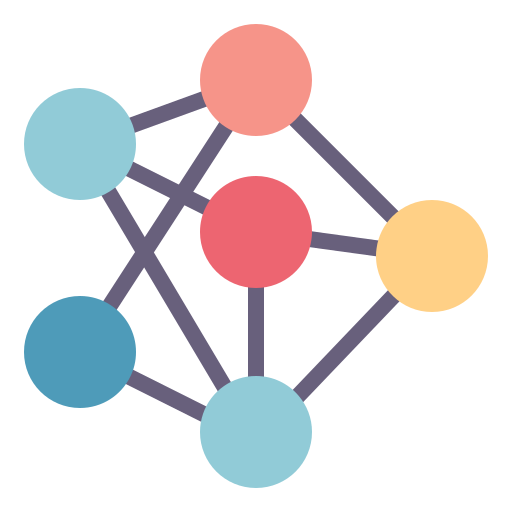
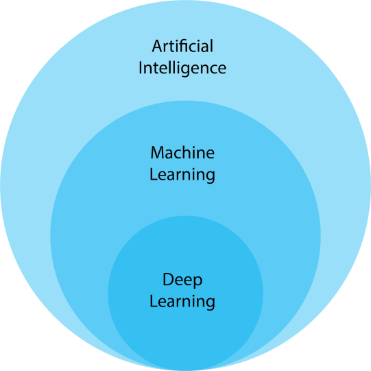
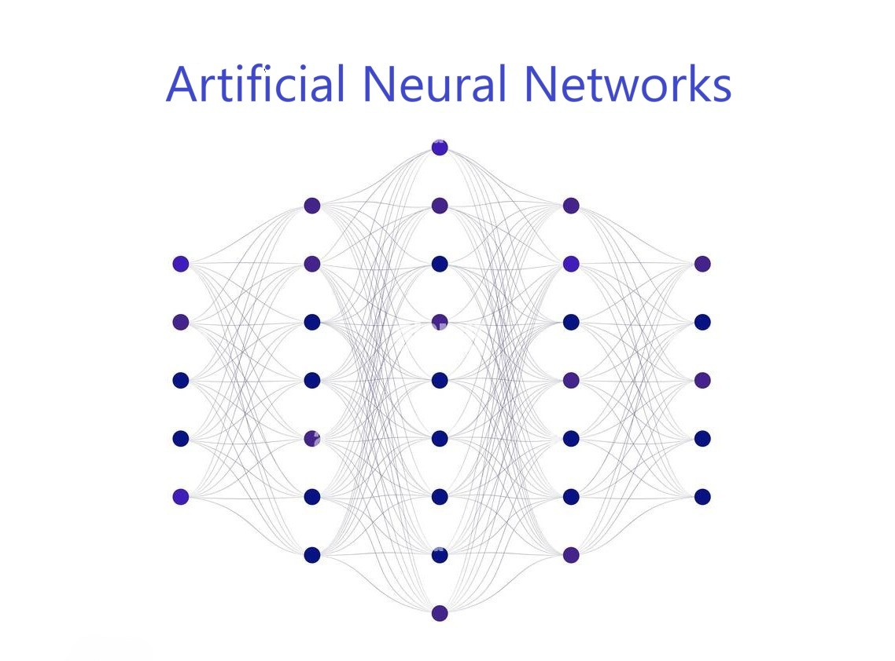
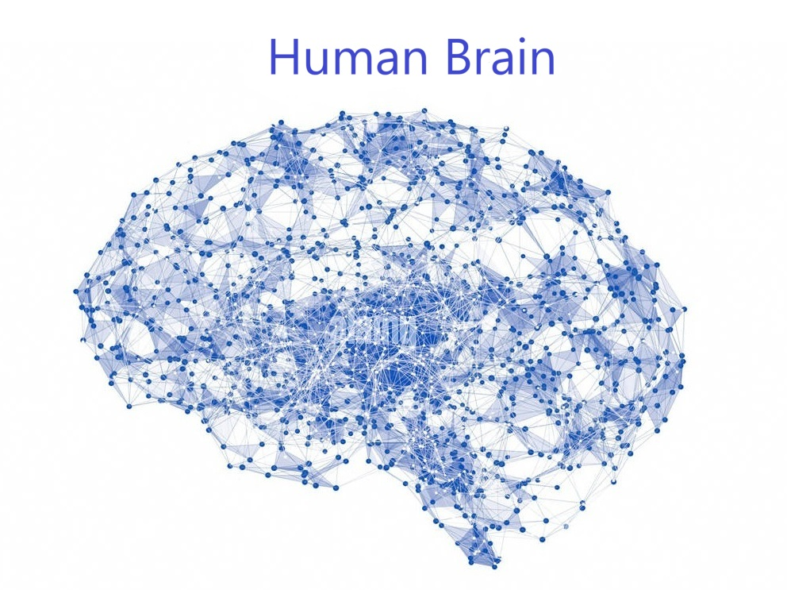
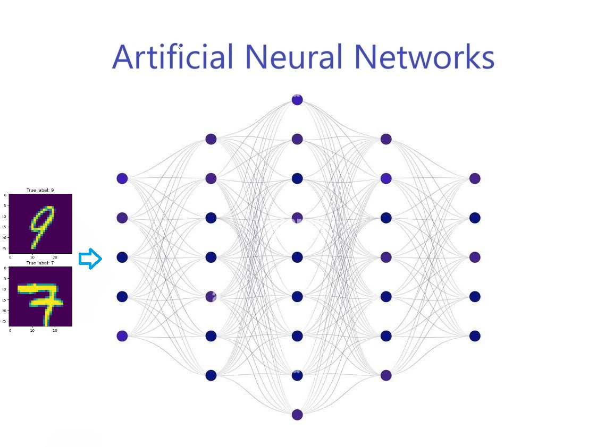
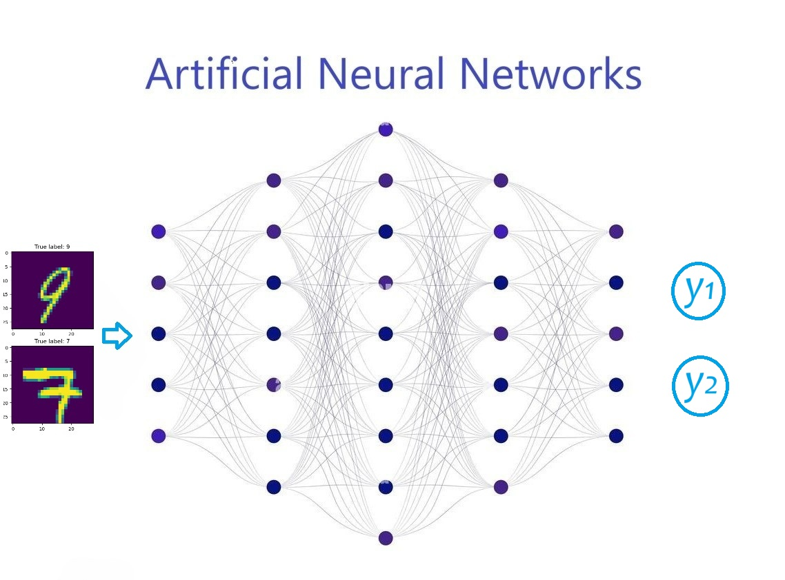
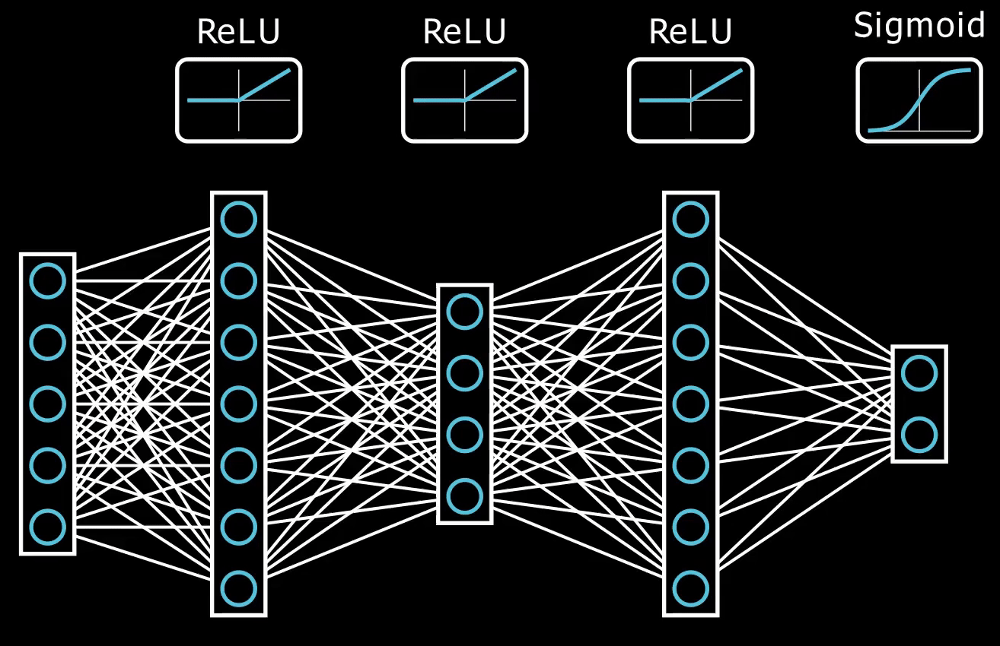
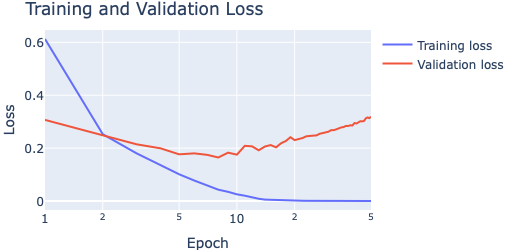

## {width="70" style="position: relative; bottom: -28px"} Content

- [Introduction]{.section .secbr} <br>

- [Multilayer Perceptrons]{.section .secbr} <br>

- [Training and Learning Curves]{.section .secbr} <br>

- [Applications]{.section .secbr} <br>

# A bit of history {background-color="#15797A"}

## History {.scrollable background-image="https://www.nobelprize.org/uploads/2024/10/2-2_3-6704d5430e393-464x696.jpg" background-opacity="0.05" background-size="60%"}
:::{style="font-size: 60%"}
| `Year` | `Development` |
|:------:|:------------|
| **1943** | [Walter Pitts and Warren McCulloch](https://www.historyofinformation.com/detail.php?entryid=782){target="_blank"} created the first computer model based on neural networks, using "threshold logic" to mimic the thought process. |
| **1960s** | [Henry J. Kelley](https://aspace.lib.vt.edu/agents/people/185){target="_blank"} developed the basics of a continuous backpropagation model, and Stuart Dreyfus simplified it using the chain rule. |
|

: [**Early Foundations**]{.blue} {tbl-colwidths="[5,95]" .hline}

|  |  |
|:------:|:------------|
| **1965** | [Alexey Ivakhnenko](https://en.wikipedia.org/wiki/Alexey_Ivakhnenko){target="_blank"} and Valentin Lapa developed early deep learning algorithms using polynomial activation functions.
| **1980s** | [Geoffrey Hinton^[ Novbel Prize in Physics 2024: https://www.nobelprize.org/prizes/physics/2024/hinton/facts/]](https://scholar.google.com/citations?user=JicYPdAAAAAJ&hl=en){target="_blank"} and colleagues revived neural networks by demonstrating effective training using backpropagation |
|

: [**Development of Algorithms**]{.blue} {tbl-colwidths="[5,95]" .striped .hover .hline}

|  |  |
|:------:|:------------|
| **1970s** | The first AI winter occurred due to unmet expectations, leading to reduced funding and research.
| **1980s** | Despite the AI winter, research continued, leading to significant advancements in neural networks and deep learning. |
|

: [**AI Winters and Resurgence**]{.blue} {tbl-colwidths="[5,95]" .striped .hover .hline}

|  |  |
|:------:|:------------|
| **1990s** | Development of convolutional neural networks (CNNs) by Yann LeCun and others for image recognition. |
| **2006** | Geoffrey Hinton and colleagues introduced deep belief networks, which further advanced deep learning techniques. |
| **2012** | AlexNet, a deep convolutional neural network, won the ImageNet competition, showcasing the power of deep learning in computer vision. |
| **2016** | AlphaGo by DeepMind defeated a human Go champion, demonstrating the potential of deep learning in complex games. |
| **Present** | Deep learning continues to evolve, with applications in natural language processing, speech recognition, autonomous vehicles, and more. |
|

: [**Modern Era**]{.blue} {tbl-colwidths="[5,95]" .striped .hover .hline}

| `Year` | `Key Model Development` |
|:------:|:------------|
| **1943** | Pitts and McCulloch's neural network model. |
| **1960s** | Kelley's backpropagation model and Dreyfus's chain rule simplification. |
| **1980s** | Hinton's backpropagation revival & Recurrent Neural Networks (RNNs). |
| **1990s** | LeCun's Convolutional Neural Networks (CNNs). |
| **2006** | Deep belief networks. |
| **2012** | AlexNet's ImageNet win. |
| **2016** | AlphaGo's victory. |
| **2017** | [Attention is all you need](https://arxiv.org/abs/1706.03762){target="_blank"} (key models of ChatGPT) |
| 

: [**Key Milestones**]{.blue} {tbl-colwidths="[5,95]" .striped .hover .hline}

:::

## Introduction

> [Deep Neural Networks (DNN)](https://www.ibm.com/topics/neural-networks){target="_blank"} or **Multilayer Perceptron (MLP)** is a type of ML model built to simulate the complex decision-making power of the **human brain** 🧠.

> It is a backbone that powers the recent development of [Artificial Intelligence (AI)](https://www.ibm.com/topics/artificial-intelligence){target="_blank"} applications in our lives today.

{fig-align="center" width="320"}


## Model: Multilayer Perceptron (MLP)
- Deep Neural Networks (DNNs)/Multilayer Perceptrons (MLP) are computational models inspired by the human brain.

:::{.columns}
:::{.column width='50%'}
:::{.r-stack}

{height="320"}

{.absolute top=300 left=101 width="0" height="200" data-id="box" auto-animate-delay="0.01"}

:::
:::
:::{.column width='50%'}
:::{.r-stack}
{height="320"}
:::
:::
:::

## Model: Multilayer perceptron (MLP) {auto-animate="true"}
- Deep Neural Networks (DNNs)/Multilayer Perceptrons (MLP) are computational models inspired by the human brain.

:::{.columns}
:::{.column width='50%'}

:::{.r-stack}

{height="320"}

{.absolute top=300 left=101 width="50" height="200" data-id="box" auto-animate-delay="0.01"}

:::
:::{style="font-size: 60%"}
- [**Input layer**]{.blue}: vector of individual inputs $\text{x}_i\in\mathbb{R}^d$.
    - It takes the inputs from the dataset.
    - The inputs should be preprocessed: scaled, encoded, transformed, etc, before passing to this layer.
:::
:::
:::{.column width='50%'}
:::{.r-stack}
{height="320"}
:::
:::
:::

## Model: Multilayer perceptron (MLP) {auto-animate="true" visibility="uncounted"}
- Deep Neural Networks (DNNs)/Multilayer Perceptrons (MLP) are computational models inspired by the human brain.

:::{.columns}
:::{.column width='50%'}

:::{.r-stack}

{height="320"}

{.absolute top=240 left=151 width="180" height="305" data-id="box" auto-animate-delay="0.01"}

:::
:::{style="font-size: 60%"}
- [**Input layer**]{.blue}: vector of individual inputs $\color{green}{\text{x}_i}\in\mathbb{R}^d$.
    - It takes the inputs from the dataset.
    - The inputs should be preprocessed: scaled, encoded, transformed, etc, before passing to this layer.
:::
:::
:::{.column width='50%' style="font-size: 60%"}
- [**Hidden layer**]{.blue}: Governed by the equations:<br>
$$\begin{align*}\color{green}{z_0}&=\color{green}{\text{x}}\in\mathbb{R}^d\\
\color{green}{z_k}&=\sigma_k(\color{blue}{W_k}\color{green}{z_{k-1}}+\color{blue}{b_k})\text{ for }k=1,...,L-1,
\end{align*}$$
:::
:::

## Model: Multilayer perceptron (MLP) {auto-animate="true"}
- Deep Neural Networks (DNNs)/Multilayer Perceptrons (MLP) are computational models inspired by the human brain.

:::{.columns}
:::{.column width='50%'}

:::{.r-stack}

{height="320"}

{.absolute top=240 left=151 width="180" height="305" data-id="box" auto-animate-delay="0.01"}

:::
:::{style="font-size: 60%"}
- [**Input layer**]{.blue}: vector of individual inputs $\color{green}{\text{x}_i}\in\mathbb{R}^d$.
    - It takes the inputs from the dataset.
    - The inputs should be preprocessed: scaled, encoded, transformed, etc, before passing to this layer.
:::
:::
:::{.column width='50%' style="font-size: 60%"}
- [**Hidden layer**]{.blue}: Governed by the equations:<br>
$$\begin{align*}\color{green}{z_0}&=\color{green}{\text{x}}\in\mathbb{R}^d\\
\color{green}{z_k}&=\sigma_k(\color{blue}{W_k}\color{green}{z_{k-1}}+\color{blue}{b_k})\text{ for }k=1,...,L-1.
\end{align*}$$
where,
    - $\color{blue}{W_k}$ is a matrix of size $\ell_{k}\times\ell_{k-1}$
    - $\color{blue}{b_k}$ is a bias vector of size $\ell_k$
    - $\sigma_k$: is a point-wise `nonlinear activation function`.
:::
:::

## Model: Multilayer perceptron (MLP) {auto-animate="true"}
- Deep Neural Networks (DNNs)/Multilayer Perceptrons (MLP) are computational models inspired by the human brain.

:::{.columns}
:::{.column width='50%'}

:::{.r-stack}

{height="320"}

{.absolute top=310 left=340 width="50" height="180" data-id="box" auto-animate-delay="0.01"}

:::
:::{style="font-size: 60%"}
- [**Input layer**]{.blue}: vector of individual inputs $\color{green}{\text{x}_i}\in\mathbb{R}^d$.
    - It takes the inputs from the dataset.
    - The inputs should be preprocessed: scaled, encoded, transformed, etc, before passing to this layer.
:::
:::
:::{.column width='50%' style="font-size: 60%"}
- [**Hidden layer**]{.blue}: Governed by the equations:<br>
$$\begin{align*}\color{green}{z_0}&=\color{green}{\text{x}}\in\mathbb{R}^d\\
\color{green}{z_k}&=\sigma_k(\color{blue}{W_k}\color{green}{z_{k-1}}+\color{blue}{b_k})\text{ for }k=1,...,L-1.
\end{align*}$$
where,
    - $\color{blue}{W_k}$ is a matrix of size $\ell_{k}\times\ell_{k-1}$
    - $\color{blue}{b_k}$ is a bias vector of size $\ell_k$
    - $\sigma_k$: is a point-wise `nonlinear activation function`.
- [**Output layer**]{.blue}: Returns the predictions:
$$\color{blue}{\hat{y}}=\sigma_L(\color{blue}{W_L}\color{green}{z_{L-1}}+\color{blue}{b_L}).$$
:::
:::

## Model: Multilayer perceptron (MLP) {auto-animate="true"}
- Deep Neural Networks (DNNs)/Multilayer Perceptrons (MLP) are computational models inspired by the human brain.

:::{.columns}
:::{.column width='50%'}

:::{.r-stack}

{height="320"}

{.absolute top=305 left=342 width="100" height="180" data-id="box" auto-animate-delay="0.01"}

:::
:::{style="font-size: 60%"}
- [**Input layer**]{.blue}: vector of individual inputs $\color{green}{\text{x}_i}\in\mathbb{R}^d$.
    - It takes the inputs from the dataset.
    - The inputs should be preprocessed: scaled, encoded, transformed, etc, before passing to this layer.
:::
:::
:::{.column width='50%' style="font-size: 60%"}
- [**Hidden layer**]{.blue}: Governed by the equations:<br>
$$\begin{align*}\color{green}{z_0}&=\color{green}{\text{x}}\in\mathbb{R}^d\\
\color{green}{z_k}&=\sigma_k(\color{blue}{W_k}\color{green}{z_{k-1}}+\color{blue}{b_k})\text{ for }k=1,...,L-1.
\end{align*}$$
where,
    - $\color{blue}{W_k}$ is a matrix of size $\ell_{k}\times\ell_{k-1}$
    - $\color{blue}{b_k}$ is a bias vector of size $\ell_k$
    - $\sigma_k$: is a point-wise `nonlinear activation function`.
- [**Output layer**]{.blue}: Returns the predictions:
$$\color{blue}{\hat{y}}=\sigma_L(\color{blue}{W_L}\color{green}{z_{L-1}}+\color{blue}{b_L}).$$
- [**Loss function**]{.blue}: measures the difference between predictions and the real targets.
:::
:::

## Model: Multilayer perceptron (MLP)
- Deep Neural Networks (DNNs)/Multilayer Perceptrons (MLP) are computational models inspired by the human brain.

:::{.columns}
:::{.column width='50%'}

:::{.r-stack}

{height="320"}

{.absolute top=310 left=342 width="0" height="180"}

:::
:::{style="font-size: 60%"}
- [**Input layer**]{.blue}: vector of individual inputs $\color{green}{\text{x}_i}\in\mathbb{R}^d$.
    - It takes the inputs from the dataset.
    - The inputs should be preprocessed: scaled, encoded, transformed, etc, before passing to this layer.
:::
:::
:::{.column width='50%' style="font-size: 60%"}
- [**Hidden layer**]{.blue}: Governed by the equations:<br>
$$\begin{align*}\color{green}{z_0}&=\color{green}{\text{x}}\in\mathbb{R}^d\\
\color{green}{z_k}&=\sigma_k(\color{blue}{W_k}\color{green}{z_{k-1}}+\color{blue}{b_k})\text{ for }k=1,...,L-1.
\end{align*}$$
where,
    - $\color{blue}{W_k}$ is a matrix of size $\ell_{k}\times\ell_{k-1}$
    - $\color{blue}{b_k}$ is a bias vector of size $\ell_k$
    - $\sigma_k$: is a point-wise `nonlinear activation function`.
- [**Output layer**]{.blue}: Returns the predictions:
$$\color{blue}{\hat{y}}=\sigma_L(\color{blue}{W_L}\color{green}{z_{L-1}}+\color{blue}{b_L}).$$
- [**Loss function**]{.blue}: measures the difference between predictions and the real targets.
:::
:::

## Model: Multilayer perceptron (MLP)
### Input Layer: sensory organs of the network
:::{style="font-size: 60%"}

```{python}
import numpy as np
import pandas as pd
```

:::{.columns}
:::{.column width="50%"}
- It plays a role as senses: 👀, 👂, 👃, 👅, 👊 ...
- The input data are directly fitted into [**input layer**]{.blue}.
- Let's take a look at [`Mnist`](https://www.digitalocean.com/community/tutorials/mnist-dataset-in-python){target="_blank"} dataset.

:::{style="font-size: 95%"}
```{python}
#| echo: true
#| eval: true
#| code-line-numbers: "|2,3|1,4-11"
import matplotlib.pyplot as plt
from keras.datasets import mnist
(X_train, y_train), (X_test, y_test) = mnist.load_data()
_, axs = plt.subplots(1,3, figsize=(6,2))
print(f"Train image dimension: {X_train.shape}")
for i in range(3):
    axs[i].imshow(X_train[i,:,:])
    axs[i].set_title(f"Number {y_test[i]}")
    axs[i].axis("off")
plt.tight_layout()
plt.axis("off")
plt.show()
```
:::

:::
:::{.column width="50%" .fragment .incremental}
### Preprocessing:
- Scaling: pixel $\in [0,1]$
- Reshaping: image dim: $28\times 28\to 784$.
- Target **one-hot encoding**:
        $$y=2\to y_{\text{one-hot}}=[0,0,\color{red}{1},0,0,0,0,0,0,0,0].$$

:::{.fragment data-id="code1"}
:::{style="font-size: 93%"}
```{python}
#| echo: true
#| code-line-numbers: "1,2|3,4,5"
X_train = X_train.reshape((-1,28*28)).astype("float32")/255
X_test = X_test.reshape((-1,28*28)).astype("float32")/255
from tensorflow.keras.utils import to_categorical
train_labels = to_categorical(y_train)
test_labels = to_categorical(y_test)
```

{width="75%" fig-align="center" .fragment}
:::
:::
:::
:::
:::


## Model: Multilayer perceptron (MLP) {auto-animate="true"}
### Input Layer: sensory organs of the network
:::{style="font-size: 60%"}
:::{.columns}
:::{.column width="55%"}
:::{.r-stack}
{height="450"}

{.absolute top=300 left=77 width="70" height="250" data-id="box" auto-animate-delay="0.01"}

:::
:::


:::{.column width="45%"}
- Let's build an `MLP` using [`Keras`](https://keras.io/){target="_blank"}.
- We first create [**Input Layer**]{.blue} of size $d=9$.

:::{style="font-size: 95%"}
```{python}
#| echo: true
#| eval: true
from sklearn.metrics import mean_squared_error 
from keras.models import Sequential 
from keras.layers import Dense, Input

# Dimension of the data
n, d = X_train.shape   # rows & columns

# Initiate the MLP model
model = Sequential()
# Add an input layer
model.add(Input(shape=(d,)))
```
:::
:::{.fragment style="font-size: 80%"}
- Given **trainable** weights $\color{blue}{W_1}$ of size $\ell_1\times d$ and bias $\color{blue}{b_1}\in\mathbb{R}^d$, the input $\color{green}{\text{x}}\in\mathbb{R}^d$ is taken at the [**input layer**]{.blue}:
$$\begin{align*}
\color{green}{z_1}&=\sigma_1(\color{blue}{W_1}\color{green}{\text{x}} + \color{blue}{b_1})\\
&=\sigma_1\begin{pmatrix}
\color{blue}{\begin{bmatrix}
w_{11} & w_{12} & \dots & w_{1d}\\
\vdots & \vdots & \ddots & \vdots\\
 w_{\ell_11} & w_{\ell_12} & \dots & w_{\ell_1d}\\
\end{bmatrix}}\color{green}{\begin{bmatrix}
x_1\\
\vdots\\
x_d
\end{bmatrix}}+
\color{blue}{\begin{bmatrix}
b_1\\
\vdots\\
b_{\ell_1}
\end{bmatrix}}
\end{pmatrix}
\end{align*}$$
:::
:::
:::
:::

## Model: Multilayer perceptron (MLP) {auto-animate="true"}
### Hidden/output Layer: brain 🧠/Action 🏃🏻‍♂️‍➡️
:::{style="font-size: 60%"}
:::{.columns}
:::{.column width="55%"}
:::{.r-stack}

{height="450"}

{.absolute top=200 left=140 width="325" height="430" data-id="box" auto-animate-delay="0.01"}

:::
:::

:::{.column width="45%"}
- Let's add two [**hidden layers**]{.blue} of sizes $32$ to our existing network.
- Then add an [**output layer**]{.blue} to make real-valued prediction $\color{blue}{\hat{y}}$ of `Rings.`

```{python}
#| echo: true
#| eval: true
# Add hidden layer of size 128
model.add(Dense(128, activation="relu"))

# Add another hidden layer of size 128
model.add(Dense(128, activation="relu"))

# Add one last layer (output) of size 10
model.add(Dense(10, activation="softmax"))
```
:::{.fragment}
- With **trainable** weights $\color{blue}{W_2, W_3}$ and biases $\color{blue}{b_2,b_3}$, the feedforward path:
$$\begin{align*}
\color{green}{z_2}&=\sigma_2(\color{blue}{W_2}\color{green}{z_1} + \color{blue}{b_2})\in\mathbb{R}^{128}\\
\color{blue}{\hat{y}}&=\sigma_3(\color{blue}{W_3}\color{green}{z_2} + \color{blue}{b_3})\in\mathbb{R}^{10}.
\end{align*}$$
- What is the dimension of each [**parameter**]{.light-blue}?
:::
:::
:::
:::

## Model: Multilayer perceptron (MLP) {auto-animate="true"}
### Activation functions: $\sigma(.)$
:::{style="font-size: 60%" .incremental}
:::{.columns}
:::{.column width="60%"}
- In feedforward path, we use matrix **multiplications**  ($\color{blue}{W_j}$'s) and **additions** ($\color{blue}{b_j}$'s).
- These **operations** are **linear**.
- Without **non-linear** components, the network is just a **linear regression**.
- These non-linear functions are called [**activation functions**]{.light-blue}.
- It's an important component that makes the networks powerful!
- Types of activation functions $\sigma_j(.)$:

:::{.fragment style="font-size: 80%"}
$$\begin{align*}
\text{Sigmoid}(z)&=1/(1+e^{-z})\text{ for }z\in\mathbb{R}\\
\text{Softmax}(z)&=(e^{z_1},\dots,e^{z_d})/\sum_{k=1}^de^{z_k},\text{ for }z\in\mathbb{R}^d\\
\color{red}{\text{ReLU}(z)}&\color{red}{=\max(0,z)\text{ for }z\in\mathbb{R}}\\
\text{Tanh}(z)&=\tanh(z)\text{ for }z\in\mathbb{R}\\
\text{Leaky ReLU}(z)&=\begin{cases}z,&\mbox{if} z>0\\ \alpha z,&\mbox{if }z\leq 0\end{cases}.
\end{align*}$$
:::
:::

:::{.column width="40%" .fragment .r-fit-text}

```{python}
#| eval: true
import numpy as np
import plotly.graph_objects as go

# Define the activation functions
def sigmoid(x):
    return 1 / (1 + np.exp(-x))

def relu(x):
    return np.maximum(0, x)

def tanh(x):
    return np.tanh(x)

def leaky_relu(x, alpha=0.01):
    return np.where(x > 0, x, alpha * x)

# Generate x values
x = np.linspace(-5, 5, 400)

# Create traces for each activation function
fig = go.Figure()

fig.add_trace(go.Scatter(x=x, y=sigmoid(x), mode='lines', name='Sigmoid'))
fig.add_trace(go.Scatter(x=x, y=relu(x), mode='lines', name='ReLU'))
fig.add_trace(go.Scatter(x=x, y=tanh(x), mode='lines', name='Tanh'))
fig.add_trace(go.Scatter(x=x, y=leaky_relu(x), mode='lines', name='Leaky ReLU'))
# fig.add_trace(go.Scatter(x=x, y=softmax(x), mode='lines', name='Softmax'))

# Update layout
fig.update_layout(
    width=400,
    height=300,
    title='Activation Functions in Neural Networks',
    xaxis_title='Neuron',
    yaxis_title='Output',
    legend_title='Activation Functions'
)

# Show the plot
fig.show()

```

#### Ex: Multiple Logistic Regression:

:::{.r-stack}
{fig-align="center"}

{width="95%" fig-align="center" .fragment}
:::
:::
:::
:::

## Model: Multilayer perceptron (MLP) {auto-animate="true"}
### Loss function: true $y$ vs prediction $\color{blue}{\hat{y}}$
:::{style="font-size: 57%"}
:::{.columns}
:::{.column width="65%"}
- Given weights $\color{blue}{W_j}$'s and biases $\color{blue}{b_j}$'s of the network, the feedforward network can produce prediction $\hat{y}$.
- To measure how good the network is, we compare the prediction $\color{blue}{\hat{y}}$ to the real target $y$.
- **Loss function** quantifies the difference between the predicted output and the actual target.
- **Regression** losses:
    - $\ell_2(y_i,\color{blue}{\hat{y}_i})=(y_i-\color{blue}{\hat{y}_i})^2$: Squared loss.
    - $\ell_1(y_i,\color{blue}{\hat{y}_i})=|y_i-\color{blue}{\hat{y}_i}|$: Absolute loss.
    - $\ell_{\text{rel}}(y_i,\color{blue}{\hat{y}_i})=|\frac{y_i-\color{blue}{\hat{y}_i}}{y_i}|$: Relative loss.
- **Classification** losses:
    - $\text{CEn}(y_i,\color{blue}{\hat{y}_i})=-\sum_{j=1}^My_{ij}\log(\color{blue}{\hat{y}_{ij}})$: Cross-Entropy.
    - $\text{Hinge}(y_i,\color{blue}{\hat{y}_i})=\max\{0,1-\sum_{j=1}^My_{ij}\color{blue}{\hat{y}_{ij}}\}$: Hinge loss.
    - $\text{KL}(y_i,\color{blue}{\hat{y}_i})=\sum_{j=1}^My_{ij}\log(y_{ij}/\color{blue}{\hat{y}_{ij}})$: Kullback-Leibler (KL) Divergence.
:::

:::{.column width="35%" .incremental}
- [**Q1**]{.light-red}: What are the [key parameters]{.light-blue} of the network?

- [**A1**]{.green}: All weights $\color{blue}{W_j}$'s and biases $\color{blue}{b_j}$'s.
- [**Q2**]{.light-red}: How to find the suitable values of these [parameters]{.light-blue}?
- [**A2**]{.green}: **Loss function** can guide the network to its better and better state! In other words, we can use the [**loss/mistake**]{.light-red} to adjust all [key parameters]{.light-blue}, leading to a better state of the network.
:::
:::
:::

## Model: Multilayer perceptron (MLP)
### Feedforward Neural Networks By Hand
👉 [Jupyter notebook: Feedforward NN by hand](https://colab.research.google.com/drive/1UlLjXnFHUKZbs2jH31eVLe5CuoQd5kXR?usp=sharing){target="_blank"}.

{height="450" fig-align="center"}

## Model: Multilayer perceptron (MLP)
### Why is it powerful?

<iframe src="https://www.deep-mind.org/2023/03/26/the-universal-approximation-theorem/" width="1000" height="450" frameborder="0" marginwidth="0" marginheight="0" style="border: none"> 
</iframe>

:::{.fragment style="font-size: 70%"}
- [Roughly speaking, it can approximate any **reasonably complex input-output relationship** to any desired **level of precision**! (For more, read [UAT, Deepmind](https://www.deep-mind.org/2023/03/26/the-universal-approximation-theorem/){target="_blank"})]{.blue}.
:::

## Model: Multilayer perceptron (MLP)
### Why is it powerful?

<iframe src="https://www.deep-mind.org/2023/03/26/the-universal-approximation-theorem/" width="1000" height="450" frameborder="0" marginwidth="0" marginheight="0" style="border: none"> 
</iframe>

:::{style="font-size: 70%"}
Let's see what it means: 👉 [Jupyter notebook: Universal Approximation Theorem](https://colab.research.google.com/drive/1oydA7p62mXIfQab5MYgAj2VhHRsPp7Ds?usp=sharing){target="_blank"}.
:::


## Backpropagation: [Gradient-based](https://hassothea.github.io/Advanced-Machine-Learning-ITC/courses/LogisticReg.html#/binary-logistic-regression-14){taret="_blank"}

:::{style="font-size: 70%"}
- [Grant Sanderson](https://www.3blue1brown.com/about) of [3B1B](https://www.3blue1brown.com/) did a really amazing job on this 👇
- Source: [Backpropagation, 3Blue1Brown](https://www.3blue1brown.com/lessons/backpropagation).
- More readings: 
    - [Stochastic Gradient Descent for Logistic Regression, AML course by Sothea HAS](https://hassothea.github.io/Advanced-Machine-Learning-ITC/courses/LogisticReg.html#/binary-logistic-regression-14){target="_blank"}
    - [Graphs: Backpropagation by Colah](https://colah.github.io/posts/2015-08-Backprop/){target="_blank"}
    - [Computational Graphs, and Backpropagation by Michael Collins](https://www.cs.columbia.edu/~mcollins/ff2.pdf){target="_blank"}.
:::

<iframe src="https://www.3blue1brown.com/lessons/backpropagation" width="100%" height="380px" frameborder="0"></iframe>


## Optimization in Keras
:::{style="font-size: 75%"}
- We set up optimization method for our existing network as follow:

```{python}
#| echo: true
#| eval: true
# We use Adam optimizer
from keras.optimizers import Adam, SGD
# Set up optimizer for our model
model.compile(
    optimizer='adam', 
    loss='categorical_crossentropy', 
    metrics=['accuracy'])
```

- Let's have a look at your model:

```{python}
#| echo: true
#| eval: true
model.summary()
```
:::

## Training & Learning Curves

:::{style="font-size: 70%"}
:::{.columns}
:::{.column width="50%"}
- A few important hyperparameters:
    - `batch_size`: number of minibatch $b$.
    - `epochs`: number of times that the network passes through the entire training dataset.
    - `validation_split`: a fraction of the training data for validation during model training. 
        We can keep track of the model state during training by measuring the loss on this validation data, especially for preventing overfitting.
- Choosing the right architecture requires experiences and tuning.
- In this case, the network yields [**Test Accuracy $=$ 0.954**]{.light-blue} (correctly predicted).
- Tuning the hyperparameters would push its performance even further.
:::
:::{.column width="50%"}
:::{style="font-size: 90%"}
```{python}
#| echo: true
#| eval: false
# Training the network
history = model.fit(
    X_train[:10000,:], train_labels[:10000], 
    epochs=50, batch_size=64, 
    validation_split=0.1, verbose=0)
# evaluation
loss, accuracy = model.evaluate(
    X_test, test_labels, verbose=0)
# Extract loss values 
train_loss = history.history['loss']
val_loss = history.history['val_loss'] 
# Plot the learning curves 
epochs = list(range(1, len(train_loss) + 1))
fig1 = go.Figure(go.Scatter(
    x=epochs, y=train_loss, name="Training loss"))
fig1.add_trace(
    go.Scatter(x=epochs, y=val_loss, 
    name="Training loss"))
fig1.update_layout(
    title="Training and Validation Loss", 
    width=510, height=250,
    xaxis=dict(title="Epoch", type="log"),
        yaxis=dict(title="Loss"))
fig1.show()
```
:::

{width="100%" fig-align="center"}

:::
:::
:::

## Diagnostics with Learning Curves
:::{style="font-size: 70%"}
:::{.columns}
:::{.column width="50%"}

{width="100%" fig-align="center"}

:::{style="font-size: 85%" .up3}
- The above learning curve can be used to access the state of our model during and after training.
    - The [**training loss**]{.light-blue} always decreases as it's measured using the training data.
    - The drop of [**validation loss**]{.light-red} indicates the generalization capability of the model at that state.
    - The model starts to overfit the training data when the validation curve starts to increase.
    - We should stop the training process when we observe this change in validation curve.
:::
:::
:::{.column width="50%" style="font-size: 90%"}
- The learning curves can also reveal other aspects of the network and the data including:
    - When the model underfit the data or requires more training epochs
    - When the learning rate ($\eta$) is too large
    - When the model cannot generalize well to validation set
    - When it converges properly
    - When the validation data is not representative enough
    - When the validation data is too easy too predict...
- These are helpful resources for understanding the above properties:
    - [A deep Dive Into Learning Curves in ML, Mostafa Ibrahim](https://wandb.ai/mostafaibrahim17/ml-articles/reports/A-Deep-Dive-Into-Learning-Curves-in-Machine-Learning--Vmlldzo0NjA1ODY0){target="_blank"}
    - [Diagnosing Model Performance with Learning Curves](https://rstudio-conf-2020.github.io/dl-keras-tf/notebooks/learning-curve-diagnostics.nb.html#:~:text=Learning%20curves%20can%20also%20be,train%20and%20a%20validation%20dataset.){target="_blank"}.
:::
:::
:::

## [Neural Network Playground](https://playground.tensorflow.org/){target="_blank"}

<iframe src="https://playground.tensorflow.org/" width="100%" height="630px" frameborder="0"></iframe>

## Summary
:::{style="font-size:80%"}
:::{.columns}
:::{.column width="50%"}
:::{.callout-tip icon="false"}
### Pros
- **Versatility**: DNNs can be used for a wide range of tasks including classification, regression, and even function approximation.
- **Non-linear Problem Solving**: They can model complex relationships and capture non-linear patterns in data, thanks to their non-linear activation functions.
- **Flexibility**: MLPs can have multiple layers and neurons, making them highly adaptable to various problem complexities.
- **Training Efficiency**: With advancements like backpropagation, training MLPs has become efficient and effective.
- **Feature Learning**: MLPs can automatically learn features from raw data, reducing the need for manual feature extraction.
:::
{width="100" style="position: relative; bottom: 10px" fig-align="center"}
:::

:::{.column width="50%"}
:::{.callout-caution icon="false"}
### Cons
- **Computational Complexity**: They can be computationally intensive, especially with large datasets and complex architectures, requiring significant processing power and memory.
- **Overfitting**: MLPs can easily overfit to training data, especially if they have too many parameters relative to the amount of training data.
- **Black Box Nature**: The internal workings of an MLP are not easily interpretable, making it difficult to understand how specific decisions are made.
- **Requires Large Datasets**: Effective training of MLPs often requires large amounts of data, which might not always be available.
- **Hyperparameter Tuning**: MLPs have several hyperparameters (e.g., learning rate, number of hidden layers, number of neurons per layer) that need careful tuning, which can be time-consuming and challenging.
- **Architecture**: Designing right architecture can be challenging as well.
:::
:::
:::
:::

:::{.center}

## 🥳 It's party time 🥂 {background-image="./img/end_page.jpg" background-opacity="0.3"}

<br>
<br>
<br>
<br>
<br>
<br>
<br>
<br>

:::