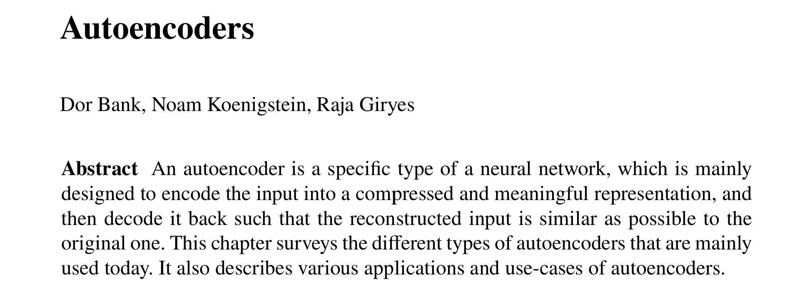
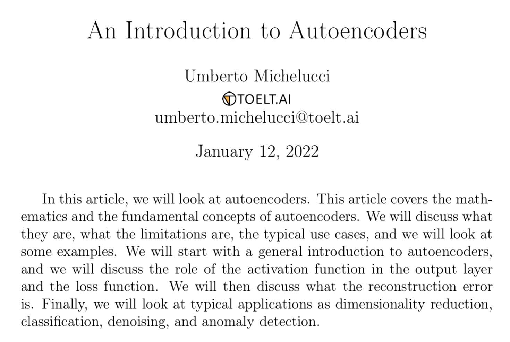
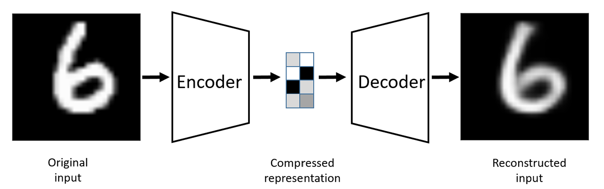
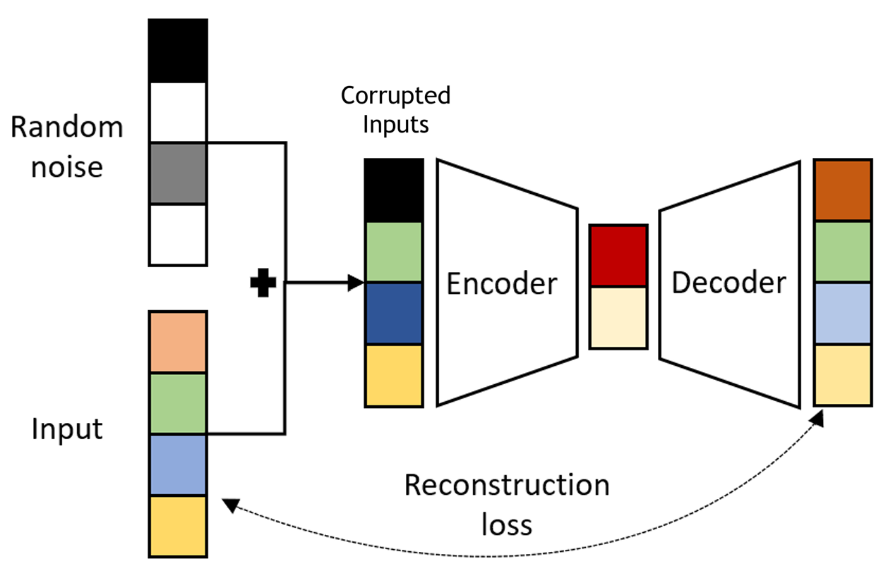

# 🧊 Dimensional Reduction Techniques {background-color="#15797A"}

## 🗺️ Content

- [Motivation]{.section .secbr} <br>

- [Principal Component Analysis (PCA)]{.section .secbr} <br>

- [t-distribution Stochastic Neighbor Embeding (t-SNE)]{.section .secbr} <br>

- [Autoencoder]{.section .secbr} <br>

## Motivation 
### Why reducing dimension?
:::{style="font-size: 80%"}
- High-dimensional data means "**large number of columns**/**fat data**".

:::{.incremental .fragment}
:::{.columns}
:::{.column width="60%"}
- There are many problems when dealing with high-dimensional data:
    - Curse of dimensionality
    - Noise
    - Complexity: analysis and computation
    - Cannot be visualized
    - Prone to overfitting...
- The core idea of "**Dimensional Reduction**" is
:::
:::{.column width="40%"}
{fig-align="center"}
:::
:::
:::{.r-fit-text .fragment}
[**High-dimensional data often live in smaller dimensional spaces.**]{.light-blue}
:::
:::
:::


## Principal Component Analysis (PCA)   {auto-animate="true"}
### Setting
:::{style="font-size: 80%"}
:::{.columns}
:::{.column width="43%"}
- Given data matrix: $X\in\mathbb{R}^{n\times d}$,

```{python}
import numpy as np
import pandas as pd
mean = np.array([0,0])
cov = np.array([[5,2],[2,3]])
n, d = 100, 2
np.random.seed(42)
X = np.random.multivariate_normal(
    mean=mean, cov=cov, size=(n,)
)
z = X[:,0] +  X[:,1] + np.random.normal(size=n)
X = np.column_stack([X, z])
df = pd.DataFrame(X, columns=['X', 'Y', 'Z']).round(3)
df.head(9)
```
:::
:::{.column width="57%" .fragment}
```{python}
#| eval: true
import plotly.graph_objects as go
from sklearn.decomposition import PCA
pca = PCA(n_components=3)
X_rotate = pca.fit_transform(X)
max_pc = np.var(X_rotate, axis=1)
fig = go.Figure(go.Scatter3d(
    x = X[:,0], y = X[:,1], z = X[:,2], name="Data",
    mode="markers", marker=dict(size=5, color = "#1d97d3")
))

gr = "#125411"
bl = "#3371ca"
red = "#e43232"


def add_arrow(fig, start, tips, fac = [1,1,1], legend = True):
    fig.add_trace(go.Scatter3d(
        x = [start[0], fac[0]*tips[0,0]],
        y =  [start[1], fac[0]*tips[0,1]],
        z =  [start[2], fac[0]*tips[0,2]],
    mode='lines', line=dict(color = red, width=3),
    name="x-axis",
    showlegend=legend
    ))
    fig.add_trace(go.Scatter3d(
        x = [start[0], fac[1]*tips[1,0]],
        y =  [start[1], fac[1]*tips[1,1]],
        z =  [start[2], fac[1]*tips[1,2]],
        mode='lines', line=dict(color = gr, width=3),
        name="y-axis",
        showlegend=legend
    ))
    fig.add_trace(go.Scatter3d(
        x = [start[0], fac[2]*tips[2,0]],
        y =  [start[1], fac[2]*tips[2,1]],
        z =  [start[2], fac[2]*tips[2,2]],
        mode='lines', line=dict(color = bl, width=3),
        name="z-axis",
        showlegend=legend
    ))
    arrow_tip_ratio = 0.5
    arrow_starting_ratio = 0.98
    fig.add_trace(go.Cone(
        x=[tips[0,0]],
        y=[tips[0,1]],
        z=[tips[0,2]],
        u=[arrow_tip_ratio*tips[0,0]], 
        v=[arrow_tip_ratio*tips[0,1]], 
        w=[arrow_tip_ratio*tips[0,2]],
        showlegend=False,
        showscale=False,
        colorscale=[[0, red], [1, red]]
    ))
    fig.add_trace(go.Cone(
        x=[tips[1,0]],
        y=[tips[1,1]],
        z=[tips[1,2]],
        u=[arrow_tip_ratio*tips[1,0]], 
        v=[arrow_tip_ratio*tips[1,1]], 
        w=[arrow_tip_ratio*tips[1,2]],
        showlegend=False,
        showscale=False,
        colorscale=[[0, gr], [1, gr]]
    ))
    fig.add_trace(go.Cone(
        x=[tips[2,0]],
        y=[tips[2,1]],
        z=[tips[2,2]],
        u=[arrow_tip_ratio*tips[2,0]], 
        v=[arrow_tip_ratio*tips[2,1]], 
        w=[arrow_tip_ratio*tips[2,2]],
        showlegend=False,
        showscale=False,
        colorscale=[[0, bl], [1, bl]]
    ))
    return fig

max_x, max_y, max_z = max(X[:,0]), max(X[:,1]), max(X[:,2])
cord_old = np.array([
    [max_x, 0, 0], 
    [0, max_y, 0], 
    [0, 0, max_z]])

fig = add_arrow(fig, [0,0,0], cord_old)

fig0 = fig

# Eigen values and vectors
C = np.corrcoef(X.transpose())
eigval, eigvec = np.linalg.eig(C)
new_vec = np.array(eigvec @ np.diag([max_x, max_y, max_z]))

frames = []
rate = np.linspace(0,1,10)
for i, t in enumerate(rate):
    coord_new = t*(new_vec - cord_old) + cord_old
    temp = go.Figure(data=[fig.data[0]])
    temp = add_arrow(temp, [0,0,0], 
                        tips=coord_new, 
                        legend=False)
    frames.append(go.Frame(
        data=[fig.data[0],
              temp.data[1],
              temp.data[2],
              temp.data[3],
              temp.data[4],
              temp.data[5],
              temp.data[6]],
        name=f'{np.round(t,3)}'))

fig1 = go.Figure(
    data=[fig.data[i] for i in range(7)],
    layout=go.Layout(
        title="Original coordinates to the new ones",
        xaxis=dict(title="X", range=[-10, 5]),
        yaxis=dict(title="Y", range=[-6, 5]),
        updatemenus=[{
            "buttons": [
                {
                    "args": [None, {"frame": {"duration": 1000, "redraw": True}, "fromcurrent": True, "mode": "immediate"}],
                    "label": "Play",
                    "method": "animate"
                },
                {
                    "args": [[None], {"frame": {"duration": 0, "redraw": False}, "mode": "immediate"}],
                    "label": "Stop",
                    "method": "animate"
                }
            ],
            "type": "buttons",
            "showactive": False,
            "x": -0.1,
            "y": 1.25,
            "pad": {"r": 10, "t": 50}
        }],
        sliders=[{
            "active": 0,
            "currentvalue": {"prefix": "Change basis rate: "},
            "pad": {"t": 50},
            "steps": [{"label": f"{np.round(t,3)}",
                       "method": "animate",
                       "args": [[f'{np.round(t,3)}'], {"frame": {"duration": 1000, "redraw": True}, "mode": "immediate", 
                       "transition": {"duration": 10}}]}
                      for t in rate]
        }]
    ),
    frames=frames
)

# To add rotate frame
camera = dict(
    center=dict(x=0, y=0, z=0),
    eye=dict(x=0.75, y=-0.9, z=0.5)
)
fig1.update_layout(
    scene_camera=camera,
    scene = dict(aspectratio=dict(x=1, y=1, z=1), 
        xaxis=dict(title="X", range=[-7, 7]),
        yaxis=dict(title="Y", range=[-7, 7]),
        zaxis=dict(range=[-14,14])),
    height = 370, width = 500,
    title = "Data points")
fig1.show()

```

:::{style="font-size: 80%" .incremental}
- [**PCA**]{.light-blue} is a process of representing $X$ in a new coordinate system (basis) such that:
    - Each column has maximum variation along its direction.
    - All columns are **perpendicular/independent**.
:::
:::
:::
:::

## Principal Component Analysis (PCA) {auto-animate="true"}
### First Principal Direction $\color{blue}{\vec{u}_1}$
:::{style="font-size: 80%"}
:::{.columns}
:::{.column width="50%"}
- [**PCA**]{.light-blue} is a process of representing $X$ in a new coordinate system such that:
    - Each column has maximum variation along its direction.
    - All columns are **perpendicular/independent**.

:::{.fragment .br20}
:::{.callout-tip icon="false"}
#### Objective of PCA
- Without loss of generality, assume $X$ is centered: $\overline{X}_j=0,\forall j=1,\dots,d$.
- [**Objective:**]{.blue} Finding $\color{blue}{U}\in\mathbb{R}^{d\times d}$ such that
$$\tilde{X}=X\color{blue}{U}\text{ s.t: }\begin{cases}\|\tilde{X}_j\|^2\text{ is maximized}\\\tilde{X}_j\perp\tilde{X}_k,\forall j\neq k.\end{cases}$$

:::{.up2}
:::
:::
:::
:::
:::{.column width="50%" .fragment}
- The objective of PCA can be reduced to finding each column of $\color{blue}{U}\in\mathbb{R}^{d}$.

:::{.callout-note icon="false" .br20}
#### First Principal Direction $\color{blue}{\vec{u}_1}$
- We define the [**1st principal direction**]{.blue} $\color{blue}{\vec{u}_1}\in\mathbb{R}^{d}$:
$$\begin{align*}\color{blue}{\vec{u}_1}&=\arg\max_{\vec{w}\in\mathbb{R}^d:\|\vec{w}\|=1}\|X\vec{w}\|^2\\
&=\arg\max_{\vec{w}\in\mathbb{R}^d:\|\vec{w}\|=1}\vec{w}^TX^TX\vec{w}.\end{align*}$$

:::{.up2}
:::
:::
:::{.fragment}
- This problem can be solved using [**Lagragian Method**]{.blue} 👇

:::{.hline style="font-size: 80%" .secbr}
[📚 Hertzman et al. (2015)](https://www.cs.toronto.edu/~mbrubake/teaching/C11/Handouts/LagrangeMultipliers.pdf){target="_blank"} <br>
[📚 Appendix E. of Bishop et al. (2006)](https://www.microsoft.com/en-us/research/uploads/prod/2006/01/Bishop-Pattern-Recognition-and-Machine-Learning-2006.pdf){target="_blank"}.
:::
:::
:::
:::
:::


## Principal Component Analysis (PCA) {auto-animate="true"}
### Lagragian Method for $\color{blue}{\vec{u}_1}$
:::{style="font-size: 75%"}
:::{.columns}
:::{.column width="55%"}
:::{.fragment}
- Problem: Find $\color{blue}{\vec{u}_1}\in\mathbb{R}^d$ such that

:::{.callout-note icon="false" appearance="minimal" .br20}
$$\begin{align*}\color{blue}{\vec{u}_1}&=\arg\max_{\vec{w}\in\mathbb{R}^d:\|\vec{w}\|=1}\vec{w}^TX^TX\vec{w}.\end{align*}$$
:::
:::
:::{.fragment}
- **Lagragian** at $\color{red}{\vec{w}}\in\mathbb{R}^d$ and $\color{red}{\lambda}\in\mathbb{R}$, [$$\begin{align*}
{\cal L}(\color{red}{\vec{w}},\color{red}{\lambda})&=f(\color{red}{\vec{w}})+\color{red}{\lambda} g(\color{red}{\vec{w}})\\
&=\color{red}{\vec{w}}^TX^TX\color{red}{\vec{w}}+\color{red}{\lambda}(1-\|\color{red}{\vec{w}}\|^2)\\
&=\color{red}{\vec{w}}^TX^TX\color{red}{\vec{w}}+\color{red}{\lambda}(1-\color{red}{\vec{w}}^T\color{red}{\vec{w}}).\end{align*}$$]{.up3}
:::
:::{.fragment .up2}
- The solution may be obtained by setting the derivatives (gradients) of $\cal L$ to 0 i.e., $\nabla {\cal L}=0$. 
:::
:::
:::{.column width="45%"}
:::{.fragment}
:::{.callout-note icon="false" appearance="minimal" .br10}
- Verify that the solution $\color{blue}{\vec{u}_1}\in\mathbb{R}^d$ and $\color{blue}{\lambda}\in\mathbb{R}$ of the system
[$$\begin{cases}\frac{\partial {\cal L}(\color{blue}{\vec{u}_1},\color{blue}{\lambda})}{\partial \color{blue}{\vec{u}_1}}=0\\
\frac{\partial {\cal L}(\color{blue}{\vec{u}_1},\color{blue}{\lambda})}{\partial \color{blue}{\lambda}}=0\end{cases},$$]{.up2}
satisfies $X^TX\color{blue}{\vec{u}_1}=\color{blue}{\lambda\vec{u}_1}.$
- This implies that the [**1st principal direction**]{.blue} $\color{blue}{\vec{u}_1}$ is the [**eigenvector**]{.light-blue} of $X^TX$ for the [**eigenvalue**]{.light-blue} $\color{blue}{\lambda}$.

:::

```{python}
fig1.update_layout(height=250, width=500)
fig1.show()
```
:::
:::
:::
:::

## Principal Component Analysis (PCA) {auto-animate="true"}
### $k$-th principal direction $\color{blue}{\vec{u}_k}, k\geq 2$
:::{style="font-size: 90%"}
:::{.columns}
:::{.column width="50%"}
:::{.callout-note icon="false" .br20 style="font-size: 95%"}
#### $k$-th Principal direction $\color{blue}{\vec{u}_k}$
- For any $k\in\{2,\dots,d\}$, let $$\color{red}{\widehat{X}_k}=X-\sum_{j=1}^{k-1}X\color{blue}{\vec{u}_j\color{blue}{\vec{u}_j^T}},$$ 
then the $k$-th [**Principal direction**]{.blue} $\color{blue}{\vec{u}_k}$ is the unit vector, **orthogonal** to $\{\color{blue}{\vec{u}_j}:1\leq j\leq k-1\}$, and the variation of projected data on its direction is maximized:
$$\begin{align*}\color{blue}{\vec{u}_k}&=\arg\max_{\vec{w}\in\mathbb{R}^d:\|\vec{w}\|=1}\vec{w}^T\color{red}{\widehat{X}_k^T\widehat{X}_k}\vec{w}.\end{align*}$$

:::{.up2} 
:::
:::
:::{.br10 style="font-size: 80%"}
- [**Proof:**]{.blue} Using Lagragian multiplier just like the case of $\color{blue}{\vec{u}_1}$.
:::
:::
:::{.column width="50%" style="font-size: 80%" .fragment}
:::{.callout-tip icon="false" style="font-size: 120%" .incremental}
#### Solution to PCA problem
- Solution to our original problem is $$\color{blue}{U}=[\color{blue}{\vec{u}_1}| \color{blue}{\vec{u}_2| \dots | \color{blue}{\vec{u}_d}}]\in\mathbb{R}^d.$$
where $\color{blue}{\vec{u}_j}$ is the $j$-th **eigenvector** of $X^TX$ corresponding to **eigenvalue** $\color{blue}{\lambda_j}>0$.
- The rotated data is defined by: $$\color{blue}{\tilde{X}}=X\color{blue}{U}.$$
- The variation along each direction $$\sum_{j=1}^d\|X_j\|^2=\sum_{j=1}^d\|\color{blue}{\tilde{X}_j}\|^2=\sum_{j=1}^d\color{blue}{\lambda_j^2}$$

:::{.sbr}
:::
:::
:::
:::
:::

## Principal Component Analysis (PCA) {auto-animate="true"}
### Implementing PCA
:::{style="font-size: 80%" .incremental}
:::{.columns}
:::{.column width="50%"}
:::{.callout-tip icon="false" style="font-size: 120%"}
#### Unnormalized PCA
- Given data: $X\in\mathbb{R}^{n\times d}$
- Centering $X_c=\underbrace{X}_{n\times d} -\underbrace{\mathbb{1}_n}_{n\times n}\underbrace{X}_{n\times d}/n.$
- Perform [**Eigenvalue Decomposition**](https://tobydriscoll.net/fnc-julia/matrixanaly/evd.html){target='_blank'} on covariance matrix $V=X_c^TX_c$:
$$V=\color{blue}{U}\Sigma \color{blue}{U}^T,$$
    - $\color{blue}{U}$: matrix of eigenvectors
    - $\Sigma=\text{diag}(\lambda_1,\dots,\lambda_d)$: diagonal matrix of eigenvalues $\lambda_1\geq \dots\geq \lambda_d\geq 0$.
:::
:::
:::{.column width="50%"}
:::{.callout-tip icon="false" style="font-size: 120%" .fragment}
#### Normalized PCA 
- Given data: $X\in\mathbb{R}^{n\times d}$
- Standardizing: compute std matrix $D=\text{diag}(\widehat{\sigma}_1,\dots,\widehat{\sigma}_d)$ and standardized data $Z=(\underbrace{X}_{n\times d} -\underbrace{\mathbb{1}_n}_{n\times n}\underbrace{X}_{n\times d}/n)D^{-1}.$
- Perform [**Eigenvalue Decomposition**](https://tobydriscoll.net/fnc-julia/matrixanaly/evd.html){target='_blank'} on correlation matrix $C=Z^TZ/(n-1)$:
$$C=\color{blue}{U}\Sigma \color{blue}{U}^T.$$
- Rotated data: $\color{blue}{\tilde{X}}=X\color{blue}{U}.$ [👉 [Demo](https://colab.research.google.com/drive/1M4JFHP5Y43uw3dQlyYbiD68wAtybS0Kw?usp=sharing){target="_blank"}]

:::{.sbr}
:::
:::
:::
:::
:::

## Principal Component Analysis (PCA) {auto-animate="true"}
### Dimensional reduction/Reconstruction
:::{style="font-size: 80%" .incremental}
:::{.columns}
:::{.column width="50%"}

#### Dimensional Reduction
- **Reduction** to $k$ dimensions ($k<d$) is done by $\tilde{X}_k=\tilde{X}[:,:k].$
- **Quality of representation** on each direction: $\left[\frac{\lambda_1}{\sum_{j=1}^d\lambda_j},\dots,\frac{\lambda_k}{\sum_{j=1}^d\lambda_j}\right].$
- **Variation explained** by $k$ dimensions: $\frac{\sum_{j=1}^k\lambda_j}{\sum_{j=1}^d\lambda_j}\times 100.$
- **For visualization**, one can choose $k=2$ or $3$. [👉 [Demo](https://colab.research.google.com/drive/1M4JFHP5Y43uw3dQlyYbiD68wAtybS0Kw?usp=sharing){target="_blank"}]
:::
:::{.column width="50%"}
:::{.r-stack}
:::{.fragment}
:::{.columns}
:::{style="font-size: 60%"}
:::{.column width="50%"}
```{python}
print(f'* Total variation of X: {(((X-X.mean()) ** 2).sum()/(X.shape[0]-1)).round(2)}')
df.head(5)
```

```{python}
import plotly.express as px
df_var0 = pd.DataFrame(
    {'Variance': X.var(axis=0), 'Original variable': ['X', 'Y', 'Z']}
)
fig_bar0 = px.bar(df_var0, x="Original variable", y='Variance')
fig_bar0.update_layout(width=250, height=300, title="Varaince of each variable")
fig_bar0.show()
```
:::
:::{.column width="50%" .fragment}
```{python}
from sklearn.decomposition import PCA
pca = PCA(n_components=3).fit(df)
X_proj = pca.transform(df)
X_proj = pd.DataFrame(X_proj).round(3)
X_proj.columns = ['PC1', 'PC2', 'PC3']
print(f'* Total variation of projection: {((X_proj ** 2).sum().sum()/(X_proj.shape[0]-1)).round(2)}')
X_proj.head(5)
```

```{python}
df_var1 = pd.DataFrame(
    {
        'Explained Varaince': pca.explained_variance_,
        'PCs': ['PC1', 'PC2', 'PC3']
    }
)
fig_bar1 = px.bar(df_var1, x="PCs", y='Explained Varaince')
fig_bar1.update_layout(width=250, height=300, title="Variance of each PC")
fig_bar1.show()
```
:::
:::
:::
:::
:::{.fragment}

```{python}
frames = []
frames.append(
    go.Frame(
        data=[fig0.data[i] for i in range(7)],
        name='Original'))
frames.append(
    go.Frame(
        data=[fig.data[0],
              temp.data[1],
              temp.data[2],
              temp.data[3],
              temp.data[4],
              temp.data[5],
              temp.data[6]],
        name=f'PCs'))

X_proj1 = X @ (pca.components_[:,:2] @ pca.components_[:,:2].transpose())

frames.append(
    go.Frame(
        data = [
        fig.data[0],
        go.Scatter3d(
            x=X_proj1[:,0],y=X_proj1[:,1], z=X_proj1[:,2],
            name="Projection",
            mode="markers", marker=dict(color="red", size=5))],
        name=f'Projection'))

fig3 = go.Figure(
    data=[fig0.data[i] for i in range(7)],
    layout=go.Layout(
        title="Data rotation by PCA and projection",
        xaxis=dict(title="X", range=[-10, 5]),
        yaxis=dict(title="Y", range=[-6, 5]),
        updatemenus=[{
            "buttons": [
                {
                    "args": [None, {"frame": {"duration": 1000, "redraw": True}, "fromcurrent": True, "mode": "immediate"}],
                    "label": "Play",
                    "method": "animate"
                },
                {
                    "args": [[None], {"frame": {"duration": 0, "redraw": False}, "mode": "immediate"}],
                    "label": "Stop",
                    "method": "animate"
                }
            ],
            "type": "buttons",
            "showactive": False,
            "x": -0.1,
            "y": 1.25,
            "pad": {"r": 10, "t": 50}
        }],
        sliders=[{
            "active": 0,
            "currentvalue": {"prefix": "Stage: "},
            "pad": {"t": 50},
            "steps": [{"label": f"{name}",
                       "method": "animate",
                       "args": [[f'{name}'], {"frame": {"duration": 1000, "redraw": True}, "mode": "immediate", 
                       "transition": {"duration": 10}}]}
                      for name in ['Original', 'PCs', 'Projection']]
        }]
    ),
    frames=frames
)

# To add rotate frame
camera = dict(
    center=dict(x=0, y=0, z=0),
    eye=dict(x=0.75, y=-1.1, z=0.5)
)
fig3.update_layout(
    scene_camera=camera,
    scene = dict(aspectratio=dict(x=1, y=1, z=1), 
        xaxis=dict(title="X", range=[-7, 7]),
        yaxis=dict(title="Y", range=[-7, 7]),
        zaxis=dict(range=[-14,14])),
    height = 550, width = 550)
fig3.show()
```
:::
:::
:::
:::
:::

## Principal Component Analysis (PCA) {auto-animate="true"}
### Dimensional reduction/Reconstruction
:::{style="font-size: 80%"}
:::{.columns}
:::{.column width="50%"}

#### Dimensional Reduction
- **Reduction** to $k$ dimensions ($k<d$) is done by $\tilde{X}_k=\tilde{X}[:,:k].$
- **Quality of representation** on each direction: $\left[\frac{\lambda_1}{\sum_{j=1}^d\lambda_j},\dots,\frac{\lambda_k}{\sum_{j=1}^d\lambda_j}\right].$
- **Variation explained** by $k$ dimensions: $\frac{\sum_{j=1}^k\lambda_j}{\sum_{j=1}^d\lambda_j}\times 100.$
- **For visualization**, one can choose $k=2$ or $3$. [👉 [Demo](https://colab.research.google.com/drive/1M4JFHP5Y43uw3dQlyYbiD68wAtybS0Kw?usp=sharing){target="_blank"}]
:::
:::{.column width="50%" .incremental}

#### Reconstruction

- The **reconsution** is defined by: $$\color{red}{X_k^{\text{rec}}}=\tilde{X}_k\color{blue}{U[:,:k]^T}.$$

- Best [**low-rank approximation**](https://en.wikipedia.org/wiki/Low-rank_approximation){target="_blank"} shows that this reconstruction $\color{red}{X_k^{\text{rec}}}$ is the best $k$-rank approximation of $X$ with respect to [**Frobenius norm**](https://en.wikipedia.org/wiki/Matrix_norm#Frobenius_norm){target="_blank"}, i.e., $$\color{red}{X_k^{\text{rec}}}=\arg\min_{M_k:r(M_k)\leq k}\|X-M_k\|_F,$$
where $\|.\|_F$ is the [**Frobenius norm**](https://en.wikipedia.org/wiki/Matrix_norm#Frobenius_norm){target="_blank"}.

:::
:::
:::

## Principal Component Analysis (PCA) {auto-animate="true"}
### Summary
:::{.incremental style="font-size: 85%"}
- `PCA` captures and arranges directions with largest, 2nd largest,... variation into the 1st, 2nd, ... column using [Spectral Theorem](https://math.mit.edu/~dav/spectral.pdf){target="_blank"} ([Eigenvalue decomposition](https://tobydriscoll.net/fnc-julia/matrixanaly/evd.html){target="_blank"}).
- These directions are contained in the eigenvector matrix of **Covariance** (unnormalized) or **Correlation** matrix (normalized) of the data.
- The variation along each direction is given by the corresponding eigenvalues: $\lambda_1>\dots>\lambda_d$.
- Our goal is to explore dimensional reduction and reconstruction power of `PCA`, however, it can be used in Data Analysis, EDA, Data Summary...
- **Remark:** Many highly correlated columns indicates effective dimensional reduction (the first two PCs can capture significant variation).
:::

<!-- https://www.microsoft.com/en-us/research/uploads/prod/2006/01/Bishop-Pattern-Recognition-and-Machine-Learning-2006.pdf 
https://www.cs.toronto.edu/~mbrubake/teaching/C11/Handouts/LagrangeMultipliers.pdf
https://www.statslab.cam.ac.uk/~rrw1/mor/s.pdf
-->

# $t$-Stochastic Neighbor Embedding ($t$-SNE) {background-color="#15797A"}

## $t$-SNE
### Setting
:::{style="font-size: 80%"}
:::{.columns}
:::{.column width="50%" .incremental}
- Suppose $X\in\mathbb{R}^{n\times d}$ with large $d$.

:::{.callout-tip icon="false" style="font-size: 120%" .br10 .fragment}
#### Objective
**$t$-SNE** aims at finding **lower dimensional** (LD) representation of $X$ (2 or 3) so that the distribution among LD data is similar to the original data.
:::

- [Hinton and Roweis (2002)](https://www.cs.toronto.edu/~fritz/absps/sne.pdf){target="_blank"} proposed Stochastic Embedding Neighbor (SNE) and $t$-SNE is its improved version [see [Laurens, $t$-SNE Page](https://lvdmaaten.github.io/tsne/){target="_blank"}].
:::
:::{.column width="50%"}
:::{.r-stack}
:::{.fragment .br10}
```{python}
#| eval: true
from keras import datasets
import numpy as np
import matplotlib.pyplot as plt

(x_train, y_train), (x_test, y_test) = datasets.mnist.load_data()
X = x_train.reshape(60000, -1)
fig, axes = plt.subplots(3, 4, figsize=(6, 3.5))
IDs = np.random.randint(0,60000, size=12)
for i,j in enumerate(IDs):
  axes[i//4, i%4].imshow(x_train[j,:,:], cmap="viridis")
  axes[i//4, i%4].axis('off')
  axes[i//4, i%4].set_title(f"Label: {y_train[j]}")
plt.tight_layout()
plt.show()
```
:::
:::{.br20}
:::{.fragment}
```{python}
#| echo: true
#| code-fold: true
#| eval: true
from sklearn.manifold import TSNE

# Prepare the t-SNE model
tsne = TSNE(n_components=2, random_state=42)

# Fit and transform the data
X_tsne = tsne.fit_transform(X[:1000,:])  # Use a subset for faster computation
df_tsne = pd.DataFrame(X_tsne, columns=['Component 1', 'Component 2'])
df_tsne['label'] = y_train[:1000]
fig_tsne = px.scatter(df_tsne, x="Component 1", y="Component 2", color="label")
fig_tsne.update_layout(height=420, width=550, title="t-SNE visualization on MNIST")
fig_tsne.show()
```
:::
:::
:::
:::
:::
:::


## $t$-SNE
### [Original]{.light-blue} and [embedding]{.light-red} distribution in $t$-SNE
:::{.colums}
:::{.column width="50%"}
:::{style="font-size: 60%" .incremental}
1. Pairwise similarities in the original space:
    - [**Conditional probabilities (Gaussian):**]{.blue} for any $\color{purple}{\text{x}_i}\in\mathbb{R}^d$, the chance that $\text{x}_j$ is its neighbor: [$$p_{j|\color{purple}{i}}=\frac{e^{-\|\text{x}_j-\color{purple}{\text{x}_i}\|^2/(2\sigma_{\color{purple}{i}}^2)}}{\sum_{k\neq \color{purple}{i}}^n e^{-\|\text{x}_k-\color{purple}{\text{x}_i}\|^2/(2\sigma_{\color{purple}{i}}^2)}}$$]{.up1 style="font-size: 120%"} [with $\sigma_{\color{purple}{i}}>0$ defining the surrounding area of $\color{purple}{\text{x}_i}$.]{style="font-size: 95%"}
    - [**Symmetric probabilities:**]{.blue} $\displaystyle \color{blue}{p_{i,j}}=\frac{p_{j|\color{purple}{i}}+p_{i|\color{purple}{j}}}{2n}.$ [$$\color{blue}{P} = \begin{bmatrix}\color{blue}{p_{1,1}} & \color{blue}{p_{1,2}} & \color{blue}{...} & \color{blue}{p_{1,n}}\\
\color{blue}{p_{2,1}} & \color{blue}{p_{2,2}} & \color{blue}{...} & \color{blue}{p_{2,n}}\\
\color{blue}{\vdots} & \color{blue}{\vdots} & \color{blue}{\ddots} & \color{blue}{\vdots}\\
\color{blue}{p_{n,1}} & \color{blue}{p_{n,2}} & \color{blue}{...} & \color{blue}{p_{n,n}}\end{bmatrix}$$]{.up1 style="font-size: 120%"}
:::
:::
:::{.column width="50%"}
:::{style="font-size: 57%" .incremental}
2. [**Objective of $t$-SNE:**]{.darkgreen} find low-dimensional data points $\color{red}{\text{z}_1},\dots, \color{red}{\text{z}_n}\in\mathbb{R}^{d'}$ ($d'<d$) [**distributing according to the original data points**]{.light-blue} i.e., preserving the pairwise similarities:
    - [**$t$-distribution probabilities**]{.light-red} between embedded data points $\color{red}{\text{z}_i,\text{z}_j}\in\mathbb{R}^{d'}$: [$$\color{red}{q_{i,j}}=\frac{(1+\|\text{z}_i-\text{z}_j\|^2)^{-1}}{\sum_{k\neq \ell:k,\ell=1}^n (1+\|\text{z}_k-\text{z}_{\ell}\|^2)^{-1}}.$$]{.up1} [$$\color{red}{Q} = \begin{bmatrix}\color{red}{q_{1,1}} & \color{red}{q_{1,2}} & \color{red}{...} & \color{red}{q_{1,n}}\\
\color{red}{q_{2,1}} & \color{red}{q_{2,2}} & \color{red}{...} & \color{red}{q_{2,n}}\\
\color{red}{\vdots} & \color{red}{\vdots} & \color{red}{\ddots} & \color{red}{\vdots}\\
\color{red}{q_{n,1}} & \color{red}{q_{n,2}} & \color{red}{...} & \color{red}{q_{n,n}}\end{bmatrix}$$]{.up1 style="font-size: 110%"}
3. We learn $(\color{red}{z_i})$ by minimizing the distance between $\color{red}{Q}$ and $\color{blue}{P}$.
:::
:::
:::


## $t$-SNE

```{python}
#| echo: true
#| code-fold: true
#| eval: true
import numpy as np
import plotly.graph_objects as go
from scipy.spatial.distance import pdist, squareform

# --- 1. CONFIGURATION & DATA GENERATION ---
np.random.seed(13)
n_points = 10
n_iter = 500
learning_rate = 10
momentum = 0.75

# Generate 3D data: 3 clusters
# We shift the Z-axis by +5 so the original data floats above the Z=0 projection plane
cluster_1 = np.random.normal(loc=[0, 0, 10], scale=1.0, size=(4, 3))
cluster_2 = np.random.normal(loc=[30, 10, 8], scale=2.0, size=(3, 3))
cluster_3 = np.random.normal(loc=[-30, -10, 6], scale=3.0, size=(3, 3))
X_3d = np.vstack([cluster_1, cluster_2, cluster_3])

colors = ['red'] * 4 + ['green'] * 3 + ['blue'] * 3

# --- 2. MINI T-SNE IMPLEMENTATION ---
def compute_joint_probabilities(X, sigma=1.0):
    dist = squareform(pdist(X, 'sqeuclidean'))
    P = np.exp(-dist / (2 * sigma**2))
    np.fill_diagonal(P, 0)
    P = P + P.T
    P = P / np.sum(P)
    return P

def compute_gradient(P, Y):
    n = len(Y)
    dist_Y = squareform(pdist(Y, 'sqeuclidean'))
    inv_dist = 1.0 / (1.0 + dist_Y)
    np.fill_diagonal(inv_dist, 0)
    Q = inv_dist / np.sum(inv_dist)
    
    grads = np.zeros_like(Y)
    PQ_diff = (P - Q) * inv_dist
    for i in range(n):
        diff = Y[i] - Y
        grads[i] = 4 * np.sum((PQ_diff[i, :][:, np.newaxis] * diff), axis=0)
    return grads

# Initialize 2D embedding (small random numbers)
Y = np.random.normal(0, 0.0001, size=(n_points, 2))
Y_history = [Y.copy()]
velocity = np.zeros_like(Y)

# Run Optimization
P = compute_joint_probabilities(X_3d)

for i in range(n_iter):
    grads = compute_gradient(P, Y)
    velocity = momentum * velocity - learning_rate * grads
    Y = Y + velocity
    Y_history.append(Y.copy())

# --- 3. CALCULATE FIXED RANGES ---
# We need to know the max extent of the data AND the final embedding 
# to set the axis ranges so the camera doesn't jump.
final_Y = Y_history[-1]
all_x = np.concatenate([X_3d[:, 0], final_Y[:, 0]])
all_y = np.concatenate([X_3d[:, 1], final_Y[:, 1]])
all_z = np.concatenate([X_3d[:, 2], np.zeros(n_points)]) # Projections are at z=0

# Add a little padding
x_range = [np.min(all_x) - 2, np.max(all_x) + 2]
y_range = [np.min(all_y) - 2, np.max(all_y) + 2]
z_range = [0, np.max(all_z) + 1] # From floor to top of data

# --- 4. PLOTLY VISUALIZATION ---
fig = go.Figure()

# -- Trace 1: Original 3D Data (Static) --
fig.add_trace(go.Scatter3d(
    x=X_3d[:, 0], y=X_3d[:, 1], z=X_3d[:, 2],
    mode='markers',
    marker=dict(size=6, color=colors, opacity=0.5), # Slightly transparent
    name='Original Data'
))

# -- Trace 2: Projected Points (Dynamic) --
# Initial state (Step 0)
fig.add_trace(go.Scatter3d(
    x=Y_history[0][:, 0], 
    y=Y_history[0][:, 1], 
    z=np.zeros(n_points), # Fixed at Z=0
    mode='markers',
    marker=dict(size=10, color=colors, symbol='circle', opacity=1.0),
    name='t-SNE Projection'
))

# -- Frames for Animation --
frames = []
for k, Y_step in enumerate(Y_history[1::5]):
    frames.append(go.Frame(
        data=[
            go.Scatter3d(), # Keep Trace 1 static
            go.Scatter3d(   # Update Trace 2
                x=Y_step[:, 0], 
                y=Y_step[:, 1],
                z=np.zeros(n_points)
            ) 
        ],
        name=str(k*5)
    ))

fig.frames = frames

# -- Layout Configuration --
fig.update_layout(
    title="3D Data and 2D t-SNE Projection",
    width=1000, height=500,
    scene=dict(
        xaxis=dict(range=x_range, title="X"),
        yaxis=dict(range=y_range, title="Y"),
        zaxis=dict(range=z_range, title="Z"),
        aspectmode='manual',
        aspectratio=dict(x=1.5, y=1.5, z=1.0) # Flatten the Z visual slightly
    ),
    updatemenus=[dict(
        type="buttons",
        buttons=[dict(label="Play",
                      method="animate",
                      args=[None, dict(frame=dict(duration=20, redraw=True), fromcurrent=True)])],
        x=0.1, y=0.05
    )],
    sliders=[dict(
        steps=[dict(method='animate',
                    args=[[str(k*5)], dict(mode='immediate', frame=dict(duration=0, redraw=True))],
                    label=str(k*5)) for k in range(len(Y_history[1::5]))],
        currentvalue=dict(prefix="Iteration: "),
        x=0.1, y=0, len=0.9
    )]
)

fig.show()
```

## $t$-SNE
### Optimization for LD data $\color{red}{z_i}$
:::{style="font-size: 80%"}
:::{.columns}
:::{.column width='50' .incremental}
- In the first proposed method (**SNE** in [Hinton and Roweis (2002)](https://www.cs.toronto.edu/~fritz/absps/sne.pdf){target="_blank"}), $\color{red}{q_{i,j}}$ was also **Gaussian** similarity. This often leads to [**Crowding Problem**](https://jmlr.org/papers/volume9/vandermaaten08a/vandermaaten08a.pdf){target="_blank"}.
- [**Solution:**]{.light-red} $t$-distribution provides better shape for similarity in LD space because of its **heavy tail**.
- $t$-SNE optimization: force LD data structure $\color{red}{Q=(q_{i,j})}$ to be similar to original data structure $\color{blue}{P=(p_{i,j})}$ using
 [Kullback-Leibler divergence](https://en.wikipedia.org/wiki/Kullback%E2%80%93Leibler_divergence){target="_blank"}: [$$D_{KL}(\color{blue}{P}||\color{red}{Q})=\sum_{i,j}\color{blue}{p_{i,j}}\log\left(\frac{\color{blue}{p_{i,j}}}{\color{red}{q_{i,j}}}\right).$$]{.up2}
:::
:::{.column width='50' .fragment}
- [**Gradient of KL w.r.t $z_i$:**]{.light-blue} 

:::{style="font-size: 70%" .sbr}
$$\frac{\partial KL}{\partial \color{red}{z_{i}}}=4\sum_{j}(\color{blue}{p_{i,j}}-\color{red}{q_{i,j}})(\color{red}{z_{i}}-\color{red}{z_{j}})(1+\|\color{red}{z_{i}}-\color{red}{z_{j}}\|^2)^{-1}.$$
:::
:::{.callout-note icon="false" .br20 style="font-size: 80%" .fragment}
#### Gradient Descent With Momentum
- Data: $X=\{\text{x}_1,\dots,\text{x}_n\}$.
- Perplexity: [**Perp**](https://distill.pub/2016/misread-tsne/){target='_blank'} (effective local neighbors between 5 and 50).
- Parameters: `max_iter`, learning rate: $\eta$, momentum $\alpha(t)$.
- **Result:** LD data $Z=\{z_1,\dots,z_n\}$.
- **Begin:**
    - Compute $p_{i,j}$
    - Initialize: $Z^{(0)}=\{z_1^{(0)},\dots,z_n^{(0)}\}$
    - `for t=1 to max_iter do:`
        - Compute $q_{i,j}$ and gradient: $\frac{\partial KL}{\partial z_i}$
        - Update: $Z^{(t)}=Z^{(t-1)}-\eta\frac{\partial KL}{\partial z_i}+\alpha(t)(Z^{(t-1)}-Z^{(t-2)})$.
- **End**. [👉 [Demo](https://colab.research.google.com/drive/1M4JFHP5Y43uw3dQlyYbiD68wAtybS0Kw?usp=sharing){target="_blank"}]

:::
:::
:::
:::

## $t$-SNE
### Use $t$-SNE effectively, Wattenberg, et al. (2016)

<iframe src="https://distill.pub/2016/misread-tsne/" width="100%" height="600px" style="border:none;"></iframe>

## $t$-SNE
### Summary
:::{style="font-size: 80%" .incremental}
- [**$t$-SNE**]{.blue} is a non-linear dimentional reduction technique aiming at searching for neighbors of points in a lower-dimensional space (2 or 3) especially for visualization.
- High-dimensional data $X$ is converted to pairwise similarity probability $\color{blue}{P=(p_{i,j})}$ according to how close they are.
- The pairwise similarity probability $\color{red}{Q=(q_{i,j})}$ of low-dimensional data points is defined based on $t$-distribution of degree 1 or Cauchy distribution.
- The proximity between $\color{blue}{P}$ and $\color{red}{Q}$ is measured using **KL divergence**.
- The LD data $z_i$ are estimated by minimizing **KL divergence** using **Gradient Descent with Momontum**.
- Understand more about $t$-SNE: [**Laurens van der Maaten's t-SNE Page**](https://lvdmaaten.github.io/tsne/){target="_blank"} and [How to Use t-SNE Effectively, Distill, Google Brain Team](https://distill.pub/2016/misread-tsne/){target="_blank"}.
:::

<!-- https://jmlr.org/papers/volume9/vandermaaten08a/vandermaaten08a.pdf -->

# Johnson-Lindenstrauss Lemma (JL) {background-color="#15797A"}

## Johnson-Lindenstrauss Lemma (JL)
### Setting
:::{.incremental}
- Given data points: $X\in\mathbb{R}^{n\times d}$
- [**JL lemma:**]{.blue} result allows us to project data $\color{blue}{\text{x}_i},\color{blue}{\text{x}_j}\in\mathbb{R}^d$ onto a smaller subspace $\color{red}{\widehat{\text{x}}_i}, \color{red}{\widehat{\text{x}}_j}\in\mathbb{R}^{d'}$ with $d'<d$ such that the Euclidean distance is nearly preserved with high probability, i.e., for any $\varepsilon>0$: $$\mathbb{P}_{\color{red}{\widehat{\text{x}}_i},\color{red}{\widehat{\text{x}}_j}}\left(\left|\frac{\|\color{red}{\widehat{\text{x}}_i}-\color{red}{\widehat{\text{x}}_j}\|_{d'}^2}{\|\color{blue}{\text{x}_i}-\color{blue}{\text{x}_j}\|_d^2}-1\right|>\varepsilon\right)\text{ is small}.$$
:::

## Johnson-Lindenstrauss Lemma (JL)
### [Lemma](https://en.wikipedia.org/wiki/Johnson%E2%80%93Lindenstrauss_lemma)
:::{.incremental}
:::{.callout-tip icon="false" style='font-size: 110%'}
#### Johnson-Lindenstrauss Lemma (Gaussian matrix projection)
Let $X=\{\color{blue}{\text{x}_1,\dots,\text{x}_n}\}\subset\mathbb{R}^d$ be $n$ points in $d$-dimensional Euclidean space $\mathbb{R}^d$, and let ${\cal G}=(G_{i,j})$ with $G_{k,j}\overset{iid}{\sim}{\cal N}(0,1/\color{red}{d'})$ for $k=1,\dots,d$ and $j=1,\dots,\color{red}{d'}$ with $\color{red}{d'}<d$. Let also $\color{red}{\widehat{\text{x}}_i}={\cal G}\color{blue}{\text{x}_i}$ and $\color{red}{\widehat{\text{x}}_j}={\cal G}\color{blue}{\text{x}_j}$ be two points of $\mathbb{R}^{\color{red}{d'}}$, thus for any $\varepsilon\in (0,1)$ one has $$\mathbb{P}_{\cal G}\left(\left|\frac{\|\color{red}{\widehat{\text{x}}_i}-\color{red}{\widehat{\text{x}}_j}\|_{\color{red}{d'}}^2}{\|\color{blue}{\text{x}_i}-\color{blue}{\text{x}_j}\|_d^2}-1,\forall i,j\right|> \varepsilon\right)< 2ne^{-\color{red}{d'}(\varepsilon^2/2-\varepsilon^3/3)}.$$

:::{.sbr}
:::
:::


- Proof: see for example: [Kevin (2016)](https://www.math.toronto.edu/undergrad/projects-undergrad/Project03.pdf){target='_blank'} or [Has (2022)](https://arxiv.org/pdf/2204.02606){target="_blank"}.
:::

## Johnson-Lindenstrauss Lemma (JL)
### When should we consider JL?
:::{.incremental style="font-size: 80%"}
- [**JL lemma**]{.light-blue} focuses on [**preserving pair of Euclidean distances**]{.light-blue} between data points when projecting.
- It's suitable for problem involving measuring Euclidean distances between high-dimensional data points: $k$-NN, KMeans clustering, Kernel smoothing methods... [👉 [Demo](https://colab.research.google.com/drive/1M4JFHP5Y43uw3dQlyYbiD68wAtybS0Kw?usp=sharing){target="_blank"}]

:::{.columns}
:::{.column width="50%" .fragment}
```{python}
#| fig-align: center
from sklearn.metrics import pairwise_distances
np.random.seed(12)
X1 = np.random.normal(size=(5,3))
X1_proj = X1 @ np.random.normal(0,1/np.sqrt(2), size=(3,2))
fig4 = go.Figure(
    go.Scatter3d(x=X1[:,0], y=X1[:,1], z=X1[:,2], 
    mode='markers', showlegend = False,
    marker=dict(size=5, color=[i for i in range(5)]), name="3D data")
)

fig4.add_trace(
    go.Scatter3d(x=X1_proj[:,0], y=X1_proj[:,1], z=np.zeros(5)-2.5, 
    mode='markers', showlegend = False,
    marker=dict(size=5, symbol='diamond', color=[i for i in range(5)]), name="2D data")
)
fig4.update_layout(height=300, width=500, title="JL Lemma from 3D to 2D")
fig4.show()
```
:::
:::{.column width="50%" .fragment}
```{python}
#| fig-align: center
np.random.seed(12)
dist = np.zeros(shape=(5000,4))
X1 = np.random.normal(size=(5,3))
dis0 = pairwise_distances(X1)
for i in range(5000):
    X1_proj = X1 @ np.random.normal(0,1/np.sqrt(2), size=(3,2))
    dis = pairwise_distances(X1_proj)
    dist[i,:] = dis[0,1:]/dis0[0,1:]
D = [dist[:,i] for i in range(4)]
group_labels = ['dist' + str(i) for i in range(4)]
import plotly.figure_factory as ff
fig5 = ff.create_distplot(D, group_labels, bin_size=.1)
fig5.update_layout(height=300, width=500, title="Distribution of distance ratio")
fig5.show()
```
:::
:::
:::

# AutoEncoders {background-color="#15797A"}

## AutoEncoders {auto-animate="true"}
### Introduction
:::{style="font-size: 80%"}
:::{.columns}
:::{.column width="50%"}
[](https://arxiv.org/pdf/2003.05991){target='_blank'}
[](https://arxiv.org/pdf/2201.03898){target='_blank'}
:::
:::{.column width="50%" .incremental}
- [**AutoEncoders:**]{.blue} are a type of DNN used for learning efficient codings of input data.
- It's an unsupervised learning method that works by compressing data into a lower-dimensional representation (encoding) and then reconstructing it back to its original form (decoding).

:::{.fragment}
{fig-align="center"}
:::
:::
:::
:::

## AutoEncoders {auto-animate="true"}
### Main components / Loss
:::{style="font-size: 80%"}
:::{.columns}
:::{.column width="50%" .incremental}
{fig-align="center"}

- Data: $X\in\mathbb{R}^{n\times d}$.
- [**Encoder:**]{.blue} $E:\mathbb{R}^d\to\mathbb{R}^{d'}$ encodes original data into lower-dimensional representation called **Latent Representation**.
- [**Decoder:**]{.blue} $D:\mathbb{R}^{d'}\to\mathbb{R}^{d}$ reconstructs back the original data from their **Latent Representation**.
:::
:::{.column width="50%" .incremental .fragment}
### Loss
- Training optimal $\color{blue}{E^*}$ and $\color{blue}{D^*}$ networks can be simply formulated as: $$(\color{blue}{E^*},\color{blue}{D^*})=\arg\min_{E,D} \frac{1}{n}\sum_{i=1}^n\ell(\text{x}_i,D[E(\text{x}_i)]).$$

- This is equivalent to training two neural networks at once.

- **AE** is in fact a generalization of PCA, while PCA finds the optimal linear subs-space (hyperplane) for the projected data, **AE** is able to learn non-linear **manifold embedding** [see [Elad Plaut (2018)](https://arxiv.org/pdf/1804.10253){target="_blank"}]. 
:::
:::
:::


## AutoEncoders {auto-animate="true"}
### Other types
:::{style="font-size: 80%"}
- [**Sparse Autoencoders:**]{.blue} $\color{blue}{E^*}$ and $\color{blue}{D^*}$ networks are trained with penalization.
    - $L_1$ regularization for regression: $$(\color{blue}{E^*},\color{blue}{D^*})=\arg\min_{E,D} \frac{1}{n}\sum_{i=1}^n\ell(\text{x}_i,D[E(\text{x}_i)])+\lambda\sum|\color{blue}{W}_{E,D}|.$$
    - KL divergence for classification: $$(\color{blue}{E^*},\color{blue}{D^*})=\arg\min_{E,D} \frac{1}{n}\sum_{i=1}^n\ell(\text{x}_i,D[E(\text{x}_i)])+\lambda\sum_{j}\color{blue}{\text{KL}}(p\|\hat{p}_j).$$
:::

## AutoEncoders {auto-animate="true"}
### Other types
:::{style="font-size: 80%"}
- [**Denoising Autoencoders:**]{.blue} $\color{blue}{E^*}$ and $\color{blue}{D^*}$ networks are trained just like before, and the noisy input $\tilde{\text{x}}_i$ is obtained by, for example, $\tilde{\text{x}}_i\sim {\cal N}(\text{x}_i,\sigma^2I_d).$

{width=450 fig-align="center"}

- [**Variational Autoencoders (VAE)**]{.blue}: see for example, [Diederik P. Kingma and Max Welling (2019)](https://arxiv.org/pdf/1906.02691){target="_blank"}. [👉 [Demo](https://colab.research.google.com/drive/1M4JFHP5Y43uw3dQlyYbiD68wAtybS0Kw?usp=sharing){target="_blank"}]
:::

<!-- https://arxiv.org/pdf/2201.03898
https://arxiv.org/pdf/2003.05991 -->


:::{.center}

## 🥳 It's party time 🥂 {background-image="./img/end_page.jpg" background-opacity="0.3"}

<br>
<br>
<br>
<br>
<br>
<br>
<br>
<br>

:::


<!--
https://www.ibm.com/think/topics/variational-autoencoder

https://arxiv.org/pdf/1906.02691
-->