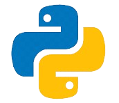
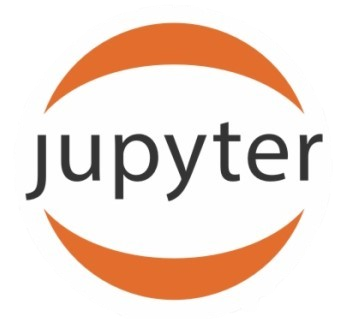
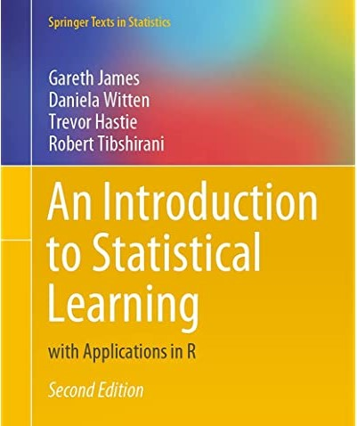
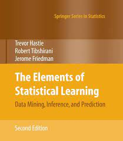
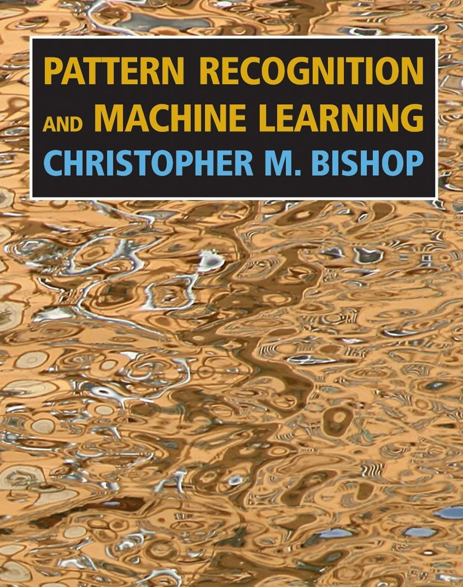
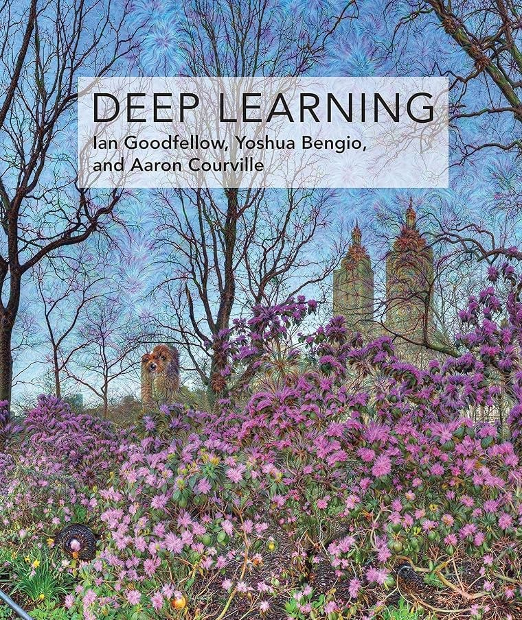
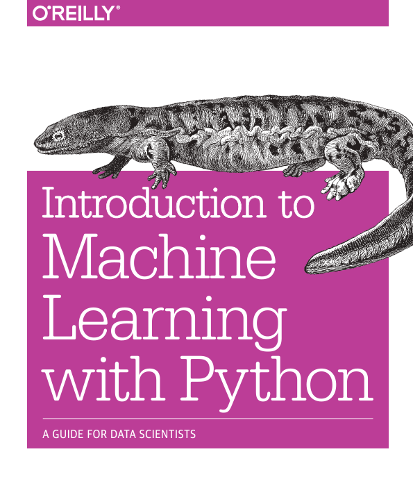
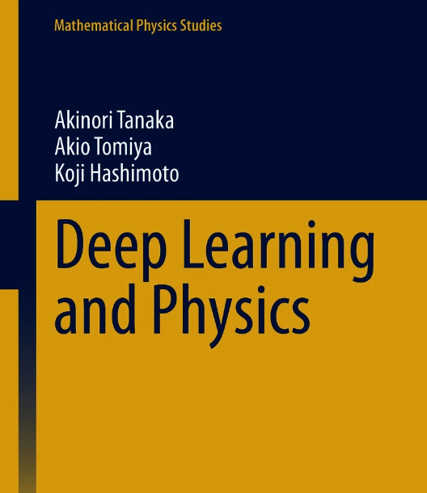
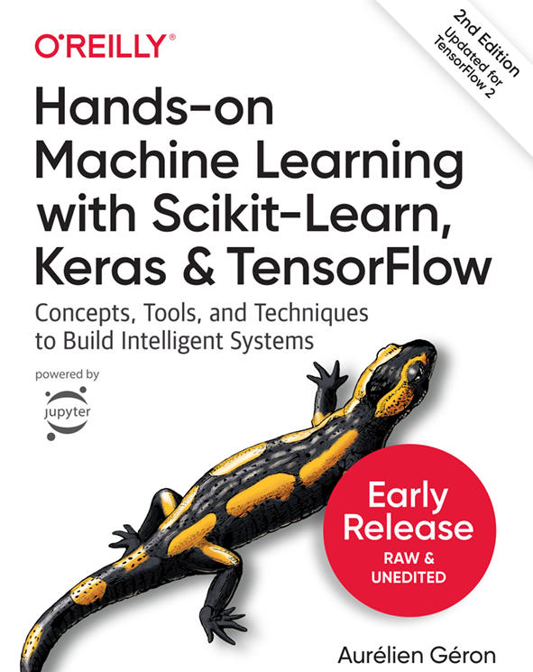
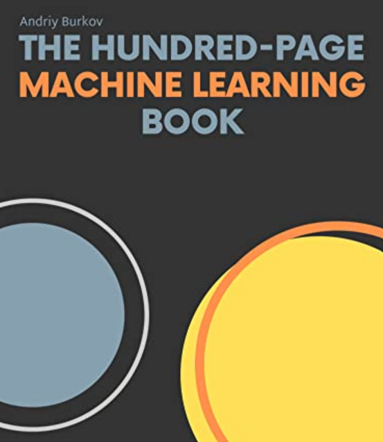

# 👋 Introduction

Welcome to the [**Advanced Machine Learning**]{.blue} course! This course is designed to provide an in-depth understanding of advanced topics in machine learning, including data comprehension, advanced machine learning methods, optimization approaches, what to watch out when working with each machine learning model, and more. By the end of this course, you will have a solid grasp of various types of datasets, machine learning techniques and be able to apply them to real-world problems.

--------------

# 📝 Course Criteria

| **`Criteria`** | **`Percentage`** |
|:----------|:----------:|
|Attendance | 10% |
|Quiz & labs | 20% |
|Midterm Exam | 20% |
|Final Exam | 20% |
|Final Project| 30% |

## ⌨️ Programming: 

> You are free you use your favorite programming language [{width=30px style="position: relative; bottom: 0px"}](https://www.python.org/){target="_blank"} `Python`...

- [{width=30px style="position: relative; bottom: 0px"} Jupyter Notebook](https://docs.jupyter.org/en/latest/){target="_blank"} 
- [{width=30px style="position: relative; bottom: 0px"} Google colab](https://colab.research.google.com/){target="_blank"}
- [{width=35px style="position: relative; bottom: 0px"} Scikit-learn](https://matplotlib.org/){target="_blank"}
- [{width=30px style="position: relative; bottom: 0px"} Pytorch](https://seaborn.pydata.org/){target="_blank"}

-----------

# 📋 Course session

| **Note**: The following table of contents will be progressively updated according to the course advancement. **To covert `html` slide to `PDF`, you can simply just click on the slide then press letter `E` on your keyboard then save the rendered `PDF` slide**.

| Topic                | TP    | Submission | Remark         |
|:---------------------|:------|:-----------|:---------------|
| [0.1 EDA Review](https://hassothea.github.io/M1_DAS_EDA_ITC/docs/01-Intro-eda-and_univarate-analysis.html){target="_blank"} | ...loading | ...loading | ...loading |
| [0.2 Data Preprocessing](https://hassothea.github.io/M1_DAS_EDA_ITC/docs/02-bivariate-analysis.html){target="_blank"} | ...loading | ...loading | ...loading |
| [1. Naive Bayes Classifier](https://hassothea.github.io/M2_DAS_AML_ITC/docs/01-nbc.html){target="_blank"} | ...loading | ...loading | ...loading |
|

<!--](https://hassothea.github.io/EDA_ITC/TPs/TP3_Data_Preprocessing.html){target="_blank"} | [TP3-solution](https://hassothea.github.io/EDA_ITC/Solutions/TP3_Data_Preprocessing_sol.html){target="_blank"} | ✅ Completed | -->

# 📋 Midterms, Exams and Projects

In this section, you will find all the information related to the midterms, exams and projects including instructions, starting dates and the deadlines.

------------

# 📚 Resources and Further Reading

Here, you will find additional resources, including books, research papers, and online courses, to further your understanding of [**Advanced Machine Learning**]{.blue}.

📚 You will find these books helpful...

[{width=22.5%}](https://www.statlearning.com/){target="_blank"}  [{width=23.2%}](https://hastie.su.domains/Papers/ESLII.pdf){target="_blank"} 
[{width=21%}](https://www.microsoft.com/en-us/research/uploads/prod/2006/01/Bishop-Pattern-Recognition-and-Machine-Learning-2006.pdf){target="_blank"} 
[{width=22.5%}](https://www.deeplearningbook.org/){target="_blank"} 

[{width=23%}](https://www.nrigroupindia.com/e-book/Introduction%20to%20Machine%20Learning%20with%20Python%20(%20PDFDrive.com%20)-min.pdf){target="_blank"} 
[{width=23%}](https://link.springer.com/book/10.1007/978-981-33-6108-9){target="_blank"} 
[{width=21%}](https://powerunit-ju.com/wp-content/uploads/2021/04/Aurelien-Geron-Hands-On-Machine-Learning-with-Scikit-Learn-Keras-and-Tensorflow_-Concepts-Tools-and-Techniques-to-Build-Intelligent-Systems-OReilly-Media-2019.pdf){target="_blank"} 
[{width=22%}](https://themlbook.com/){target="_blank"} 

------

